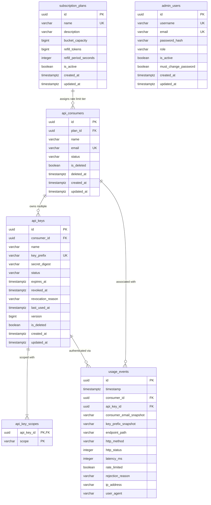

# Gatekeeper

Gatekeeper is an API Key Management and Intelligent Rate Limiting Platform built with Spring Boot and Java 21.

## Prerequisites

- **Java**: Eclipse Temurin OpenJDK 21 (`D:\Development\tools\jdk-21`)
- **Maven**: Apache Maven 3.9.16 (`D:\Development\tools\maven`)
- **Docker Desktop**: Engine running with storage on `D:\Development\docker-data\disk`
- **Environment**: Activated via `env.ps1` located at the root of the project

## Environment Initialization

Before running build, test, or execution commands in PowerShell:

```powershell
. .\env.ps1
```

This script:
- Sets `JAVA_HOME` (`D:\Development\tools\jdk-21`) and `MAVEN_HOME` (`D:\Development\tools\maven`)
- Redirects Maven local repository to `D:\Development\maven-repository`
- Redirects temporary files to `D:\Development\temp`
- Safely loads `.env` variables (`DB_USERNAME`, `DB_PASSWORD`, `REDIS_PASSWORD`, etc.) into the PowerShell session without printing credentials to the console

## Local Infrastructure (Docker Compose)

Gatekeeper uses Docker Compose with isolated containers and host bind mounts on `D:`:
- **PostgreSQL 16**: Port `127.0.0.1:5434` -> container `5432` (Storage: `D:\Development\database-data\gatekeeper`)
- **Redis 7**: Port `127.0.0.1:6380` -> container `6379` (Storage: `D:\Development\docker-data\redis`)

To manage infrastructure:

```powershell
# Start containers in detached mode
docker compose up -d

# Verify container status and health
docker compose ps

# View container logs
docker compose logs -f
```

## Database Architecture

### Entity-Relationship Diagram



### Flyway Migration Order

Database migrations reside in `backend/src/main/resources/db/migration/`:

1. **`V1__init_security_and_plans.sql`**:
   - Creates `admin_users` table with unique constraints on username and email (no default credentials seeded).
   - Creates `subscription_plans` table implementing Token Bucket semantics (`bucket_capacity`, `refill_tokens`, `refill_period_seconds`).
   - Seeds standard plans: `FREE` (60 tokens / 60s), `PRO` (600 tokens / 60s), and `ENTERPRISE` (6000 tokens / 60s).
2. **`V2__init_consumers_and_keys.sql`**:
   - Creates `api_consumers` with soft-deletion support (`is_deleted`, `deleted_at`) and foreign key referencing plans.
   - Creates `api_keys` with fixed 24-character public lookup prefix, SHA-256 secret digest, and optimistic concurrency version.
   - Creates `api_key_scopes` junction table for granular key scopes.
3. **`V3__init_usage_events.sql`**:
   - Creates `usage_events` table for audit and telemetry logging.
   - `consumer_id` and `api_key_id` are nullable to allow logging unauthenticated or invalid-key requests.
   - Includes historical snapshot columns (`consumer_email_snapshot`, `key_prefix_snapshot`) and composite performance indexes.
4. **`V4__add_admin_token_version.sql`**:
   - Adds `token_version` (BIGINT DEFAULT 1) and `password_changed_at` (TIMESTAMPTZ) to `admin_users`.
   - Enables instantaneous cryptographic invalidation of previously issued JWTs upon password change or credential rotation.

### Verifying Migrations

Verify migration status directly in PostgreSQL:

```powershell
docker exec gatekeeper-postgres psql -U gatekeeper_app -d gatekeeper -c "SELECT installed_rank, version, description, success FROM flyway_schema_history;"
```

## Building and Running Tests

```powershell
cd D:\Development\Gatekeeper\backend

# Execute the test suite (includes database integration and foundation tests)
mvn clean test
```

## Running the Application

### Local Development Profile (`local`)

Connects to local Docker PostgreSQL (`127.0.0.1:5434`) and Redis (`127.0.0.1:6380`) with Flyway migrations and Hibernate schema validation (`ddl-auto: validate`):

```powershell
mvn spring-boot:run -Dspring-boot.run.profiles=local
```

### Local Foundation Profile (`foundation`)

Runs without requiring live PostgreSQL or Redis instances (excludes auto-configurations while maintaining full Spring Security enforcement):

```powershell
mvn spring-boot:run -Dspring-boot.run.profiles=foundation
```

## Verification Endpoints

- **Health Endpoint**:
  - `GET http://localhost:8080/api/v1/health`
  - Expected Response: `{"status":"UP","service":"gatekeeper","serviceName":"gatekeeper","timestamp":"..."}`
- **Protected Endpoints**:
  - Any protected route without credentials returns `401 Unauthorized`.

## Secure API Key Lifecycle & Domain Services

Gatekeeper implements a high-throughput, cryptographically secure API key lifecycle management system designed for API gateways.

### 1. API Key Format and Token Anatomy

API keys adhere to a strict 68-character structured token format:

```
gk_live_1122334455667788_aB3dE5gH7jK9mN1pQ3sU5wY7zB1dF3hJ5lM7oP9rT1v
\______/\______________/\/\_________________________________________/
Prefix     Public ID     |              Secret Component
(8 chars)  (16 hex chars)|                 (43 chars)
\_______________________/ \
   Lookup Key Prefix       Delimiter
       (24 chars)          (1 char)
```

| Component | Format | Length | Description |
|---|---|---|---|
| **Prefix / Environment** | `gk_live_` | 8 chars | Environment identifier enabling secret scanners (e.g. GitHub Secret Scanning) to detect leaked production keys. |
| **Public Identifier** | `[0-9a-f]{16}` | 16 hex chars | 8 cryptographically secure random bytes rendered as lowercase hexadecimal. Combined with `gk_live_`, forms the unique 24-character `key_prefix` used for $O(1)$ database/cache indexing. |
| **Delimiter** | `_` | 1 char | Single underscore separator between public prefix and secret component. |
| **Secret Component** | `[A-Za-z0-9_-]{43}` | 43 chars | 32 cryptographically secure random bytes (256 bits entropy) encoded in URL-safe Base64 without padding. |
| **Full API Key** | `gk_live_<publicId>_<secret>` | 68 chars | The complete token issued to the consumer. |

### 2. Cryptographic Architecture & Entropy Rationale

- **CSPRNG Generation**: All public IDs and secret components are generated using `java.security.SecureRandom`.
- **256-Bit Entropy**: The secret component contains $2^{256}$ possible combinations, rendering offline dictionary attacks, rainbow tables, or brute-force enumeration computationally infeasible.
- **Prefix Collision Resistance**: Key generation enforces bounded retry loops (maximum 5 attempts) to guarantee uniqueness on the database `uk_api_keys_key_prefix` constraint.
- **Constant-Time Verification**: API secret digests are compared using `MessageDigest.isEqual()` to prevent timing side-channel attacks during authentication.

### 3. Hashing Strategy: SHA-256 vs. BCrypt

Gatekeeper deliberately differentiates between machine credentials and human credentials:

| Metric | API Key Secrets (Gatekeeper) | Human User Passwords |
|---|---|---|
| **Entropy** | High ($\ge 256$ bits cryptographically random) | Low (typically human-chosen words/patterns) |
| **Hashing Algorithm** | **SHA-256** (Cryptographic Hash) | **BCrypt / Argon2** (Key Derivation Function) |
| **Compute Overhead** | Sub-microsecond ($\approx 1\ \mu\text{s}$) | High work factor ($\approx 100\text{--}500\text{ ms}$) |
| **Gateway Throughput** | Thousands of authentications / sec | Single login session initialization |
| **Dictionary Risk** | Zero (impossible to precompute $2^{256}$ values) | High (requires work factor and salt to slow attacks) |

### 4. API Key Lifecycle States

```
[ Active Consumer ]
       |
       v
+--------------+     Expires At Reached      +--------------+
|    ACTIVE    | --------------------------> |   EXPIRED    |
+--------------+                             +--------------+
       |                                            |
       | Revoke / Consumer Suspended                | Revoke
       v                                            v
+--------------+                             +--------------+
|   REVOKED    | <-------------------------- |   REVOKED    |
+--------------+                             +--------------+
```

1. **Creation**:
   - Generates the full 68-character token.
   - Extracts the 24-character `key_prefix` and computes the SHA-256 `secret_digest`.
   - Returns an `ApiKeyCreationResult` containing the plaintext key **strictly once**. Plaintext secrets are never stored in the database or logged.
2. **Lookup & Validation**:
   - The gateway parses the incoming key, extracts the 24-character prefix in $O(1)$, and performs an indexed database query.
   - Verifies consumer status is `ACTIVE` and key status is `ACTIVE`.
   - Checks expiration timestamp (`expires_at`).
   - Constant-time verifies SHA-256 digest of secret.
   - Authorizes requested scopes against granted scopes.
3. **Revocation**:
   - Idempotent revocation transitions status to `REVOKED` and sets `revoked_at` and `revocation_reason`.
   - Safe against concurrent revocation races via JPA optimistic locking (`@Version`).
4. **Soft Deletion**:
   - Consumers and keys support non-destructive deactivation (`is_deleted = true`, `deleted_at = NOW()`), preserving historical audit integrity for usage events and logs.

### 5. Domain Services Overview (Java Backend Architecture)

- **`ApiKeyGenerator`**: Cryptographic component responsible for producing structured tokens (`gk_live_<publicId>_<secret>`) with `SecureRandom` and validating raw key string format and length.
- **`ApiKeyHasher`**: Cryptographic hashing service performing deterministic SHA-256 hashing and constant-time digest verification using `MessageDigest.isEqual`.
- **`ApiKeyService`**: Primary domain service orchestrating API key generation, prefix collision handling, validation, scope authorization, idempotent revocation, and metadata queries.
- **`ConsumerService`**: Manages consumer lifecycle, plan assignment, email uniqueness, suspension, reactivation, and soft deletion.
- **`SubscriptionPlanService`**: Manages rate-limiting plans, validates token bucket parameters (`bucket_capacity > 0`, `refill_tokens > 0`, `refill_period_seconds > 0`), and provides cached read-only plan lookups.

### 6. Scope Authorization

Key scopes follow a hierarchical format:
- `resource:action` (e.g. `billing:read`, `analytics:export`, `users:write`)
- Validated via regex `^[a-z0-9]+(:[a-z0-9_-]+)*$`
- Validation passes if the key possesses all requested scopes. If any requested scope is missing, an `InsufficientScopeException` is thrown.

### 7. Current Architectural Limitations & Phase 3 Roadmap

- **Database as Source of Truth**: Key validation currently executes against PostgreSQL. In Phase 3, an active-key Redis cache with instant invalidation will be integrated to eliminate database latency on high-frequency gateway requests.
- **Distributed Rate Limiting**: Token bucket rate limiting will be enforced via Redis Lua scripts in Phase 3.

## Administrator Authentication & Spring Security (Phase 2E)

Gatekeeper implements an enterprise-grade administrator authentication and Role-Based Access Control (RBAC) system built on Spring Security and signed JSON Web Tokens (JWT).

### 1. Security Architecture Overview

```
Client (Admin)
      |
      | 1. POST /api/v1/auth/login { username, password }
      v
+-----------------------------+
| AuthController              |
+-----------------------------+
      |
      v
+-----------------------------+
| LoginRateLimiter            | ---> Checks IP/Username Abuse (Fail-Closed: 503)
+-----------------------------+
      |
      v
+-----------------------------+
| AdminAuthenticationService  | ---> Verifies User & BCrypt Hash (Generic 401)
+-----------------------------+
      |
      v
+-----------------------------+
| JwtService (HS256)          | ---> Issues 15-Minute Signed Bearer Token
+-----------------------------+
```

### 2. Administrator Password Security

- **Algorithm**: `BCryptPasswordEncoder` with strength factor `12`.
- **Entropy & Salting**: Passwords use per-user random salts automatically generated and embedded by BCrypt. Work factor 12 enforces $\approx 250\text{--}350\text{ ms}$ computation time per hash, preventing offline GPU/ASIC cracking.
- **Password Complexity Rules**:
  - Minimum 12 characters.
  - At least one uppercase letter (`[A-Z]`).
  - At least one lowercase letter (`[a-z]`).
  - At least one digit (`[0-9]`).
  - At least one special symbol (`[!@#$%^&*()_+\-=\[\]{};':"\\|,.<>\/?]`).
- **Memory Safety**: Plaintext passwords are accepted as `char[]` arrays during bootstrap and wiped with `\0` immediately after hashing.
- **Generic Error Responses**: Both non-existent usernames, bad passwords, and deactivated accounts return a uniform HTTP 401 `"Invalid username or password"` to prevent user enumeration attacks.

### 3. Secure Initial Administrator Bootstrap

Gatekeeper strictly forbids default credentials or generating random passwords in startup logs:

- **Controlled Trigger**: Bootstrap is disabled during normal startup. It can **only** run when explicitly invoked via `--gatekeeper.bootstrap.enabled=true`.
- **One-Time Execution**: If any administrator exists (`adminUserRepository.count() > 0`), the bootstrap process aborts immediately.
- **Interactive Local Setup**:
  Run the secure PowerShell bootstrap script:
  ```powershell
  .\setup-admin.ps1
  ```
  This script securely prompts for `username`, `email`, and `password` (using `Read-Host -AsSecureString`), passes them via transient process-only memory, runs the bootstrap runner, and scrubs all memory variables upon completion.
- **No Unauthenticated HTTP Bootstrap**: Initial administrator setup is completely isolated from HTTP endpoints.

### 4. JWT Access Token Design & Signing Key Persistence

- **Signing Algorithm**: Strict `HMAC-SHA256` (`HS256`) via Nimbus JOSE + JWT.
- **Key Persistence**: Local development generates a persistent, cryptographically secure 256-bit signing key saved in `D:\Development\Gatekeeper\.jwt.key` (Git-ignored). Existing keys are preserved across backend restarts, preventing silent token invalidation.
- **Production Key Governance**: Production environments load the secret strictly from `${GATEKEEPER_JWT_SECRET}`. Hardcoded fallback secrets are completely disallowed; keys with $< 256$ bits of entropy fail startup immediately.
- **Token Lifetime**: Fixed 15-minute validity (`access-token-expiration-seconds: 900`).
- **Minimal Claims Structure**:
  ```json
  {
    "sub": "3fa85f64-5717-4562-b3fc-2c963f66afa6",
    "username": "superadmin",
    "role": "ROLE_SUPER_ADMIN",
    "ver": 1,
    "iss": "gatekeeper-auth",
    "iat": 1700000000,
    "exp": 1700000900
  }
  ```
- **Cryptographic Token Invalidation (Token Version)**:
  Every issued JWT includes a `ver` (token version) claim corresponding to `admin_users.token_version`. Changing an administrator's password increments `token_version` in PostgreSQL, instantly invalidating all previously issued access tokens on subsequent requests.
- **Real-Time Account Status Check**:
  `JwtAuthenticationFilter` validates on every request that the administrator account remains active in PostgreSQL (`admin.isActive() == true`). Deactivating an account revokes access immediately.

### 5. Password-Change Enforcement Workflow

Administrators flagged with `must_change_password = true` have restricted access:
- **Restricted Access**: Any attempt to access standard administrative resources returns **HTTP 403 Forbidden** (`"Password change is required before accessing protected resources. Please change your password at /api/v1/auth/change-password"`).
- **Change Password Endpoint**: `POST /api/v1/auth/change-password` (Authenticated via Bearer token).
  - Verifies current password against stored BCrypt hash.
  - Enforces strong password complexity (min 12 chars, upper, lower, digit, special symbol).
  - Rejects new password identical to current password.
  - Clears `must_change_password = false`, increments `token_version`, updates `password_changed_at`.
  - Returns HTTP 200 with a new valid JWT bearing the updated `ver` claim.

### 6. Login Abuse & Brute-Force Rate Limiting

- **Distributed Enforcement**: Backed by atomic Redis counters (`gatekeeper:auth:abuse:<key>`) with explicit TTL, providing multi-instance consistency across backend replicas. Falls back to in-memory tracking in offline testing environments.
- **Anti-Spoofing & Normalization**:
  - Usernames are normalized to lowercase (`username.toLowerCase().trim()`) to prevent casing evasion attacks.
  - Client IP defaults to `request.getRemoteAddr()`. Forwarded proxy headers (`X-Forwarded-For`) are untrusted unless explicitly enabled via `gatekeeper.security.login.trust-proxy-headers=true`.
- **Threshold**: 5 failed attempts per `client_ip:username` within a 15-minute lockout window.
- **Lockout (HTTP 429)**: Exceeding the threshold triggers HTTP 429 with standard `Retry-After: <seconds>` response header.
- **Fail-Closed Guarantee (HTTP 503)**: If Redis or login protection experiences an infrastructure failure, it fails closed returning HTTP 503 `"Service Unavailable"` to safeguard credentials.

### 7. Role-Based Access Control (RBAC) Permissions Matrix

| Resource / Action | Public | ROLE_SUPER_ADMIN | ROLE_ADMIN | ROLE_ANALYST |
|---|---|---|---|---|
| **Health Check (`GET /api/v1/health`)** | Yes | Yes | Yes | Yes |
| **Admin Login (`POST /api/v1/auth/login`)** | Yes | Yes | Yes | Yes |
| **Admin User Provisioning / Roles** | No | Full Access | No Access | No Access |
| **Subscription Plan Management** | No | Full Access | Full Access | Read-Only |
| **Consumer Management (Create/Update/Suspend)** | No | Full Access | Full Access | Read-Only |
| **API Key Management (Create/Revoke)** | No | Full Access | Full Access | Read-Only (Metadata) |
| **Telemetry & Usage Analytics** | No | Full Access | Full Access | Full Access |

- **Default Fail-Secure**: All endpoints outside `/api/v1/health` and `/api/v1/auth/login` require explicit authentication.
- **Missing / Invalid Token**: Returns **HTTP 401 Unauthorized**.
- **Insufficient Role**: Returns **HTTP 403 Forbidden** (`"Access is denied: insufficient role privileges"`).

### 7. Stateless Architecture & CSRF Decision

- **Session Management**: Configured as `SessionCreationPolicy.STATELESS`. Spring Security never creates HTTP sessions (`JSESSIONID`).
- **CSRF Disabled Rationale**: Cross-Site Request Forgery (CSRF) relies on web browsers automatically appending ambient credentials (such as cookies or HTTP basic auth headers) to cross-origin requests. Gatekeeper authenticates purely via explicit HTTP `Authorization: Bearer <JWT>` headers. Because browsers never automatically attach custom bearer headers cross-origin, standard CSRF exploits are structurally impossible, making disabling CSRF safe and standard.

### 8. Core Conceptual Differences (Backend Interview Knowledge)

#### Authentication vs. Authorization
- **Authentication (AuthN)**: Answering *"Who are you?"* (verifying identity via username/password against BCrypt hashes and issuing a signed JWT).
- **Authorization (AuthZ)**: Answering *"What are you allowed to do?"* (verifying permissions, e.g. checking if `ROLE_ADMIN` has privileges to revoke an API key).

#### BCrypt vs. SHA-256
- **BCrypt**: A slow, salted, adaptive Key Derivation Function (KDF) designed specifically for **low-entropy human passwords**. Its high work factor (configurable rounds) protects against offline GPU/ASIC brute-force dictionary attacks.
- **SHA-256**: A fast, fixed-time cryptographic digest function designed for **high-entropy machine tokens** (e.g., 256-bit API key secrets). It evaluates in sub-microsecond time to enable tens of thousands of API gateway validations per second without CPU exhaustion.

#### JWT vs. API Keys
- **JWT (JSON Web Token)**: Short-lived (15 minutes), signed, client-held credential conveying user identity and role claims for interactive administrative sessions.
- **API Key**: Long-lived, machine-to-machine credential with fixed prefix indexing and constant-time secret validation, scoped to high-frequency automated consumption.

#### HTTP 401 Unauthorized vs. HTTP 403 Forbidden
- **HTTP 401 (Unauthorized / Unauthenticated)**: The client has not provided valid credentials or the token is missing/expired/malformed. *"Please log in."*
- **HTTP 403 (Forbidden)**: The client's identity is authenticated and verified, but their role/permissions do not grant access to the requested resource. *"You are authenticated, but you are not allowed here."*

