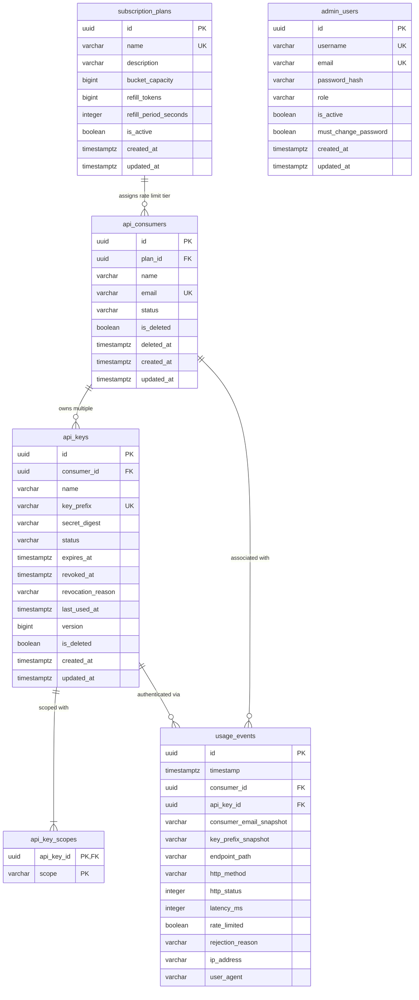
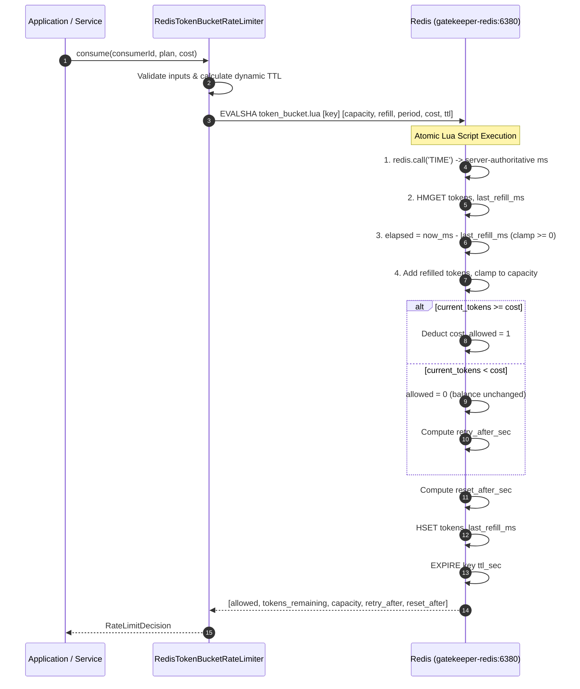
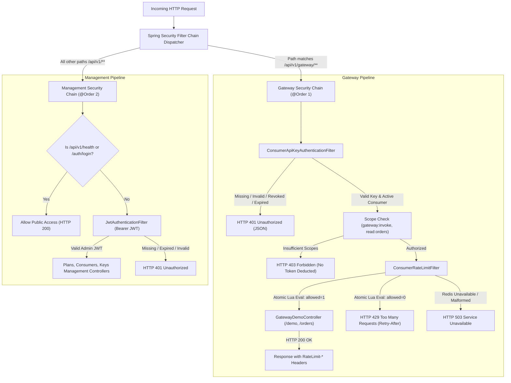
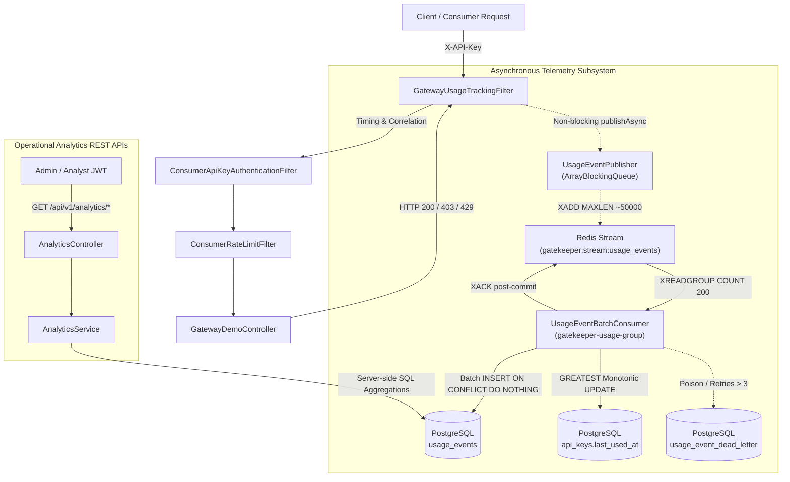
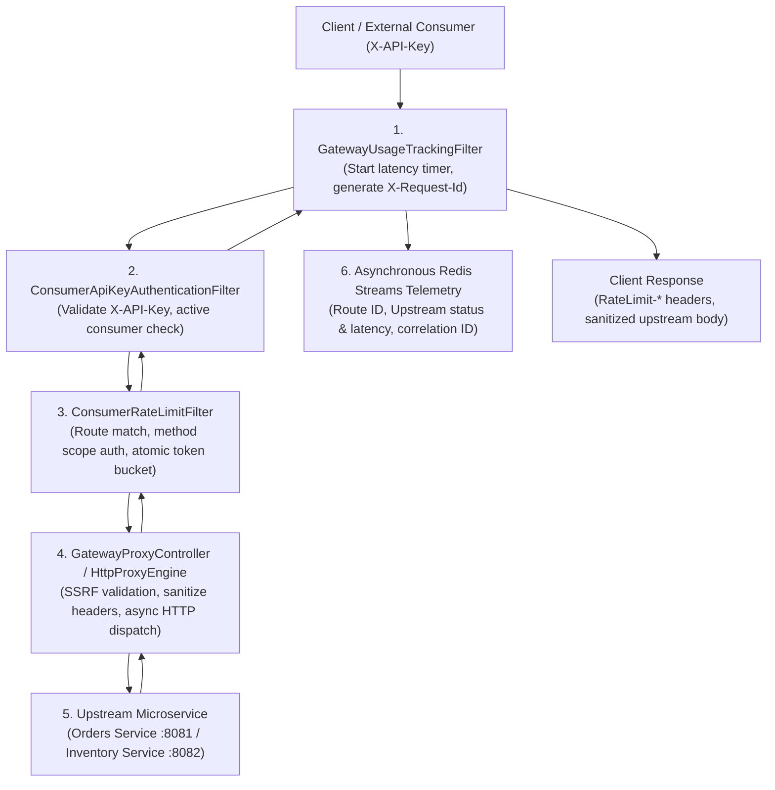
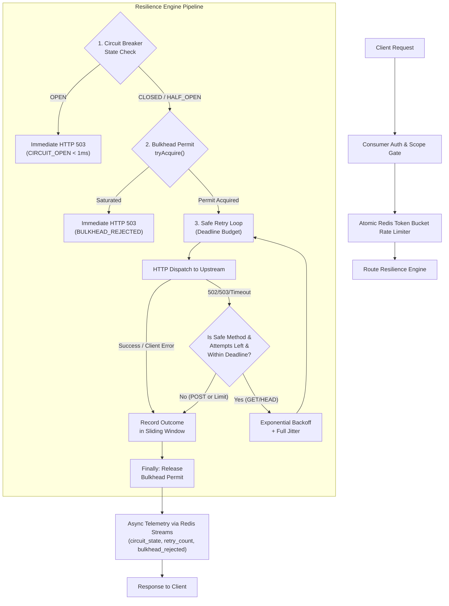
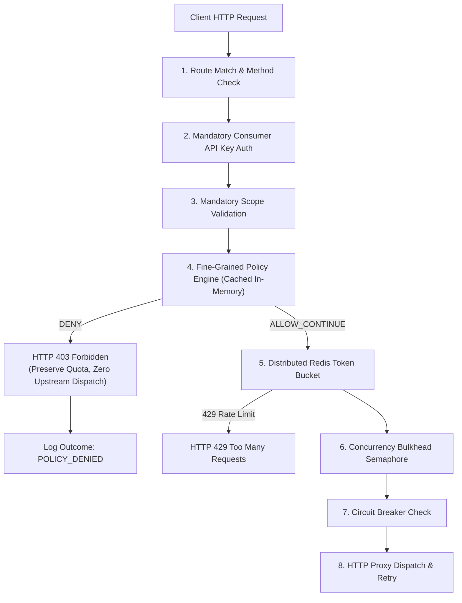

# Gatekeeper

Gatekeeper is an API Key Management and Intelligent Rate Limiting Platform built with Spring Boot and Java 21.

## Prerequisites

- **Java**: Eclipse Temurin OpenJDK 21 (`D:\Development\tools\jdk-21`)
- **Maven**: Apache Maven 3.9.16 (`D:\Development\tools\maven`)
- **Docker Desktop**: Engine running with storage on `D:\Development\docker-data\disk`
- **Environment**: Activated via `env.ps1` located at the root of the project

## Environment Initialization

Before running build, test, or execution commands in PowerShell:

```powershell
. .\env.ps1
```

This script:
- Sets `JAVA_HOME` (`D:\Development\tools\jdk-21`) and `MAVEN_HOME` (`D:\Development\tools\maven`)
- Redirects Maven local repository to `D:\Development\maven-repository`
- Redirects temporary files to `D:\Development\temp`
- Safely loads `.env` variables (`DB_USERNAME`, `DB_PASSWORD`, `REDIS_PASSWORD`, etc.) into the PowerShell session without printing credentials to the console

## Local Infrastructure (Docker Compose)

Gatekeeper uses Docker Compose with isolated containers and host bind mounts on `D:`:
- **PostgreSQL 16**: Port `127.0.0.1:5434` -> container `5432` (Storage: `D:\Development\database-data\gatekeeper`)
- **Redis 7**: Port `127.0.0.1:6380` -> container `6379` (Storage: `D:\Development\docker-data\redis`)

To manage infrastructure:

```powershell
# Start containers in detached mode
docker compose up -d

# Verify container status and health
docker compose ps

# View container logs
docker compose logs -f
```

## Database Architecture

### Entity-Relationship Diagram



### Flyway Migration Order

Database migrations reside in `backend/src/main/resources/db/migration/`:

1. **`V1__init_security_and_plans.sql`**:
   - Creates `admin_users` table with unique constraints on username and email (no default credentials seeded).
   - Creates `subscription_plans` table implementing Token Bucket semantics (`bucket_capacity`, `refill_tokens`, `refill_period_seconds`).
   - Seeds standard plans: `FREE` (60 tokens / 60s), `PRO` (600 tokens / 60s), and `ENTERPRISE` (6000 tokens / 60s).
2. **`V2__init_consumers_and_keys.sql`**:
   - Creates `api_consumers` with soft-deletion support (`is_deleted`, `deleted_at`) and foreign key referencing plans.
   - Creates `api_keys` with fixed 24-character public lookup prefix, SHA-256 secret digest, and optimistic concurrency version.
   - Creates `api_key_scopes` junction table for granular key scopes.
3. **`V3__init_usage_events.sql`**:
   - Creates `usage_events` table for audit and telemetry logging.
   - `consumer_id` and `api_key_id` are nullable to allow logging unauthenticated or invalid-key requests.
   - Includes historical snapshot columns (`consumer_email_snapshot`, `key_prefix_snapshot`) and composite performance indexes.
4. **`V4__add_admin_token_version.sql`**:
   - Adds `token_version` (BIGINT DEFAULT 1) and `password_changed_at` (TIMESTAMPTZ) to `admin_users`.
   - Enables instantaneous cryptographic invalidation of previously issued JWTs upon password change or credential rotation.

### Verifying Migrations

Verify migration status directly in PostgreSQL:

```powershell
docker exec gatekeeper-postgres psql -U gatekeeper_app -d gatekeeper -c "SELECT installed_rank, version, description, success FROM flyway_schema_history;"
```

## Building and Running Tests

```powershell
cd D:\Development\Gatekeeper\backend

# Execute the test suite (includes database integration and foundation tests)
mvn clean test
```

## Running the Application

### Local Development Profile (`local`)

Connects to local Docker PostgreSQL (`127.0.0.1:5434`) and Redis (`127.0.0.1:6380`) with Flyway migrations and Hibernate schema validation (`ddl-auto: validate`):

```powershell
mvn spring-boot:run -Dspring-boot.run.profiles=local
```

### Local Foundation Profile (`foundation`)

Runs without requiring live PostgreSQL or Redis instances (excludes auto-configurations while maintaining full Spring Security enforcement):

```powershell
mvn spring-boot:run -Dspring-boot.run.profiles=foundation
```

## Verification Endpoints

- **Health Endpoint**:
  - `GET http://localhost:8080/api/v1/health`
  - Expected Response: `{"status":"UP","service":"gatekeeper","serviceName":"gatekeeper","timestamp":"..."}`
- **Protected Endpoints**:
  - Any protected route without credentials returns `401 Unauthorized`.

## Secure API Key Lifecycle & Domain Services

Gatekeeper implements a high-throughput, cryptographically secure API key lifecycle management system designed for API gateways.

### 1. API Key Format and Token Anatomy

API keys adhere to a strict 68-character structured token format:

```
gk_live_1122334455667788_aB3dE5gH7jK9mN1pQ3sU5wY7zB1dF3hJ5lM7oP9rT1v
\______/\______________/\/\_________________________________________/
Prefix     Public ID     |              Secret Component
(8 chars)  (16 hex chars)|                 (43 chars)
\_______________________/ \
   Lookup Key Prefix       Delimiter
       (24 chars)          (1 char)
```

| Component | Format | Length | Description |
|---|---|---|---|
| **Prefix / Environment** | `gk_live_` | 8 chars | Environment identifier enabling secret scanners (e.g. GitHub Secret Scanning) to detect leaked production keys. |
| **Public Identifier** | `[0-9a-f]{16}` | 16 hex chars | 8 cryptographically secure random bytes rendered as lowercase hexadecimal. Combined with `gk_live_`, forms the unique 24-character `key_prefix` used for $O(1)$ database/cache indexing. |
| **Delimiter** | `_` | 1 char | Single underscore separator between public prefix and secret component. |
| **Secret Component** | `[A-Za-z0-9_-]{43}` | 43 chars | 32 cryptographically secure random bytes (256 bits entropy) encoded in URL-safe Base64 without padding. |
| **Full API Key** | `gk_live_<publicId>_<secret>` | 68 chars | The complete token issued to the consumer. |

### 2. Cryptographic Architecture & Entropy Rationale

- **CSPRNG Generation**: All public IDs and secret components are generated using `java.security.SecureRandom`.
- **256-Bit Entropy**: The secret component contains $2^{256}$ possible combinations, rendering offline dictionary attacks, rainbow tables, or brute-force enumeration computationally infeasible.
- **Prefix Collision Resistance**: Key generation enforces bounded retry loops (maximum 5 attempts) to guarantee uniqueness on the database `uk_api_keys_key_prefix` constraint.
- **Constant-Time Verification**: API secret digests are compared using `MessageDigest.isEqual()` to prevent timing side-channel attacks during authentication.

### 3. Hashing Strategy: SHA-256 vs. BCrypt

Gatekeeper deliberately differentiates between machine credentials and human credentials:

| Metric | API Key Secrets (Gatekeeper) | Human User Passwords |
|---|---|---|
| **Entropy** | High ($\ge 256$ bits cryptographically random) | Low (typically human-chosen words/patterns) |
| **Hashing Algorithm** | **SHA-256** (Cryptographic Hash) | **BCrypt / Argon2** (Key Derivation Function) |
| **Compute Overhead** | Sub-microsecond ($\approx 1\ \mu\text{s}$) | High work factor ($\approx 100\text{--}500\text{ ms}$) |
| **Gateway Throughput** | Thousands of authentications / sec | Single login session initialization |
| **Dictionary Risk** | Zero (impossible to precompute $2^{256}$ values) | High (requires work factor and salt to slow attacks) |

### 4. API Key Lifecycle States

```
[ Active Consumer ]
       |
       v
+--------------+     Expires At Reached      +--------------+
|    ACTIVE    | --------------------------> |   EXPIRED    |
+--------------+                             +--------------+
       |                                            |
       | Revoke / Consumer Suspended                | Revoke
       v                                            v
+--------------+                             +--------------+
|   REVOKED    | <-------------------------- |   REVOKED    |
+--------------+                             +--------------+
```

1. **Creation**:
   - Generates the full 68-character token.
   - Extracts the 24-character `key_prefix` and computes the SHA-256 `secret_digest`.
   - Returns an `ApiKeyCreationResult` containing the plaintext key **strictly once**. Plaintext secrets are never stored in the database or logged.
2. **Lookup & Validation**:
   - The gateway parses the incoming key, extracts the 24-character prefix in $O(1)$, and performs an indexed database query.
   - Verifies consumer status is `ACTIVE` and key status is `ACTIVE`.
   - Checks expiration timestamp (`expires_at`).
   - Constant-time verifies SHA-256 digest of secret.
   - Authorizes requested scopes against granted scopes.
3. **Revocation**:
   - Idempotent revocation transitions status to `REVOKED` and sets `revoked_at` and `revocation_reason`.
   - Safe against concurrent revocation races via JPA optimistic locking (`@Version`).
4. **Soft Deletion**:
   - Consumers and keys support non-destructive deactivation (`is_deleted = true`, `deleted_at = NOW()`), preserving historical audit integrity for usage events and logs.

### 5. Domain Services Overview (Java Backend Architecture)

- **`ApiKeyGenerator`**: Cryptographic component responsible for producing structured tokens (`gk_live_<publicId>_<secret>`) with `SecureRandom` and validating raw key string format and length.
- **`ApiKeyHasher`**: Cryptographic hashing service performing deterministic SHA-256 hashing and constant-time digest verification using `MessageDigest.isEqual`.
- **`ApiKeyService`**: Primary domain service orchestrating API key generation, prefix collision handling, validation, scope authorization, idempotent revocation, and metadata queries.
- **`ConsumerService`**: Manages consumer lifecycle, plan assignment, email uniqueness, suspension, reactivation, and soft deletion.
- **`SubscriptionPlanService`**: Manages rate-limiting plans, validates token bucket parameters (`bucket_capacity > 0`, `refill_tokens > 0`, `refill_period_seconds > 0`), and provides cached read-only plan lookups.

### 6. Scope Authorization

Key scopes follow a hierarchical format:
- `resource:action` (e.g. `billing:read`, `analytics:export`, `users:write`)
- Validated via regex `^[a-z0-9]+(:[a-z0-9_-]+)*$`
- Validation passes if the key possesses all requested scopes. If any requested scope is missing, an `InsufficientScopeException` is thrown.

### 7. Current Architectural Limitations & Phase 3 Roadmap

- **Database as Source of Truth**: Key validation currently executes against PostgreSQL. In Phase 3, an active-key Redis cache with instant invalidation will be integrated to eliminate database latency on high-frequency gateway requests.
- **Distributed Rate Limiting**: Token bucket rate limiting will be enforced via Redis Lua scripts in Phase 3.

## Administrator Authentication & Spring Security (Phase 2E)

Gatekeeper implements an enterprise-grade administrator authentication and Role-Based Access Control (RBAC) system built on Spring Security and signed JSON Web Tokens (JWT).

### 1. Security Architecture Overview

```
Client (Admin)
      |
      | 1. POST /api/v1/auth/login { username, password }
      v
+-----------------------------+
| AuthController              |
+-----------------------------+
      |
      v
+-----------------------------+
| LoginRateLimiter            | ---> Checks IP/Username Abuse (Fail-Closed: 503)
+-----------------------------+
      |
      v
+-----------------------------+
| AdminAuthenticationService  | ---> Verifies User & BCrypt Hash (Generic 401)
+-----------------------------+
      |
      v
+-----------------------------+
| JwtService (HS256)          | ---> Issues 15-Minute Signed Bearer Token
+-----------------------------+
```

### 2. Administrator Password Security

- **Algorithm**: `BCryptPasswordEncoder` with strength factor `12`.
- **Entropy & Salting**: Passwords use per-user random salts automatically generated and embedded by BCrypt. Work factor 12 enforces $\approx 250\text{--}350\text{ ms}$ computation time per hash, preventing offline GPU/ASIC cracking.
- **Password Complexity Rules**:
  - Minimum 12 characters.
  - At least one uppercase letter (`[A-Z]`).
  - At least one lowercase letter (`[a-z]`).
  - At least one digit (`[0-9]`).
  - At least one special symbol (`[!@#$%^&*()_+\-=\[\]{};':"\\|,.<>\/?]`).
- **Memory Safety**: Plaintext passwords are accepted as `char[]` arrays during bootstrap and wiped with `\0` immediately after hashing.
- **Generic Error Responses**: Both non-existent usernames, bad passwords, and deactivated accounts return a uniform HTTP 401 `"Invalid username or password"` to prevent user enumeration attacks.

### 3. Secure Initial Administrator Bootstrap

Gatekeeper strictly forbids default credentials or generating random passwords in startup logs:

- **Controlled Trigger**: Bootstrap is disabled during normal startup. It can **only** run when explicitly invoked via `--gatekeeper.bootstrap.enabled=true`.
- **One-Time Execution**: If any administrator exists (`adminUserRepository.count() > 0`), the bootstrap process aborts immediately.
- **Interactive Local Setup**:
  Run the secure PowerShell bootstrap script:
  ```powershell
  .\setup-admin.ps1
  ```
  This script securely prompts for `username`, `email`, and `password` (using `Read-Host -AsSecureString`), passes them via transient process-only memory, runs the bootstrap runner, and scrubs all memory variables upon completion.
- **No Unauthenticated HTTP Bootstrap**: Initial administrator setup is completely isolated from HTTP endpoints.

### 4. JWT Access Token Design & Signing Key Persistence

- **Signing Algorithm**: Strict `HMAC-SHA256` (`HS256`) via Nimbus JOSE + JWT.
- **Key Persistence**: Local development generates a persistent, cryptographically secure 256-bit signing key saved in `D:\Development\Gatekeeper\.jwt.key` (Git-ignored). Existing keys are preserved across backend restarts, preventing silent token invalidation.
- **Production Key Governance**: Production environments load the secret strictly from `${GATEKEEPER_JWT_SECRET}`. Hardcoded fallback secrets are completely disallowed; keys with $< 256$ bits of entropy fail startup immediately.
- **Token Lifetime**: Fixed 15-minute validity (`access-token-expiration-seconds: 900`).
- **Minimal Claims Structure**:
  ```json
  {
    "sub": "3fa85f64-5717-4562-b3fc-2c963f66afa6",
    "username": "superadmin",
    "role": "ROLE_SUPER_ADMIN",
    "ver": 1,
    "iss": "gatekeeper-auth",
    "iat": 1700000000,
    "exp": 1700000900
  }
  ```
- **Cryptographic Token Invalidation (Token Version)**:
  Every issued JWT includes a `ver` (token version) claim corresponding to `admin_users.token_version`. Changing an administrator's password increments `token_version` in PostgreSQL, instantly invalidating all previously issued access tokens on subsequent requests.
- **Real-Time Account Status Check**:
  `JwtAuthenticationFilter` validates on every request that the administrator account remains active in PostgreSQL (`admin.isActive() == true`). Deactivating an account revokes access immediately.

### 5. Password-Change Enforcement Workflow

Administrators flagged with `must_change_password = true` have restricted access:
- **Restricted Access**: Any attempt to access standard administrative resources returns **HTTP 403 Forbidden** (`"Password change is required before accessing protected resources. Please change your password at /api/v1/auth/change-password"`).
- **Change Password Endpoint**: `POST /api/v1/auth/change-password` (Authenticated via Bearer token).
  - Verifies current password against stored BCrypt hash.
  - Enforces strong password complexity (min 12 chars, upper, lower, digit, special symbol).
  - Rejects new password identical to current password.
  - Clears `must_change_password = false`, increments `token_version`, updates `password_changed_at`.
  - Returns HTTP 200 with a new valid JWT bearing the updated `ver` claim.

### 6. Login Abuse & Brute-Force Rate Limiting

- **Distributed Enforcement**: Backed by atomic Redis counters (`gatekeeper:auth:abuse:<key>`) with explicit TTL, providing multi-instance consistency across backend replicas. Falls back to in-memory tracking in offline testing environments.
- **Anti-Spoofing & Normalization**:
  - Usernames are normalized to lowercase (`username.toLowerCase().trim()`) to prevent casing evasion attacks.
  - Client IP defaults to `request.getRemoteAddr()`. Forwarded proxy headers (`X-Forwarded-For`) are untrusted unless explicitly enabled via `gatekeeper.security.login.trust-proxy-headers=true`.
- **Threshold**: 5 failed attempts per `client_ip:username` within a 15-minute lockout window.
- **Lockout (HTTP 429)**: Exceeding the threshold triggers HTTP 429 with standard `Retry-After: <seconds>` response header.
- **Fail-Closed Guarantee (HTTP 503)**: If Redis or login protection experiences an infrastructure failure, it fails closed returning HTTP 503 `"Service Unavailable"` to safeguard credentials.

### 7. Role-Based Access Control (RBAC) Permissions Matrix

| Resource / Action | Public | ROLE_SUPER_ADMIN | ROLE_ADMIN | ROLE_ANALYST |
|---|---|---|---|---|
| **Health Check (`GET /api/v1/health`)** | Yes | Yes | Yes | Yes |
| **Admin Login (`POST /api/v1/auth/login`)** | Yes | Yes | Yes | Yes |
| **Admin User Provisioning / Roles** | No | Full Access | No Access | No Access |
| **Subscription Plan Management** | No | Full Access | Full Access | Read-Only |
| **Consumer Management (Create/Update/Suspend)** | No | Full Access | Full Access | Read-Only |
| **API Key Management (Create/Revoke)** | No | Full Access | Full Access | Read-Only (Metadata) |
| **Telemetry & Usage Analytics** | No | Full Access | Full Access | Full Access |

- **Default Fail-Secure**: All endpoints outside `/api/v1/health` and `/api/v1/auth/login` require explicit authentication.
- **Missing / Invalid Token**: Returns **HTTP 401 Unauthorized**.
- **Insufficient Role**: Returns **HTTP 403 Forbidden** (`"Access is denied: insufficient role privileges"`).

### 7. Stateless Architecture & CSRF Decision

- **Session Management**: Configured as `SessionCreationPolicy.STATELESS`. Spring Security never creates HTTP sessions (`JSESSIONID`).
- **CSRF Disabled Rationale**: Cross-Site Request Forgery (CSRF) relies on web browsers automatically appending ambient credentials (such as cookies or HTTP basic auth headers) to cross-origin requests. Gatekeeper authenticates purely via explicit HTTP `Authorization: Bearer <JWT>` headers. Because browsers never automatically attach custom bearer headers cross-origin, standard CSRF exploits are structurally impossible, making disabling CSRF safe and standard.

### 8. Core Conceptual Differences (Backend Interview Knowledge)

#### Authentication vs. Authorization
- **Authentication (AuthN)**: Answering *"Who are you?"* (verifying identity via username/password against BCrypt hashes and issuing a signed JWT).
- **Authorization (AuthZ)**: Answering *"What are you allowed to do?"* (verifying permissions, e.g. checking if `ROLE_ADMIN` has privileges to revoke an API key).

#### BCrypt vs. SHA-256
- **BCrypt**: A slow, salted, adaptive Key Derivation Function (KDF) designed specifically for **low-entropy human passwords**. Its high work factor (configurable rounds) protects against offline GPU/ASIC brute-force dictionary attacks.
- **SHA-256**: A fast, fixed-time cryptographic digest function designed for **high-entropy machine tokens** (e.g., 256-bit API key secrets). It evaluates in sub-microsecond time to enable tens of thousands of API gateway validations per second without CPU exhaustion.

#### JWT vs. API Keys
- **JWT (JSON Web Token)**: Short-lived (15 minutes), signed, client-held credential conveying user identity and role claims for interactive administrative sessions.
- **API Key**: Long-lived, machine-to-machine credential with fixed prefix indexing and constant-time secret validation, scoped to high-frequency automated consumption.

#### HTTP 401 Unauthorized vs. HTTP 403 Forbidden
- **HTTP 401 (Unauthorized / Unauthenticated)**: The client has not provided valid credentials or the token is missing/expired/malformed. *"Please log in."*
- **HTTP 403 (Forbidden)**: The client's identity is authenticated and verified, but their role/permissions do not grant access to the requested resource. *"You are authenticated, but you are not allowed here."*

## Management REST APIs (Phase 2F)

Gatekeeper provides secure REST management APIs for subscription plans, API consumers, and API keys. All endpoints require HTTP Bearer JWT authentication.

### OpenAPI & Interactive Documentation

- **Swagger UI**: `http://localhost:8080/swagger-ui.html`
- **OpenAPI 3.0 Specification**: `http://localhost:8080/v3/api-docs`

### Endpoint Catalog

| Method | Endpoint | Allowed Roles | Description | Status Code |
|---|---|---|---|---|
| `GET` | `/api/v1/plans` | SUPER_ADMIN, ADMIN, ANALYST | List all active subscription plans | `200 OK` |
| `GET` | `/api/v1/plans/{planId}` | SUPER_ADMIN, ADMIN, ANALYST | Get subscription plan by ID | `200 OK` / `404` |
| `POST` | `/api/v1/consumers` | SUPER_ADMIN, ADMIN | Create a new API consumer | `201 Created` (`Location`) |
| `GET` | `/api/v1/consumers` | SUPER_ADMIN, ADMIN, ANALYST | List consumers with bounded pagination | `200 OK` |
| `GET` | `/api/v1/consumers/{consumerId}` | SUPER_ADMIN, ADMIN, ANALYST | Get consumer details by ID | `200 OK` / `404` |
| `PATCH` | `/api/v1/consumers/{consumerId}/plan` | SUPER_ADMIN, ADMIN | Update consumer subscription plan | `200 OK` / `404` |
| `PATCH` | `/api/v1/consumers/{consumerId}/suspend` | SUPER_ADMIN, ADMIN | Suspend consumer access | `200 OK` / `404` |
| `PATCH` | `/api/v1/consumers/{consumerId}/reactivate` | SUPER_ADMIN, ADMIN | Reactivate suspended consumer | `200 OK` / `404` |
| `DELETE` | `/api/v1/consumers/{consumerId}` | SUPER_ADMIN, ADMIN | Soft-delete consumer (audit preserved) | `204 No Content` |
| `POST` | `/api/v1/consumers/{consumerId}/keys` | SUPER_ADMIN, ADMIN | Generate API key (one-time plaintext) | `201 Created` (`Cache-Control: no-store`) |
| `GET` | `/api/v1/consumers/{consumerId}/keys` | SUPER_ADMIN, ADMIN, ANALYST | List sanitized key metadata for consumer | `200 OK` |
| `GET` | `/api/v1/consumers/{consumerId}/keys/{keyId}` | SUPER_ADMIN, ADMIN, ANALYST | Get sanitized key metadata by ID | `200 OK` / `404` |
| `POST` | `/api/v1/consumers/{consumerId}/keys/{keyId}/revoke` | SUPER_ADMIN, ADMIN | Revoke key with reason (idempotent) | `200 OK` / `404` |

### Security Guarantees

1. **One-Time Plaintext Credential Exposure**: The plaintext API key is delivered **only once** in the HTTP 201 response body of `POST /api/v1/consumers/{consumerId}/keys`. It is never stored in plaintext and is never returned in listing or detail APIs.
2. **Cache Prevention**: Key generation responses enforce `Cache-Control: no-store` to prevent caching of plaintext credentials in intermediate proxies or browser caches.
3. **Cross-Consumer Isolation**: Any key lookup or revocation request where `{keyId}` does not belong to `{consumerId}` is rejected with `HTTP 404 Not Found`.
4. **Transaction Guarantee**: The database transaction is committed before the plaintext API key is returned to the HTTP client.
5. **Bounded Pagination**: Consumer pagination is bounded (max page size: 100, default: 20) with deterministic multi-column ordering (`createdAt DESC, id ASC`).

### Live Verification Script

Run the automated live verification script to test all 10 management steps against the running server:

```powershell
Set-Location D:\Development\Gatekeeper
.\verify-management-apis.ps1
```

## Distributed Token Bucket Rate Limiting Engine (Phase 3A)

Gatekeeper implements an enterprise-grade, distributed Token Bucket rate limiter designed for high-concurrency API gateway environments. The engine is backed by Redis and executes via an atomic Lua script that guarantees sub-millisecond evaluation, zero race conditions, server-authoritative time synchronization, and fail-closed security.

### 1. Token Bucket Architecture & Lua Atomicity

Unlike Fixed Window or Sliding Window counters which suffer from boundary burst vulnerabilities or high memory consumption, the Token Bucket algorithm allows bounded bursts while enforcing a continuous, smooth replenishment rate.



### 2. Atomic Redis Script Mechanics (`token_bucket.lua`)

1. **Server-Authoritative Clock**: Time is derived directly from Redis using `redis.call('TIME')` in microseconds:
   $$\text{now\_ms} = (\text{now\_sec} \times 1000) + \lfloor\text{now\_usec} / 1000\rfloor$$
   This eliminates clock skew across multiple distributed Spring Boot instances.
2. **Defensive Clock Handling**: If $\text{elapsed\_ms} < 0$ due to leap seconds or NTP adjustments, elapsed time is safely clamped to 0 to prevent balance corruption.
3. **Continuous Refill**: Refill tokens are added proportionally to the exact millisecond delta:
   $$\text{tokens\_to\_add} = \frac{\text{elapsed\_ms} \times \text{refill\_tokens}}{\text{refill\_period\_sec} \times 1000}$$
4. **Fractional Precision**: The Redis hash stores tokens as floating-point numbers to preserve fractional refill progress across high-frequency requests, while returning integer floors ($\lfloor\text{current\_tokens}\rfloor$) to callers.
5. **Atomic State & TTL Persistence**: Evaluates and updates `tokens` and `last_refill_ms` within a single Redis atomic transaction (`EVALSHA`), guaranteeing zero race conditions between concurrent worker threads.

### 3. Redis Data Structure & Key Design

- **Key Format**: `gatekeeper:ratelimit:consumer:{consumerId}`
- **Storage Type**: Redis Hash (`HMGET` / `HSET`)
  - `tokens`: Current token count (stringified float, e.g., `"59.45"`)
  - `last_refill_ms`: Timestamp of last refill evaluation in milliseconds
- **Multi-Key Consumer Quota Sharing**: All API keys belonging to a consumer resolve to the same `consumerId` bucket key, ensuring a unified rate limit across multiple keys without quota duplication.
- **TTL Lifecycle**: Keys are automatically set with an expiration:
  $$\text{TTL} = \max\left(86400, 2 \times \left\lceil \frac{\text{bucket\_capacity} \times \text{refill\_period\_sec}}{\text{refill\_tokens}} \right\rceil\right)$$
  Inactive consumer buckets naturally expire without creating Redis memory leaks.

### 4. Plan Upgrade and Downgrade Dynamics

- **Plan Upgrade (e.g., FREE 60 $\to$ PRO 600)**:
  - Existing token balance is preserved.
  - The bucket does not give an unearned instant burst to 600 tokens; instead, it immediately begins refilling towards the new 600-token capacity at the upgraded rate (10 tokens/sec).
- **Plan Downgrade (e.g., PRO with 450 tokens $\to$ FREE 60)**:
  - Token balance is immediately clamped to the new plan's lower capacity: $\text{tokens} = \min(60, 450) = 60$.
  - Prevents consumers from retaining excess capacity after downgrading.

### 5. Fail-Closed Security Policy

In accordance with strict zero-trust API security standards:
- If Redis is unreachable, times out, or encounters a connection error, `RedisTokenBucketRateLimiter` catches the exception, logs a structured error, and throws `RateLimitUnavailableException` (**HTTP 503 Service Unavailable**).
- The limiter **never falls back to an in-memory bypass** and **never fails open**, preventing backend exhaustion or unauthorized quota overruns during infrastructure incidents.

### 6. Local Performance Benchmark Results

A high-concurrency stress test was executed using JUnit 5 against the live `gatekeeper-redis` container (`127.0.0.1:6380`):

| Metric | Result |
|---|---|
| **Total Operations** | **5,000 requests** |
| **Allowed Requests** | **5,000 (100%)** |
| **Denied Requests** | **0 (0%)** |
| **Concurrent Worker Threads** | **20 threads** |
| **Total Elapsed Duration** | **1.691 seconds** |
| **Throughput** | **2,956.3 operations / second** |
| **Average Latency** | **6.711 ms** |
| **Median (p50) Latency** | **6.427 ms** |
| **95th Percentile (p95)** | **9.584 ms** |
| **99th Percentile (p99)** | **13.897 ms** |
| **Maximum Latency** | **27.708 ms** |
| **Race Conditions Observed** | **0 (Zero)** |

### 7. Automated Test Suite

The rate limiting engine is verified with 22 automated unit and integration tests (`RedisTokenBucketRateLimiterTest`):
1. Initial bucket capacity and single token consumption
2. Sequential token consumption until exhaustion
3. Empty bucket rejection and zero negative balance
4. Partial refill over time (sub-second millisecond precision)
5. Full refill capping at bucket capacity without over-refill
6. High concurrency stress test (100 simultaneous requests against 60-token bucket: exactly 60 allowed, 40 denied)
7. Consumer isolation (Consumer A cannot affect Consumer B)
8. Multi-key shared quota across distinct API keys
9. Plan upgrade preserving balance
10. Plan downgrade clamping balance to lower capacity
11. Redis key TTL setting and expiration
12. Fail-closed on Redis outage (throwing `RateLimitUnavailableException`)
13. Corrupted Redis state fail-closed (returns `allowed = -1`, throws HTTP 503 `RateLimitUnavailableException`)
14. Malformed Redis state self-healing on legitimate first-time consumer
15. Invalid request cost validation
16. Null parameter validation
17. Retry-After calculation accuracy
18. Reset-After calculation accuracy
19. Reset bucket clearing state in Redis
20. SubscriptionPlan entity adapter overloads
21. Local performance benchmark (5,000 operations across 20 threads)

---

## Phase 3B: External API Key Authentication & HTTP Rate Limit Enforcement

Phase 3B connects consumer API keys to the atomic Redis Token Bucket engine through a dedicated Spring Security HTTP filter pipeline and demonstrates quota enforcement over live HTTP traffic.

### 1. Dual Security Filter Chain Architecture

To maintain strict boundaries between internal administrator management and external consumer traffic, Gatekeeper configures two independent `SecurityFilterChain` beans:



### 2. Security Separation & Boundaries

- **Consumer Key $\to$ Management Route**: A consumer API key sent via `X-API-Key` to `/api/v1/consumers` or `/api/v1/plans` is rejected with **HTTP 401 Unauthorized** by the management filter chain (which requires an `Authorization: Bearer <jwt>` header).
- **Admin JWT $\to$ Gateway Route**: An administrator JWT sent via `Authorization: Bearer <jwt>` to `/api/v1/gateway/**` is rejected with **HTTP 401 Unauthorized** by `ConsumerApiKeyAuthenticationFilter` (which requires an `X-API-Key` header).
- **Public Health Route**: `GET /api/v1/health` remains unauthenticated and excluded from both security filters.

### 3. Execution Pipeline & Scope Pre-Authorization

1. **API Key Extraction & Format Verification**:
   - Header: `X-API-Key: gk_live_<publicId16Hex>_<secret43Base64Url>`
   - Format: Must match `gk_live_[0-9a-f]{16}_[A-Za-z0-9_-]{43}` (total 68 characters, authored strictly by `ApiKeyGenerator`).
   - Prefix Tag: `gk_live_` (8 characters).
   - Public Lookup Prefix: `gk_live_<16hex>` (24 characters).
   - Secret Material: 32 bytes (256 bits entropy) encoded as URL-safe unpadded Base64 (43 characters).
   - Validation: Constant-time SHA-256 secret verification prevents timing attacks.
   - Rejection: Missing, blank, duplicate, malformed, non-hex prefix, invalid secret characters/length, revoked, expired keys, or suspended consumers immediately terminate with standard JSON error responses and HTTP 401.
2. **Scope Enforcement Before Rate Limiting**:
   - Route `GET /api/v1/gateway/demo` requires scope `gateway:invoke`.
   - Route `GET /api/v1/gateway/orders` requires scope `read:orders`.
   - **Crucial Rule**: Scope authorization occurs *prior* to contacting Redis. If a request lacks required scopes, it returns **HTTP 403 Forbidden** immediately with **zero quota deducted**, protecting consumer balances from invalid calls.
3. **Atomic Token Bucket Rate Limiting**:
   - Consumers consume 1 token per authorized request via `RedisTokenBucketRateLimiter`.
   - All keys of the same consumer share the consumer-level token bucket.
4. **Standard HTTP Rate Limit Headers**:
   - Every gateway response includes standard IETF-compliant rate limit headers:
     - `RateLimit-Limit`: Bucket burst capacity.
     - `RateLimit-Remaining`: Floor of remaining token balance.
     - `RateLimit-Reset`: Integer seconds until the bucket is completely full.
   - On quota exhaustion (**HTTP 429 Too Many Requests**):
     - `Retry-After`: Integer seconds until at least 1 token is refilled.
     - Response Body: RFC 7807 problem details JSON with `code: RATE_LIMIT_EXCEEDED`.
5. **Fail-Closed Availability**:
   - If Redis is down or data is corrupt, the system returns **HTTP 503 Service Unavailable** with `code: RATE_LIMIT_SERVICE_UNAVAILABLE`.
   - Quota bypass is never permitted.

### 4. Consumer Demonstration Endpoints

| Endpoint | Method | Required Scope | Description |
|---|---|---|---|
| `/api/v1/gateway/demo` | `GET` | `gateway:invoke` | Returns consumer identity, rate limit tier, and gateway timestamp |
| `/api/v1/gateway/orders` | `GET` | `read:orders` | Demonstrates endpoint-specific scope gating with mock order data |

#### Example Request:

```http
GET /api/v1/gateway/demo HTTP/1.1
Host: localhost:8080
X-API-Key: gk_live_0123456789abcdef_AbCdEfGhIjKlMnOpQrStUvWxYz0123456789-_AbCdE
```

#### Example Response (HTTP 200 OK):

```http
HTTP/1.1 200 OK
Content-Type: application/json
RateLimit-Limit: 60
RateLimit-Remaining: 59
RateLimit-Reset: 1

{
  "status": "UP",
  "consumerId": "4a71b123-5e92-4f11-8a90-e38029b3c4d1",
  "consumerName": "Acme Corp",
  "keyPrefix": "a1b2c3d4",
  "plan": "FREE",
  "timestamp": "2026-11-16T22:00:00Z"
}
```

#### Example Response on Quota Exhaustion (HTTP 429 Too Many Requests):

```http
HTTP/1.1 429 Too Many Requests
Content-Type: application/json
Retry-After: 1
RateLimit-Limit: 60
RateLimit-Remaining: 0
RateLimit-Reset: 60

{
  "timestamp": "2026-11-16T22:00:05Z",
  "status": 429,
  "error": "Too Many Requests",
  "code": "RATE_LIMIT_EXCEEDED",
  "message": "Rate limit quota exceeded. Retry after 1 seconds.",
  "path": "/api/v1/gateway/demo"
}
```

### 5. Hot-Path Metadata & Access Tracking Architecture

To guarantee wire-speed performance under high concurrency:
- `ApiKeyService.validateKey` operates in `@Transactional(readOnly = true)`.
- No row locks or synchronous `UPDATE` statements are issued to PostgreSQL on the gateway hot path.
- In-memory `lastUsedAt` modifications on the entity remain transient for caller inspection, completely eliminating database connection pool exhaustion and `OptimisticLockException` under load.
- Persistent access tracking, time-series metrics, and asynchronous event streaming are cleanly decoupled and scheduled for Phase 3C.

### 6. Automated Test Suite (155 Passing Tests)

Phase 3B and 3B.1 hardened the HTTP gateway pipeline with 26 comprehensive integration tests in `GatewayRateLimitIntegrationTest`:
1. Valid API key authentication on `/api/v1/gateway/demo` returns HTTP 200 with `RateLimit-*` headers.
2. Missing `X-API-Key` returns HTTP 401 Unauthorized.
3. Empty/whitespace `X-API-Key` returns HTTP 401 Unauthorized.
4. Duplicate `X-API-Key` headers return HTTP 401 Unauthorized.
5. Malformed API key prefix returns HTTP 401 Unauthorized.
6. Unknown API key returns HTTP 401 Unauthorized.
7. Revoked API key returns HTTP 401 Unauthorized.
8. Expired API key returns HTTP 401 Unauthorized.
9. Suspended consumer API key returns HTTP 401 Unauthorized.
10. Soft-deleted consumer API key returns HTTP 401 Unauthorized.
11. Insufficient scope on `/api/v1/gateway/demo` returns HTTP 403 Forbidden.
12. Scope failure deducts zero tokens from Redis token bucket.
13. Endpoint requiring specific scope (`GET /api/v1/gateway/orders`) returns HTTP 200 with `read:orders`.
14. Endpoint requiring specific scope returns HTTP 403 without `read:orders`.
15. Quota exhaustion returns HTTP 429 with `Retry-After` header.
16. Refill permits subsequent requests after quota exhaustion.
17. Unauthorized environment prefix (`gk_test_`) rejected with HTTP 401.
18. Incorrect public ID length and secret length rejected with HTTP 401.
19. Non-URL-safe Base64 characters in secret rejected with HTTP 401.
20. Mutated/tampered secret for valid prefix rejected with HTTP 401.
21. Verified `lastUsedAt` is not written synchronously to PostgreSQL on hot path.
22. Multiple keys of same consumer share the consumer token bucket.
23. Different consumers have completely isolated quotas.
24. Concurrent HTTP requests respect bucket capacity and do not overspend.
25. Administrator JWT token rejected with HTTP 401 on gateway endpoints.
26. Consumer API key rejected with HTTP 401 on management endpoints.
27. Health check endpoint `/api/v1/health` accessible without authentication.
28. No sensitive credentials leaked in error responses.

### 7. Live Verification Script

The end-to-end gateway and rate limiting pipeline can be verified using the PowerShell 5.1-compatible test script:

```powershell
.\verify-gateway-rate-limit.ps1
```

The script executes 18 comprehensive verification checks:
1. Health check verification (`GET /api/v1/health`)
2. Secure administrator authentication (`POST /api/v1/auth/login`)
3. Plan query to retrieve `FREE` plan (`GET /api/v1/plans`)
4. Isolated test consumer creation (`POST /api/v1/consumers`)
5. Key A generation (`gateway:invoke`, `read:orders`)
6. Key B generation (`gateway:invoke` only)
7. Key C generation (`metrics:read` lacking `gateway:invoke`)
8. Missing API key rejection (`GET /api/v1/gateway/demo` $\to$ 401)
9. Malformed and unsupported prefix rejection (`gk_test_` $\to$ 401)
10. Scope enforcement check (`GET /api/v1/gateway/demo` with Key C $\to$ 403 with zero quota deducted)
11. Valid request verification with Key A (`RateLimit-Limit`, `RateLimit-Remaining`, `RateLimit-Reset`)
12. Quota sharing verification with Key B (remaining tokens decremented across keys)
13. Specific scope gating on `/api/v1/gateway/orders` (Key B $\to$ 403, Key A $\to$ 200)
14. Rapid quota exhaustion loop ($\to$ HTTP 429 with `Retry-After`)
15. Token bucket refill verification (subsequent requests succeed after wait $\to$ HTTP 200)
16. Immediate key revocation enforcement (Key A revoked $\to$ 401, Key B active)
17. Security boundary isolation (Admin JWT on gateway $\to$ 401; Consumer API key on management $\to$ 401)
18. Consumer soft-deletion lifecycle enforcement (Key B immediately invalidated with 401)

---

## Phase 3C: Asynchronous Usage Tracking & Analytics Pipeline

Phase 3C introduces a high-throughput, asynchronous telemetry and operational analytics architecture for the Gatekeeper gateway. It decouples gateway request execution from database persistence using Redis Streams and atomic batch persistence workers, guaranteeing zero hot-path database write overhead.

### 1. Architectural Overview



### 2. Telemetry Semantics & Data Contract

Each gateway request outcome is captured into an immutable `UsageEventRecord`:
- **Unique Event ID**: UUID generated at telemetry capture.
- **Timestamp**: UTC `Instant` of event creation.
- **Correlation ID**: Sourced from request header `X-Request-Id` (or generated UUID), attached to both request attributes and HTTP response headers.
- **Endpoint Route**: Normalized allowlisted template (e.g., `/api/v1/gateway/demo`, `/api/v1/gateway/orders`) to prevent unbounded metric cardinality attacks.
- **HTTP Method & Status**: Request verb and HTTP response status (200, 403, 429, 503).
- **Outcome Category**: Standardized enum (`ALLOWED`, `RATE_LIMITED`, `SCOPE_DENIED`, `SERVICE_UNAVAILABLE`, `UNAUTHORIZED`).
- **Processing Latency (`latencyMs`)**: Measures the total gateway request duration from initial filter entry to response generation.
- **Consumer & Key Attribution**:
  - Authenticated requests capture `consumerId`, `apiKeyId`, `consumerEmailSnapshot`, `keyPrefixSnapshot`, and `rateLimitPlan`.
  - Missing, blank, or invalid keys (HTTP 401 with no principal) do NOT fabricate consumer identities and never persist raw credentials.
  - Safe audit snapshots preserve context even if the consumer or key is subsequently soft-deleted or modified.

### 3. Redis Streams Pipeline & Batch Persistence

- **Dedicated Stream Key**: `gatekeeper:stream:usage_events`.
- **Consumer Group**: `gatekeeper-usage-group` (consumer name: `worker-1`).
- **Asynchronous Publisher**:
  - Bounded in-memory submission queue (`ArrayBlockingQueue(10000)`).
  - Controlled thread pool (2 core, 4 max daemon threads).
  - Saturation policy: drops excess events with throttled warnings and atomic drop counters, never blocking the gateway hot path.
  - Approximate stream trimming (`MAXLEN ~ 50000`) prevents unbounded Redis memory consumption.
- **Batch Consumer & Database Worker**:
  - Scheduled batch polling every 1000ms reading up to 200 events per cycle.
  - Safe foreign key pre-validation: validates whether `consumer_id` and `api_key_id` exist in PostgreSQL before insertion. If an entity was deleted before the batch landed, foreign key columns are set to `NULL` while audit snapshots (`consumerEmailSnapshot`, `keyPrefixSnapshot`) are safely retained.
  - Database Idempotency: inserts use PostgreSQL `INSERT INTO usage_events ... ON CONFLICT (id) DO NOTHING`.
  - Transactional Commit & Acknowledgments: Redis `XACK` is executed **only after** the PostgreSQL transaction successfully commits. If a database error occurs, rollback is triggered and messages remain in the stream for retry.
  - Poison-Message & Dead-Letter Handling: unparseable payloads or messages exceeding max retries (3) are routed to `usage_event_dead_letter` and acknowledged in the main stream to prevent pipeline stalling.
  - Crash Recovery: periodically scans the Pending Entries List (`XPENDING` / `XREADGROUP ... 0`) to reprocess messages abandoned by dead workers.

### 4. Monotonic `lastUsedAt` Tracking

- `ApiKeyService.validateKey` operates in `@Transactional(readOnly = true)` without issuing synchronous database updates on the request hot path.
- In-memory aggregation across the batch computes the latest timestamp per API key.
- Keys are updated asynchronously using monotonic maximum semantics:
  ```sql
  UPDATE api_keys
  SET last_used_at = :newTimestamp
  WHERE id = :keyId
    AND (last_used_at IS NULL OR last_used_at < :newTimestamp)
    AND is_deleted = false
  ```
- Guarantees that older or out-of-order batches never overwrite newer timestamps, and soft-deleted or revoked keys are never reactivated.

### 5. Database Migrations (V5)

Flyway migration `V5__enhance_usage_events_and_indexes.sql`:
1. Enhances `usage_events` with `outcome_category` (VARCHAR(32)), `rate_limit_plan` (VARCHAR(32)), and `correlation_id` (VARCHAR(64)).
2. Adds performance indexes:
   - `idx_usage_events_outcome_timestamp` on `(outcome_category, timestamp DESC)`
   - `idx_usage_events_consumer_timestamp_status` on `(consumer_id, timestamp DESC, http_status)`
   - `idx_usage_events_correlation_id` on `(correlation_id)`
   - `idx_usage_events_plan_timestamp` on `(rate_limit_plan, timestamp DESC)`
3. Creates `usage_event_dead_letter` table with indices for unprocessable telemetry.

### 6. Analytics REST APIs

All analytics endpoints require administrator JWT authentication with roles `ROLE_SUPER_ADMIN`, `ROLE_ADMIN`, or `ROLE_ANALYST`. Consumer API keys are rejected with HTTP 401.

| Endpoint | Method | Roles | Description |
|---|---|---|---|
| `/api/v1/analytics/overview` | `GET` | SUPER_ADMIN, ADMIN, ANALYST | Global metrics: total, allowed, rate-limited, scope-denied, errors, denial %, and usage by plan |
| `/api/v1/analytics/timeseries` | `GET` | SUPER_ADMIN, ADMIN, ANALYST | Bucketed traffic over time (`hourly` or `daily` granularity) |
| `/api/v1/analytics/consumers/{id}` | `GET` | SUPER_ADMIN, ADMIN, ANALYST | Specific consumer metrics, first/last seen, endpoint & key prefix breakdown |
| `/api/v1/analytics/consumers/{id}/usage` | `GET` | SUPER_ADMIN, ADMIN, ANALYST | Paginated detailed audit log events for a consumer |
| `/api/v1/analytics/top-consumers` | `GET` | SUPER_ADMIN, ADMIN, ANALYST | Top consumers ranked by total gateway request volume |

#### Example: Analytics Overview (`GET /api/v1/analytics/overview`)

```json
{
  "totalRequests": 1250,
  "allowedRequests": 1180,
  "rateLimitedRequests": 55,
  "scopeDeniedRequests": 15,
  "errorRequests": 0,
  "rateLimitDenialPercentage": 4.4,
  "usageByPlan": {
    "FREE": 720,
    "STARTER": 380,
    "PRO": 150
  },
  "windowStart": "2026-11-16T00:50:00Z",
  "windowEnd": "2026-11-17T00:50:00Z"
}
```

### 7. Automated Test Suite (186 Passing Tests)

The test suite contains 31 new automated tests across unit and integration levels:
- `UsageEventRecordTest`: Immutability, contract fields, and OutcomeCategory enum values.
- `UsageEventPublisherTest`: Asynchronous submission, non-blocking queue behavior, saturation drop counting, safe shutdown.
- `UsageEventPipelineIntegrationTest`: Real Redis Streams and PostgreSQL batch persistence, idempotent replay, monotonic `last_used_at` updates, poison-message DLQ routing.
- `AnalyticsServiceIntegrationTest`: SQL server-side aggregations, overview calculations, hourly/daily time series, consumer stats, pagination, top consumers, and date validation.
- `AnalyticsControllerTest`: RBAC permissions (`SUPER_ADMIN`, `ADMIN`, `ANALYST` allowed; unauthenticated and consumer API keys rejected with 401), input validation.
- `GatewayUsageTrackingIntegrationTest`: End-to-end HTTP gateway requests generating telemetry, correlation ID propagation, scope denial capture, and missing key handling.

---

## Phase 4: Production-Quality React Admin Dashboard

A developer-platform administrative dashboard built with React 19, TypeScript, Vite, Tailwind CSS, TanStack Query, and Recharts.

### 1. Technology Stack & Key Libraries

- **Framework & Runtime**: React 19 (`react` 19.3.1, `react-dom` 19.3.1), TypeScript 5.7.3, Vite 8.3.8
- **Styling & UI**: Tailwind CSS (with custom design system tokens), custom accessible shadcn/ui-inspired primitives, Lucide React icons
- **State & Data Fetching**: TanStack Query v5 (`@tanstack/react-query`) with automatic background caching and mutation invalidation
- **Routing**: React Router v7 (`react-router-dom`) with declarative protected route guards and role gating
- **Forms & Validation**: React Hook Form with Zod runtime schema validation
- **Data Visualization**: Recharts (Area charts for time-series throughput, horizontal bar charts for subscription distribution, donut charts for outcome ratios)
- **Testing**: Vitest, React Testing Library, `@testing-library/jest-dom`, JSDOM

### 2. Frontend Project Structure

```
D:\Development\Gatekeeper\frontend\
├── src/
│   ├── components/
│   │   ├── auth/
│   │   │   ├── OneTimeSecretModal.tsx     # One-time plaintext secret reveal modal (wipes on close)
│   │   │   └── ProtectedRoute.tsx         # Route guard with session & role validation
│   │   ├── layout/
│   │   │   ├── AppLayout.tsx              # Shell with responsive drawer & topbar
│   │   │   ├── Header.tsx                 # Top navigation, status indicator & user menu
│   │   │   └── Sidebar.tsx                # Slate-950 developer navigation sidebar
│   │   └── ui/                            # Reusable accessible UI components
│   │       ├── Badge.tsx, Breadcrumbs.tsx, Button.tsx, Card.tsx, DateRangePicker.tsx
│   │       ├── Input.tsx, Modal.tsx, Select.tsx, Skeleton.tsx, Table.tsx
│   ├── context/
│   │   ├── AuthContext.tsx                # Strictly volatile in-memory JWT storage & RBAC
│   │   └── ToastContext.tsx               # Accessible auto-dismissing toast notifications
│   ├── lib/
│   │   ├── apiClient.ts                   # Axios instance, error normalization, 401 callback
│   │   └── utils.ts                       # Date/number formatting, cn() Tailwind helper
│   ├── pages/
│   │   ├── Analytics.tsx                  # Deep-dive traffic metrics & outcome distributions
│   │   ├── ApiKeys.tsx                    # Multi-consumer key management & generation
│   │   ├── ConsumerDetail.tsx             # Detail view with key & audit event tabs
│   │   ├── Consumers.tsx                  # Consumer catalog, pagination, lifecycle actions
│   │   ├── Login.tsx                      # Operator authentication & lockout handling
│   │   ├── NotFound.tsx                   # 404 error page
│   │   ├── Overview.tsx                   # KPI summary, traffic trend & top consumers
│   │   ├── Plans.tsx                      # Token bucket capacity & refill specifications
│   │   └── Security.tsx                   # Administrator profile & password change workflow
│   ├── services/
│   │   ├── analyticsService.ts, apiKeyService.ts, authService.ts, consumerService.ts, planService.ts
│   ├── test/
│   │   ├── setup.ts, apiClient.test.ts, AuthContext.test.tsx, Consumers.test.tsx
│   │   ├── Login.test.tsx, OneTimeSecretModal.test.tsx, ProtectedRoute.test.tsx, utils.test.ts
│   ├── types/
│   │   ├── analytics.ts, api.ts, apiKey.ts, auth.ts, consumer.ts, plan.ts
│   ├── App.tsx, main.tsx, index.css
├── eslint.config.js, package.json, tailwind.config.js, tsconfig.app.json, vite.config.ts, vitest.config.ts
```

### 3. Security Architecture & In-Memory Session Policy

1. **In-Memory JWT Storage**:
   - The dashboard **never** persists JWTs, passwords, or cryptographic secrets to `localStorage`, `sessionStorage`, or cookies.
   - Tokens reside exclusively in a JavaScript closure within `apiClient.ts` / `AuthContext.tsx`.
   - Reloading the browser terminates the active session, requiring explicit operator reauthentication.
2. **One-Time Secret Reveal Modal (`OneTimeSecretModal.tsx`)**:
   - Plaintext API keys generated by `POST /api/v1/consumers/{id}/keys` are displayed strictly once in an isolated modal.
   - Plaintext keys are never placed in the TanStack Query cache, never written to disk, and never logged.
   - Dismissing the modal immediately wipes the plaintext key from component state (`null`).
3. **Role-Based Access Control (RBAC)**:
   - Evaluates roles (`ROLE_SUPER_ADMIN`, `ROLE_ADMIN`, `ROLE_ANALYST`) returned from backend authentication.
   - `ROLE_ANALYST` is granted read-only visibility into consumers, plans, and analytics; creation, modification, suspension, soft-deletion, and key generation/revocation controls are disabled or hidden.
4. **Development CORS & Proxy Isolation**:
   - Vite development server proxies `/api` directly to `http://localhost:8080`.
   - Spring Security (`SecurityConfig.java`) explicitly restricts CORS preflight and requests to `http://localhost:5173` and `http://127.0.0.1:5173`. Any other cross-origin request is rejected with `HTTP 403 Forbidden`.

### 4. Running the Dashboard Locally

```powershell
# 1. Start Docker containers (PostgreSQL & Redis)
docker compose up -d

# 2. Start Spring Boot backend (port 8080)
. .\env.ps1
cd D:\Development\Gatekeeper\backend
mvn spring-boot:run

# 3. Start React frontend dev server (port 5173) in a new terminal
cd D:\Development\Gatekeeper\frontend
npm run dev
```

Open `http://localhost:5173` in a web browser.

### 5. Frontend Quality Checks

```powershell
cd D:\Development\Gatekeeper\frontend

# TypeScript type checking (0 errors)
npx tsc -b

# ESLint code style & purity check (0 errors, 0 warnings)
npm run lint

# Vitest unit & component test suite (25 passing tests)
npm run test

# Production build bundle
npm run build
```

---

## Phase 5A: Real API Routing Engine & Upstream Service Integration

Phase 5A transforms Gatekeeper from a platform protecting synthetic demonstration endpoints into a production-grade, secure API gateway that forwards authenticated, authorized, and rate-limited HTTP traffic to independently running upstream microservices.

### 1. Architecture & Upstream Services



#### Dedicated Upstream Services (`services/`)
- **Orders Service** (`services/orders-service`):
  - Listens on port `8081`.
  - In-memory order repository with idempotency and order tracking.
  - Endpoints: `GET /orders`, `GET /orders/{id}`, `POST /orders`, `GET /health`.
  - Mapped gateway route: `/api/v1/proxy/orders/**` $\to$ `http://localhost:8081`.
  - Required Scopes: `GET -> orders:read`, `POST -> orders:write`.
- **Inventory Service** (`services/inventory-service`):
  - Listens on port `8082`.
  - In-memory inventory catalog with stock tracking and warehouse partitioning.
  - Endpoints: `GET /inventory`, `GET /inventory/{sku}`, `GET /health`.
  - Mapped gateway route: `/api/v1/proxy/inventory/**` $\to$ `http://localhost:8082`.
  - Required Scopes: `GET -> inventory:read`.
  - Allowed Methods: `GET` only (mutating methods like `DELETE` or `POST` return `HTTP 405 Method Not Allowed`).

---

### 2. Security Invariants & Filter Ordering

1. **Route Match & Scope Resolution Before Quota Consumption**:
   - The route registry evaluates incoming paths using Spring `AntPathMatcher`.
   - Unknown routes return **HTTP 404 Not Found** with **zero quota deducted**.
   - Disabled routes return **HTTP 503 Service Unavailable** with **zero quota deducted**.
   - Disallowed HTTP methods return **HTTP 405 Method Not Allowed** with **zero quota deducted**.
   - Missing required scopes return **HTTP 403 Forbidden** with **zero quota deducted**.
2. **Atomic Rate Limit Quota Deduction**:
   - Quota deduction (1 token) against the Redis Lua Token Bucket only executes after route existence, consumer active status, and method scope authorization pass.
   - Exceeded quotas return **HTTP 429 Too Many Requests** with `Retry-After` headers.
3. **SSRF Guard & Open Proxy Prevention**:
   - Upstream base URIs are strictly resolved from server-authoritative route configuration (`GatewayRouteRegistry`). Clients cannot specify arbitrary destination targets.
   - URI schemes are restricted to `http` and `https`.
   - Target hosts are validated against an allowlist (`localhost`, `127.0.0.1`, `::1`).
   - Cloud metadata IP addresses (`169.254.169.254`, `metadata.google.internal`, `100.100.100.200`) are blocked.
   - Protected internal database/cache ports (PostgreSQL `5432`/`5434`, Redis `6379`/`6380`) are blocked.
   - Path traversal sequences (`..`, `%2e%2e`, `%2e`, null bytes) are rejected with **HTTP 400 Bad Request**.
   - Automatic HTTP redirect following is disabled (`HttpClient.Redirect.NEVER`) to prevent SSRF via open redirects.
4. **Header Sanitization & Correlation Propagation**:
   - Hop-by-hop headers (`Connection`, `Keep-Alive`, `Proxy-Authenticate`, `Transfer-Encoding`, `Upgrade`, `Host`) are stripped in both directions.
   - Sensitive client credentials (`X-API-Key`, `Authorization`, `Cookie`, `X-Admin-*`) are stripped before forwarding to upstream services.
   - Correlation tracking (`X-Request-Id`, `X-Correlation-Id`) and client origin (`X-Forwarded-For`, `X-Forwarded-Proto`) are propagated upstream.
5. **Bounded Streaming & Error Translation**:
   - Request bodies exceeding route limits return **HTTP 413 Payload Too Large**.
   - Unreachable upstream services return **HTTP 502 Bad Gateway**.
   - Upstream service timeouts return **HTTP 504 Gateway Timeout**.

---

### 3. Asynchronous Routing Telemetry (Flyway V6)

Flyway migration `V6__add_routing_telemetry_fields.sql` enriches the `usage_events` table with upstream routing metrics:
- `route_id VARCHAR(100)`: Identifies the matched gateway route (e.g. `orders-service-v1`).
- `upstream_status INTEGER`: Captures the HTTP status code returned by the upstream service.
- `upstream_latency_ms INTEGER`: Tracks the upstream roundtrip duration in milliseconds.
- Index `idx_usage_events_route_id` on `usage_events(route_id)` for high-performance analytics queries.

Telemetry events are asynchronously published via Redis Streams and ingested into PostgreSQL in non-blocking batches by `UsageEventBatchConsumer`.

---

## Phase 5B: Production-Grade Gateway Resilience Engine

Gatekeeper includes an integrated, zero-external-dependency resilience engine designed to shield upstream microservices from cascading failures, sudden load spikes, and slow service degradation.

### 1. Resilience Architecture & Request Flow



---

### 2. Core Resilience Components

#### A. High-Performance Sliding Window Circuit Breaker (`com.gatekeeper.resilience.circuitbreaker`)
- **State Machine**:
  - `CLOSED`: Normal operation. Calls pass through; outcomes recorded in a fixed-size ring buffer (`SlidingWindow`).
  - `OPEN`: When minimum evaluated calls reached and either failure rate or slow call rate meets the threshold. Fast-rejects all incoming traffic immediately with HTTP 503 without touching the network.
  - `HALF_OPEN`: Automatically transitions from OPEN after `waitDurationInOpenStateMs`. Admits a strictly bounded number of probe test calls (`permittedNumberOfCallsInHalfOpenState`).
  - `RECOVERY`: Transitions back to `CLOSED` upon consecutive successful probe calls; trips back to `OPEN` immediately on any probe failure.
- **Process-Local Execution**: Lock-free atomic reference transitions and nano/millisecond clock decoupling for deterministic unit testing.

#### B. Concurrency Bulkhead Isolation (`com.gatekeeper.resilience.bulkhead`)
- **Resource Partitioning**: Uses per-route counting semaphores (`RouteBulkhead`) to bound in-flight upstream calls (default 50 concurrent calls per route).
- **Fast Saturation Defense**: When concurrency limit is reached, excess requests are rejected immediately with HTTP 503 (`BULKHEAD_REJECTED`) instead of accumulating in unbounded queues that exhaust JVM memory.
- **Permit Leak Prevention**: Permits are strictly released in a `finally` block regardless of upstream response or connection failure.

#### C. Idempotency-Aware Safe Retry Engine (`com.gatekeeper.resilience.retry`)
- **Strict Idempotency Guard**:
  - `GET` and `HEAD` requests are safe to retry on transient failures (HTTP 502, 503, 504, `ConnectException`, `HttpTimeoutException`).
  - `POST` and `PATCH` requests are **NEVER** retried automatically to prevent duplicate mutations or billing charges.
- **Exponential Backoff with Full Jitter**:
  $$\text{Delay} = \text{random}\left(\text{base} \times (1 - J),\, \text{base} \times (1 + J)\right) \quad \text{where } \text{base} = \text{initialBackoff} \times \text{multiplier}^{\text{attempt}-1}$$
- **Cumulative Deadline Budget**: Aborts remaining retries if total elapsed time plus next backoff would exceed `maxCumulativeDeadlineMs` (default 5000ms).
- **Zero Double-Billing**: Gateway retries occur within the original client request context without deducting additional Redis token bucket quota.

---

### 3. Asynchronous Resilience Telemetry (Flyway V7)

Flyway migration `V7__add_resilience_telemetry_fields.sql` enriches the `usage_events` table:
- `circuit_state VARCHAR(20) DEFAULT 'CLOSED'`: Breaker state during dispatch (`CLOSED`, `OPEN`, `HALF_OPEN`).
- `retry_count INTEGER DEFAULT 0`: Number of retry attempts executed for the request.
- `bulkhead_rejected BOOLEAN DEFAULT FALSE`: Flag indicating whether request was rejected due to concurrency saturation.
- Index `idx_usage_events_circuit_state` on `usage_events(circuit_state)` for analytics filtering.

---

### 4. Administrative Resilience REST APIs

Secured with `@PreAuthorize("hasAnyRole('SUPER_ADMIN', 'ADMIN', 'ANALYST')")`:

| Method | Endpoint | Description |
| :--- | :--- | :--- |
| `GET` | `/api/v1/resilience/routes` | Returns list of all routes with circuit breaker status, metrics, and bulkhead in-flight/rejected counts. |
| `GET` | `/api/v1/resilience/routes/{routeId}` | Detailed resilience configuration and runtime sliding-window metrics for a specific route. |
| `POST` | `/api/v1/resilience/routes/{routeId}/reset` | Manually resets a route's circuit breaker to `CLOSED` and clears sliding window metrics (`ADMIN` only). |

---

### 5. Upstream Controlled Fault Injection

Orders Service (`8081`) and Inventory Service (`8082`) include in-memory fault simulation controllers:
- `POST /fault/configure`: `{"delayMs": 1000, "statusCode": 503, "failureCount": 5}`
- `POST /fault/reset`: Clears all active faults.
- `GET /fault/status`: Queries current fault simulation configuration.

---

### 6. Live Verification & Benchmarks

#### Live Verification Script (`verify-resilience-engine.ps1`)
Runs 20 automated live checks against Gatekeeper and upstream microservices:
- Validates circuit breaker tripping on sustained upstream errors.
- Measures fast rejection latency in `OPEN` state.
- Verifies transparent retry on idempotent `GET` and strict non-retry on `POST`.
- Tests admin resilience status APIs and manual breaker reset.
- Validates concurrency bulkhead capacity and permit restoration.

```powershell
.\verify-resilience-engine.ps1
```

#### Fast Rejection Latency Benchmark (`benchmark-resilience.ps1`)
```powershell
.\benchmark-resilience.ps1 -ApiKey "gk_live_..." -Iterations 100
```

---

## Phase 5C: Explainable, Versioned Gateway Policy Engine

Phase 5C equips Gatekeeper with a deterministic, explainable, and versioned policy engine (`com.gatekeeper.policy`) operating directly on the gateway hot path before token-bucket rate limiting.

### 1. Architectural Pipeline & Invariants



#### Core Security Invariants:
1. **Mandatory Security Separation**: Platform authentication and required scopes precede policy evaluation. A policy rule of `ALLOW_CONTINUE` **never** grants access to unauthenticated or unauthorized requests.
2. **Quota Preservation on Denial**: When a policy rule evaluates to `DENY`, the gateway returns HTTP 403 Forbidden with a sanitized `safeReason`. The consumer's Redis Token Bucket is **not decremented**, preserving quota.
3. **Deterministic Evaluation**: Rules evaluate strictly by `priority` ascending (1 before 10), with alphanumeric `ruleId` tie-breaking. Maximum 500 rules per version.
4. **Historical Replay Non-Fabrication**: The replay engine strictly refuses to guess missing historical scopes and flags those events as `NOT_EVALUABLE` / `UNKNOWN`.
5. **Multi-Instance Consistency**: Caching in `PolicyCacheManager` uses atomic reference swapping, with invalidations synchronized across instances via Redis channel `gatekeeper:policy:invalidation`.

---

### 2. Administrative REST APIs (`/api/v1/policies`)

Secured by Spring Security RBAC (`ROLE_SUPER_ADMIN`, `ROLE_ADMIN` full access; `ROLE_ANALYST` read/simulate/replay; API consumers blocked):

| Method | Endpoint | Description | Roles |
| :--- | :--- | :--- | :--- |
| `POST` | `/api/v1/policies` | Create a new policy definition (`policyKey`, `name`, `description`). | ADMIN |
| `GET` | `/api/v1/policies` | List all policy definitions with active/shadow version metadata. | ADMIN, ANALYST |
| `GET` | `/api/v1/policies/{policyKey}` | Get policy definition details and active version rules. | ADMIN, ANALYST |
| `POST` | `/api/v1/policies/{policyKey}/versions` | Create a new immutable policy version (DRAFT). | ADMIN |
| `GET` | `/api/v1/policies/{policyKey}/versions` | List all versions and their lifecycle statuses. | ADMIN, ANALYST |
| `POST` | `/api/v1/policies/{policyKey}/versions/{versionNumber}/activate` | Atomically activate a version and broadcast invalidation. | ADMIN |
| `POST` | `/api/v1/policies/{policyKey}/rollback?targetVersion=N` | Rollback to target version, preserving audit trail. | ADMIN |
| `POST` | `/api/v1/policies/{policyKey}/simulate` | Dry-run simulate a synthetic request (zero side-effects). | ADMIN, ANALYST |
| `POST` | `/api/v1/policies/{policyKey}/replay` | Replay candidate version against historical `usage_events`. | ADMIN, ANALYST |
| `POST` | `/api/v1/policies/{policyKey}/shadow` | Configure or clear shadow policy version. | ADMIN |
| `GET` | `/api/v1/policies/{policyKey}/audits` | Query immutable audit log of all activations/rollbacks. | ADMIN, ANALYST |

---

### 3. Verification & Benchmarking Scripts

#### Live Verification Script (`verify-policy-engine.ps1`)
Runs 16 end-to-end checks against the live system:
- Verifies backend and upstream microservices health.
- Authenticates admin and provisions dedicated test consumer and scoped API key.
- Creates policy definition, draft version 1 (DENY rule), and executes dry-run simulation.
- Activates version 1 and verifies live HTTP 403 enforcement with quota preservation.
- Verifies mandatory authentication and scope check invariants.
- Creates and activates version 2 (ALLOW_CONTINUE) and verifies live upstream traffic.
- Verifies immutable audit trail, executes transactional rollback, and tests RBAC isolation.

```powershell
.\verify-policy-engine.ps1
```

#### Policy Evaluation Performance Benchmark (`benchmark-policy-engine.ps1`)
Measures in-memory engine evaluation latency across 10, 100, and 500 rules:
```powershell
.\benchmark-policy-engine.ps1 -Iterations 200
```


