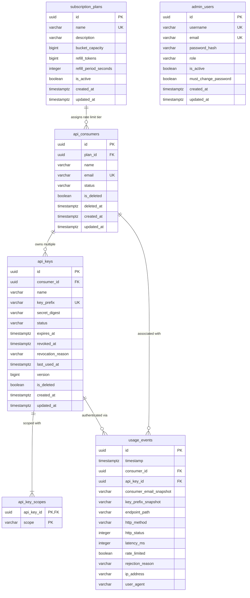

# Gatekeeper

Gatekeeper is an API Key Management and Intelligent Rate Limiting Platform built with Spring Boot and Java 21.

## Prerequisites

- **Java**: Eclipse Temurin OpenJDK 21 (`D:\Development\tools\jdk-21`)
- **Maven**: Apache Maven 3.9.16 (`D:\Development\tools\maven`)
- **Docker Desktop**: Engine running with storage on `D:\Development\docker-data\disk`
- **Environment**: Activated via `env.ps1` located at the root of the project

## Environment Initialization

Before running build, test, or execution commands in PowerShell:

```powershell
. .\env.ps1
```

This script:
- Sets `JAVA_HOME` (`D:\Development\tools\jdk-21`) and `MAVEN_HOME` (`D:\Development\tools\maven`)
- Redirects Maven local repository to `D:\Development\maven-repository`
- Redirects temporary files to `D:\Development\temp`
- Safely loads `.env` variables (`DB_USERNAME`, `DB_PASSWORD`, `REDIS_PASSWORD`, etc.) into the PowerShell session without printing credentials to the console

## Local Infrastructure (Docker Compose)

Gatekeeper uses Docker Compose with isolated containers and host bind mounts on `D:`:
- **PostgreSQL 16**: Port `127.0.0.1:5434` -> container `5432` (Storage: `D:\Development\database-data\gatekeeper`)
- **Redis 7**: Port `127.0.0.1:6380` -> container `6379` (Storage: `D:\Development\docker-data\redis`)

To manage infrastructure:

```powershell
# Start containers in detached mode
docker compose up -d

# Verify container status and health
docker compose ps

# View container logs
docker compose logs -f
```

## Database Architecture

### Entity-Relationship Diagram



### Flyway Migration Order

Database migrations reside in `backend/src/main/resources/db/migration/`:

1. **`V1__init_security_and_plans.sql`**:
   - Creates `admin_users` table with unique constraints on username and email (no default credentials seeded).
   - Creates `subscription_plans` table implementing Token Bucket semantics (`bucket_capacity`, `refill_tokens`, `refill_period_seconds`).
   - Seeds standard plans: `FREE` (60 tokens / 60s), `PRO` (600 tokens / 60s), and `ENTERPRISE` (6000 tokens / 60s).
2. **`V2__init_consumers_and_keys.sql`**:
   - Creates `api_consumers` with soft-deletion support (`is_deleted`, `deleted_at`) and foreign key referencing plans.
   - Creates `api_keys` with fixed 24-character public lookup prefix, SHA-256 secret digest, and optimistic concurrency version.
   - Creates `api_key_scopes` junction table for granular key scopes.
3. **`V3__init_usage_events.sql`**:
   - Creates `usage_events` table for audit and telemetry logging.
   - `consumer_id` and `api_key_id` are nullable to allow logging unauthenticated or invalid-key requests.
   - Includes historical snapshot columns (`consumer_email_snapshot`, `key_prefix_snapshot`) and composite performance indexes.

### Verifying Migrations

Verify migration status directly in PostgreSQL:

```powershell
docker exec gatekeeper-postgres psql -U gatekeeper_app -d gatekeeper -c "SELECT installed_rank, version, description, success FROM flyway_schema_history;"
```

## Building and Running Tests

```powershell
cd D:\Development\Gatekeeper\backend

# Execute the test suite (includes database integration and foundation tests)
mvn clean test
```

## Running the Application

### Local Development Profile (`local`)

Connects to local Docker PostgreSQL (`127.0.0.1:5434`) and Redis (`127.0.0.1:6380`) with Flyway migrations and Hibernate schema validation (`ddl-auto: validate`):

```powershell
mvn spring-boot:run -Dspring-boot.run.profiles=local
```

### Local Foundation Profile (`foundation`)

Runs without requiring live PostgreSQL or Redis instances (excludes auto-configurations while maintaining full Spring Security enforcement):

```powershell
mvn spring-boot:run -Dspring-boot.run.profiles=foundation
```

## Verification Endpoints

- **Health Endpoint**:
  - `GET http://localhost:8080/api/v1/health`
  - Expected Response: `{"status":"UP","service":"gatekeeper","serviceName":"gatekeeper","timestamp":"..."}`
- **Protected Endpoints**:
  - Any protected route without credentials returns `401 Unauthorized`.

## Secure API Key Lifecycle & Domain Services

Gatekeeper implements a high-throughput, cryptographically secure API key lifecycle management system designed for API gateways.

### 1. API Key Format and Token Anatomy

API keys adhere to a strict 68-character structured token format:

```
gk_live_1122334455667788_aB3dE5gH7jK9mN1pQ3sU5wY7zB1dF3hJ5lM7oP9rT1v
\______/\______________/\/\_________________________________________/
Prefix     Public ID     |              Secret Component
(8 chars)  (16 hex chars)|                 (43 chars)
\_______________________/ \
   Lookup Key Prefix       Delimiter
       (24 chars)          (1 char)
```

| Component | Format | Length | Description |
|---|---|---|---|
| **Prefix / Environment** | `gk_live_` | 8 chars | Environment identifier enabling secret scanners (e.g. GitHub Secret Scanning) to detect leaked production keys. |
| **Public Identifier** | `[0-9a-f]{16}` | 16 hex chars | 8 cryptographically secure random bytes rendered as lowercase hexadecimal. Combined with `gk_live_`, forms the unique 24-character `key_prefix` used for $O(1)$ database/cache indexing. |
| **Delimiter** | `_` | 1 char | Single underscore separator between public prefix and secret component. |
| **Secret Component** | `[A-Za-z0-9_-]{43}` | 43 chars | 32 cryptographically secure random bytes (256 bits entropy) encoded in URL-safe Base64 without padding. |
| **Full API Key** | `gk_live_<publicId>_<secret>` | 68 chars | The complete token issued to the consumer. |

### 2. Cryptographic Architecture & Entropy Rationale

- **CSPRNG Generation**: All public IDs and secret components are generated using `java.security.SecureRandom`.
- **256-Bit Entropy**: The secret component contains $2^{256}$ possible combinations, rendering offline dictionary attacks, rainbow tables, or brute-force enumeration computationally infeasible.
- **Prefix Collision Resistance**: Key generation enforces bounded retry loops (maximum 5 attempts) to guarantee uniqueness on the database `uk_api_keys_key_prefix` constraint.
- **Constant-Time Verification**: API secret digests are compared using `MessageDigest.isEqual()` to prevent timing side-channel attacks during authentication.

### 3. Hashing Strategy: SHA-256 vs. BCrypt

Gatekeeper deliberately differentiates between machine credentials and human credentials:

| Metric | API Key Secrets (Gatekeeper) | Human User Passwords |
|---|---|---|
| **Entropy** | High ($\ge 256$ bits cryptographically random) | Low (typically human-chosen words/patterns) |
| **Hashing Algorithm** | **SHA-256** (Cryptographic Hash) | **BCrypt / Argon2** (Key Derivation Function) |
| **Compute Overhead** | Sub-microsecond ($\approx 1\ \mu\text{s}$) | High work factor ($\approx 100\text{--}500\text{ ms}$) |
| **Gateway Throughput** | Thousands of authentications / sec | Single login session initialization |
| **Dictionary Risk** | Zero (impossible to precompute $2^{256}$ values) | High (requires work factor and salt to slow attacks) |

### 4. API Key Lifecycle States

```
[ Active Consumer ]
       |
       v
+--------------+     Expires At Reached      +--------------+
|    ACTIVE    | --------------------------> |   EXPIRED    |
+--------------+                             +--------------+
       |                                            |
       | Revoke / Consumer Suspended                | Revoke
       v                                            v
+--------------+                             +--------------+
|   REVOKED    | <-------------------------- |   REVOKED    |
+--------------+                             +--------------+
```

1. **Creation**:
   - Generates the full 68-character token.
   - Extracts the 24-character `key_prefix` and computes the SHA-256 `secret_digest`.
   - Returns an `ApiKeyCreationResult` containing the plaintext key **strictly once**. Plaintext secrets are never stored in the database or logged.
2. **Lookup & Validation**:
   - The gateway parses the incoming key, extracts the 24-character prefix in $O(1)$, and performs an indexed database query.
   - Verifies consumer status is `ACTIVE` and key status is `ACTIVE`.
   - Checks expiration timestamp (`expires_at`).
   - Constant-time verifies SHA-256 digest of secret.
   - Authorizes requested scopes against granted scopes.
3. **Revocation**:
   - Idempotent revocation transitions status to `REVOKED` and sets `revoked_at` and `revocation_reason`.
   - Safe against concurrent revocation races via JPA optimistic locking (`@Version`).
4. **Soft Deletion**:
   - Consumers and keys support non-destructive deactivation (`is_deleted = true`, `deleted_at = NOW()`), preserving historical audit integrity for usage events and logs.

### 5. Domain Services Overview (Java Backend Architecture)

- **`ApiKeyGenerator`**: Cryptographic component responsible for producing structured tokens (`gk_live_<publicId>_<secret>`) with `SecureRandom` and validating raw key string format and length.
- **`ApiKeyHasher`**: Cryptographic hashing service performing deterministic SHA-256 hashing and constant-time digest verification using `MessageDigest.isEqual`.
- **`ApiKeyService`**: Primary domain service orchestrating API key generation, prefix collision handling, validation, scope authorization, idempotent revocation, and metadata queries.
- **`ConsumerService`**: Manages consumer lifecycle, plan assignment, email uniqueness, suspension, reactivation, and soft deletion.
- **`SubscriptionPlanService`**: Manages rate-limiting plans, validates token bucket parameters (`bucket_capacity > 0`, `refill_tokens > 0`, `refill_period_seconds > 0`), and provides cached read-only plan lookups.

### 6. Scope Authorization

Key scopes follow a hierarchical format:
- `resource:action` (e.g. `billing:read`, `analytics:export`, `users:write`)
- Validated via regex `^[a-z0-9]+(:[a-z0-9_-]+)*$`
- Validation passes if the key possesses all requested scopes. If any requested scope is missing, an `InsufficientScopeException` is thrown.

### 7. Current Architectural Limitations & Phase 3 Roadmap

- **Database as Source of Truth**: Key validation currently executes against PostgreSQL. In Phase 3, an active-key Redis cache with instant invalidation will be integrated to eliminate database latency on high-frequency gateway requests.
- **Distributed Rate Limiting**: Token bucket rate limiting will be enforced via Redis Lua scripts in Phase 3.
