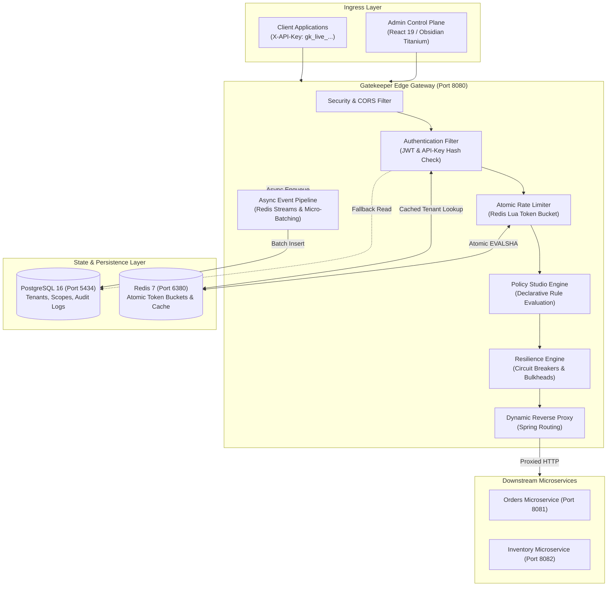
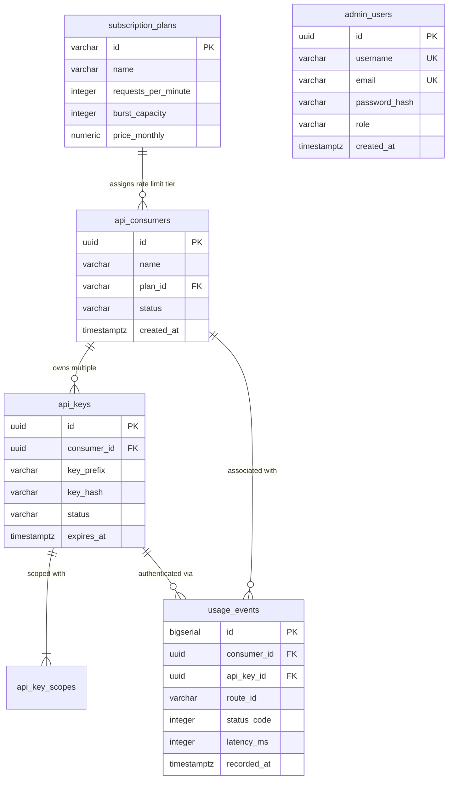

# Gatekeeper — Enterprise API Gateway & Traffic Control Plane

[](https://openjdk.org/projects/jdk/21/)
[](https://spring.io/projects/spring-boot)
[](https://react.dev/)
[](https://www.typescriptlang.org/)
[](https://redis.io/)
[](https://www.postgresql.org/)
[](docs/TESTING.md)
[](docs/SECURITY.md)
[](LICENSE)

Gatekeeper is an industrial-grade, multi-tenant API Gateway and Intelligent Traffic Control Plane engineered from first principles in **Java 21 (Spring Boot 3)** and **TypeScript (React 19)**. It acts as an intelligent, high-throughput proxy between public ingress and downstream microservices, enforcing atomic token-bucket rate limiting, cascading failure protection, and declarative policy-driven traffic governance.

---

## 🎥 Watch Gatekeeper in Action

[](https://youtu.be/c29oX3FUKVc)

[▶ **Watch the 4-Minute Project Demo**](https://youtu.be/c29oX3FUKVc)

A narrated walkthrough of Gatekeeper's API gateway control plane, traffic analytics, API security, policy evaluation, circuit breakers, interactive health scenarios and system architecture.

*The video demonstrates a standalone frontend simulation. The repository contains the actual Java/Spring Boot backend and associated microservices.*

---

## ⚡ Quick Navigation

- 🎥 **[4-Minute Video Walkthrough](https://youtu.be/c29oX3FUKVc)**: Narrated demonstration of the control plane, traffic analytics, and fault isolation.
- 🚀 **[60-Second Recruiter Demo](docs/DEMO_GUIDE.md)**: Explore the entire control plane locally with zero cloud or backend setup.
- 📋 **[Recruiter & Hiring Manager Evaluation Guide](docs/RECRUITER_WALKTHROUGH.md)**: 5-minute technical evaluation walkthrough.
- 🏛️ **[System Architecture Blueprint](docs/ARCHITECTURE.md)**: Deep dive into distributed algorithms, Mermaid diagrams, and data flows.
- 📡 **[REST API Specification](docs/api/README.md)**: Authoritative documentation of all gateway and microservice endpoints.
- 🧪 **[Testing Strategy & Verification](docs/TESTING.md)**: 5-tier testing pyramid, Vitest suites, and chaos benchmarks.
- 🛡️ **[Security Architecture](docs/SECURITY.md)**: Zero-trust credentials, CSPRNG key generation, and threat mitigations.
- 💼 **[Portfolio & Interview Package](docs/portfolio/INTERVIEW_QA.md)**: 22 technical interview Q&As and resume bullets.

---

## 🏛️ System Architecture



---

## 🌟 Core Architectural Highlights

### 1. Atomic Distributed Rate Limiting (Redis Lua)
- **Zero Race Conditions**: Executes an atomic Redis Lua script (`rate_limiter.lua`) calculating fractional token refills on-the-fly.
- **Atomic Concurrency Control**: Eliminates distributed locks and multi-step database roundtrips under concurrent traffic.
- **Multi-Tenant Quotas**: Enforces dynamic tier limits (`Starter`, `Professional`, `Enterprise`) with burst headroom.

### 2. Cascading Failure Protection & Fault Isolation
- **Sliding-Window Circuit Breakers**: Automatically trips to `OPEN` when upstream failure rates exceed configured thresholds (default: 50%), short-circuiting calls with graceful fallbacks.
- **Semaphore Bulkheads**: Isolates concurrent execution permits per downstream route (configurable, default: 10 permits), guaranteeing an outage in Orders Service never starves or degrades Inventory Service.
- **Automated Healing**: Transitions through `HALF-OPEN` probe states with automatic self-recovery once downstream services stabilize.

### 3. Explainable Policy Studio & Governance Engine
- **Declarative Rule Engine**: Evaluates request IP, CIDR blocks, route paths, headers, and consumer plans against versioned rule definitions.
- **Dry-Run Simulation**: Enables operators to simulate incoming requests and inspect an explainable decision trace before production activation.
- **Immutable History**: Version-controlled policies with instant one-click rollback and audit logging.

### 4. Zero-Trust API Key Lifecycle
- **Cryptographic Security**: Generates keys with 256 bits of CSPRNG entropy.
- **Hashed Storage**: Only irreversible SHA-256 digests are persisted in PostgreSQL.
- **Single-Reveal UX**: Plaintext secrets are revealed strictly once upon generation via `OneTimeSecretModal`.

### 5. High-Throughput Asynchronous Analytics Ingestion
- **Non-Blocking Critical Path**: Proxy responses dispatch to clients immediately; telemetry events are enqueued asynchronously via Redis Streams.
- **Micro-Batched Persistence**: Consumer groups read event streams and flush micro-batches to PostgreSQL using JDBC batching, eliminating per-request database write overhead.
- **Dead-Letter Safety**: Transient database failures route to a dead-letter queue (DLQ) with automated backoff retries.

---

## 🚀 Getting Started

Gatekeeper supports two execution workflows:

### Workflow A: Standalone Recruiter Demo (Fastest — 60 Seconds)
*Requires only Node.js 20+. No Docker, Java, PostgreSQL, or Redis needed.*

```bash
# 1. Clone repository
git clone https://github.com/saipranav22-commits/gatekeeper.git
cd gatekeeper/frontend

# 2. Install dependencies & launch demo
npm install
npm run preview:demo
```
Open **`http://127.0.0.1:4173/login`** and click **"Sign In as Administrator"** (credentials pre-filled).
- Explore all 9 control plane views.
- Toggle interactive health scenarios (`HEALTHY`, `DEGRADED`, `UNHEALTHY`, `RECOVERING`) to observe real-time metric and topology changes.

👉 *See the full [Standalone Demo Guide](docs/DEMO_GUIDE.md) for a detailed walkthrough.*

---

### Workflow B: Full Local Microservice Stack
*Runs the genuine distributed Java 21, Spring Boot 3, PostgreSQL 16, and Redis 7 environment.*

#### 1. Environment Setup (PowerShell)
```powershell
# From project root:
. .\env.ps1
```

#### 2. Start PostgreSQL & Redis Infrastructure
```bash
docker compose up -d
docker compose ps
```

#### 3. Bootstrap Database & Admin Credentials
```powershell
.\setup-admin.ps1
```

#### 4. Launch Downstream Microservices
```bash
# Terminal 1: Orders Microservice (Port 8081)
cd services/orders-service && mvn spring-boot:run

# Terminal 2: Inventory Microservice (Port 8082)
cd services/inventory-service && mvn spring-boot:run
```

#### 5. Launch Gatekeeper Core Gateway & Live Frontend
```bash
# Terminal 3: Gateway Core (Port 8080)
cd backend && mvn spring-boot:run

# Terminal 4: React Control Plane (Port 5173)
cd frontend && npm run dev
```

👉 *See the full [Getting Started Guide](docs/GETTING_STARTED.md) and [Developer Guide](docs/DEVELOPMENT.md).*

---

## 🧪 Testing & Verification Matrix

Gatekeeper maintains an exhaustive automated testing suite across every architecture tier:

| Tier | Scope | Framework | Status |
| :--- | :--- | :--- | :--- |
| **Frontend Unit & Component** | 24 test suites covering 147 test cases | Vitest + React Testing Library | **147/147 Passing** |
| **Backend Integration** | Controller contracts, Redis token-bucket concurrency | JUnit 5 + MockMvc + Mockito | **Passing** |
| **Chaos & Resilience** | Upstream fault injection, circuit trips, bulkhead isolation | PowerShell empirical harness | **Verified** |
| **Visual QA & Responsive** | Multi-viewport testing (320px, 390px, 768px, 1280px, 1440px) | Automated Chrome Headless | **0 Console Errors** |
| **DevSecOps** | Automated credential scanning across entire Git history | Gitleaks | **100% Clean** |

Run tests locally:
```bash
cd frontend && npm test -- --run
```

👉 *See the complete [Testing Strategy Blueprint](docs/TESTING.md).*

---

## 🗄️ Database Architecture



---

## 📂 Repository Structure

```text
Gatekeeper/
├── backend/                  # Gatekeeper Core Gateway (Java 21, Spring Boot 3)
├── frontend/                 # Admin Control Plane (React 19, TypeScript, Tailwind)
├── services/                 # Downstream Microservices (Orders & Inventory)
├── docs/                     # Architecture, API specs, testing, and portfolio docs
│   ├── api/                  # Complete REST API Specification
│   ├── portfolio/            # Interview Q&A, Resume Bullets, Project Summary
│   ├── ARCHITECTURE.md       # Distributed system architecture blueprint
│   ├── GETTING_STARTED.md    # Dual-workflow quickstart guide
│   ├── DEVELOPMENT.md        # Engineering guidelines and contribution guide
│   ├── TESTING.md            # Comprehensive 5-layer testing strategy
│   ├── SECURITY.md           # Threat mitigation model & secret policies
│   ├── DEMO_GUIDE.md         # Standalone recruiter demo walkthrough
│   ├── RECRUITER_WALKTHROUGH.md # 5-minute technical recruiter tour
│   └── TROUBLESHOOTING.md    # Operational diagnostic and error runbook
├── scripts/                  # Automated CI and verification scripts
└── docker-compose.yml        # PostgreSQL 16 & Redis 7 container orchestration
```

---

## 💼 Portfolio & Interview Materials

- **[22 Deep Technical Interview Questions & Grounded Answers](docs/portfolio/INTERVIEW_QA.md)**: Master discussions on distributed rate limiting, circuit breaking, bulkheads, and zero-trust security.
- **[ATS-Friendly Resume Bullet Points](docs/portfolio/RESUME_BULLETS.md)**: Action-oriented, quantified bullets for Backend, Full-Stack, and DevOps/SRE roles.
- **[One-Page Executive Project Summary](docs/portfolio/PROJECT_SUMMARY.md)**: Problem statement, metrics, and technical achievements.
- **[LinkedIn Project Showcase Description](docs/portfolio/LINKEDIN_PROJECT_DESCRIPTION.md)**: Production-ready post for social platforms.

---

## 📄 License

This project is licensed under the MIT License — see the [LICENSE](LICENSE) file for details.
