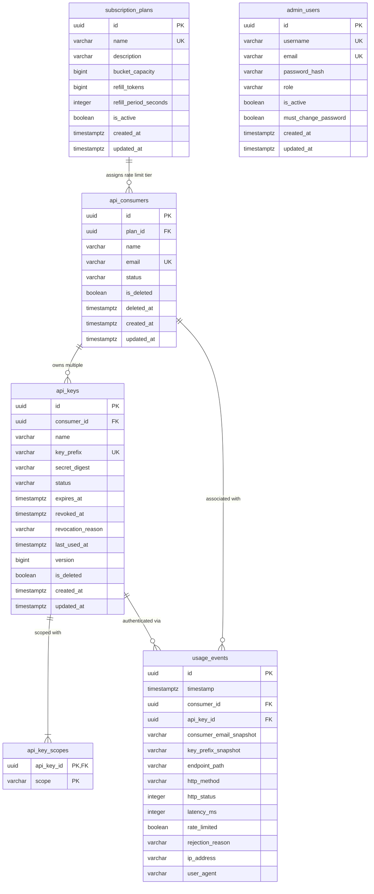

# Gatekeeper

Gatekeeper is an API Key Management and Intelligent Rate Limiting Platform built with Spring Boot and Java 21.

## Prerequisites

- **Java**: Eclipse Temurin OpenJDK 21 (`D:\Development\tools\jdk-21`)
- **Maven**: Apache Maven 3.9.16 (`D:\Development\tools\maven`)
- **Docker Desktop**: Engine running with storage on `D:\Development\docker-data\disk`
- **Environment**: Activated via `env.ps1` located at the root of the project

## Environment Initialization

Before running build, test, or execution commands in PowerShell:

```powershell
. .\env.ps1
```

This script:
- Sets `JAVA_HOME` (`D:\Development\tools\jdk-21`) and `MAVEN_HOME` (`D:\Development\tools\maven`)
- Redirects Maven local repository to `D:\Development\maven-repository`
- Redirects temporary files to `D:\Development\temp`
- Safely loads `.env` variables (`DB_USERNAME`, `DB_PASSWORD`, `REDIS_PASSWORD`, etc.) into the PowerShell session without printing credentials to the console

## Local Infrastructure (Docker Compose)

Gatekeeper uses Docker Compose with isolated containers and host bind mounts on `D:`:
- **PostgreSQL 16**: Port `127.0.0.1:5434` -> container `5432` (Storage: `D:\Development\database-data\gatekeeper`)
- **Redis 7**: Port `127.0.0.1:6380` -> container `6379` (Storage: `D:\Development\docker-data\redis`)

To manage infrastructure:

```powershell
# Start containers in detached mode
docker compose up -d

# Verify container status and health
docker compose ps

# View container logs
docker compose logs -f
```

## Database Architecture

### Entity-Relationship Diagram



### Flyway Migration Order

Database migrations reside in `backend/src/main/resources/db/migration/`:

1. **`V1__init_security_and_plans.sql`**:
   - Creates `admin_users` table with unique constraints on username and email (no default credentials seeded).
   - Creates `subscription_plans` table implementing Token Bucket semantics (`bucket_capacity`, `refill_tokens`, `refill_period_seconds`).
   - Seeds standard plans: `FREE` (60 tokens / 60s), `PRO` (600 tokens / 60s), and `ENTERPRISE` (6000 tokens / 60s).
2. **`V2__init_consumers_and_keys.sql`**:
   - Creates `api_consumers` with soft-deletion support (`is_deleted`, `deleted_at`) and foreign key referencing plans.
   - Creates `api_keys` with fixed 24-character public lookup prefix, SHA-256 secret digest, and optimistic concurrency version.
   - Creates `api_key_scopes` junction table for granular key scopes.
3. **`V3__init_usage_events.sql`**:
   - Creates `usage_events` table for audit and telemetry logging.
   - `consumer_id` and `api_key_id` are nullable to allow logging unauthenticated or invalid-key requests.
   - Includes historical snapshot columns (`consumer_email_snapshot`, `key_prefix_snapshot`) and composite performance indexes.

### Verifying Migrations

Verify migration status directly in PostgreSQL:

```powershell
docker exec gatekeeper-postgres psql -U gatekeeper_app -d gatekeeper -c "SELECT installed_rank, version, description, success FROM flyway_schema_history;"
```

## Building and Running Tests

```powershell
cd D:\Development\Gatekeeper\backend

# Execute the test suite (includes database integration and foundation tests)
mvn clean test
```

## Running the Application

### Local Development Profile (`local`)

Connects to local Docker PostgreSQL (`127.0.0.1:5434`) and Redis (`127.0.0.1:6380`) with Flyway migrations and Hibernate schema validation (`ddl-auto: validate`):

```powershell
mvn spring-boot:run -Dspring-boot.run.profiles=local
```

### Local Foundation Profile (`foundation`)

Runs without requiring live PostgreSQL or Redis instances (excludes auto-configurations while maintaining full Spring Security enforcement):

```powershell
mvn spring-boot:run -Dspring-boot.run.profiles=foundation
```

## Verification Endpoints

- **Health Endpoint**:
  - `GET http://localhost:8080/api/v1/health`
  - Expected Response: `{"status":"UP","service":"gatekeeper","serviceName":"gatekeeper","timestamp":"..."}`
- **Protected Endpoints**:
  - Any protected route without credentials returns `401 Unauthorized`.
