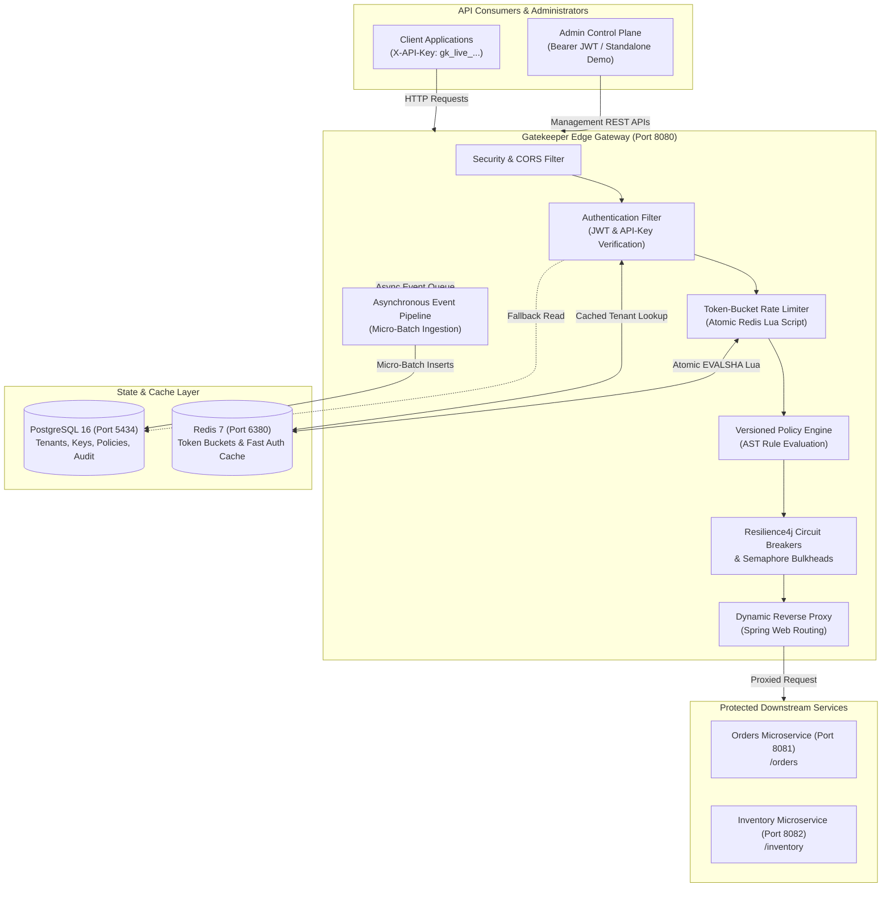
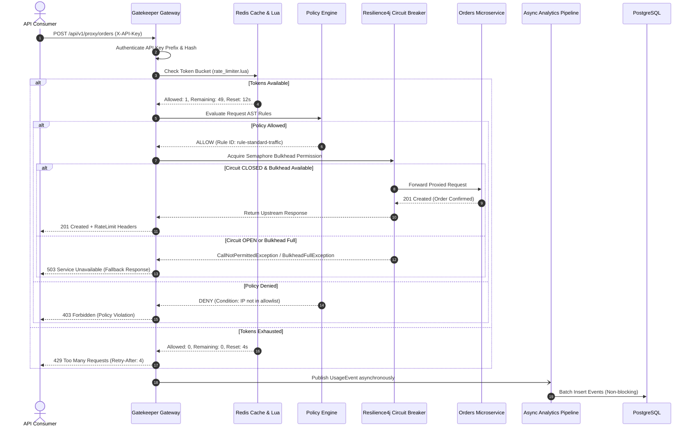
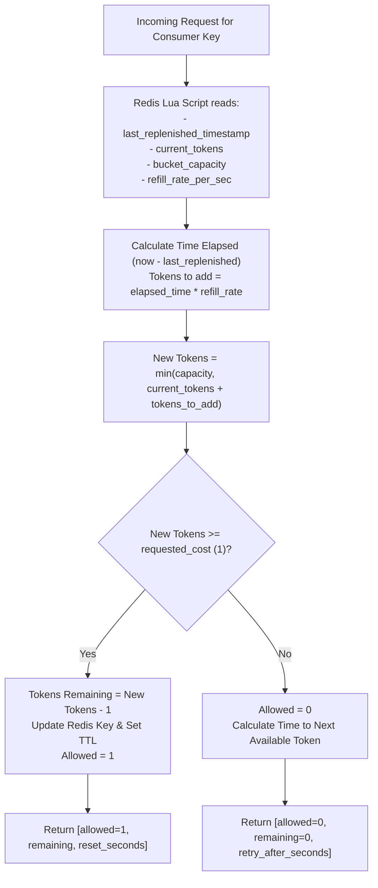
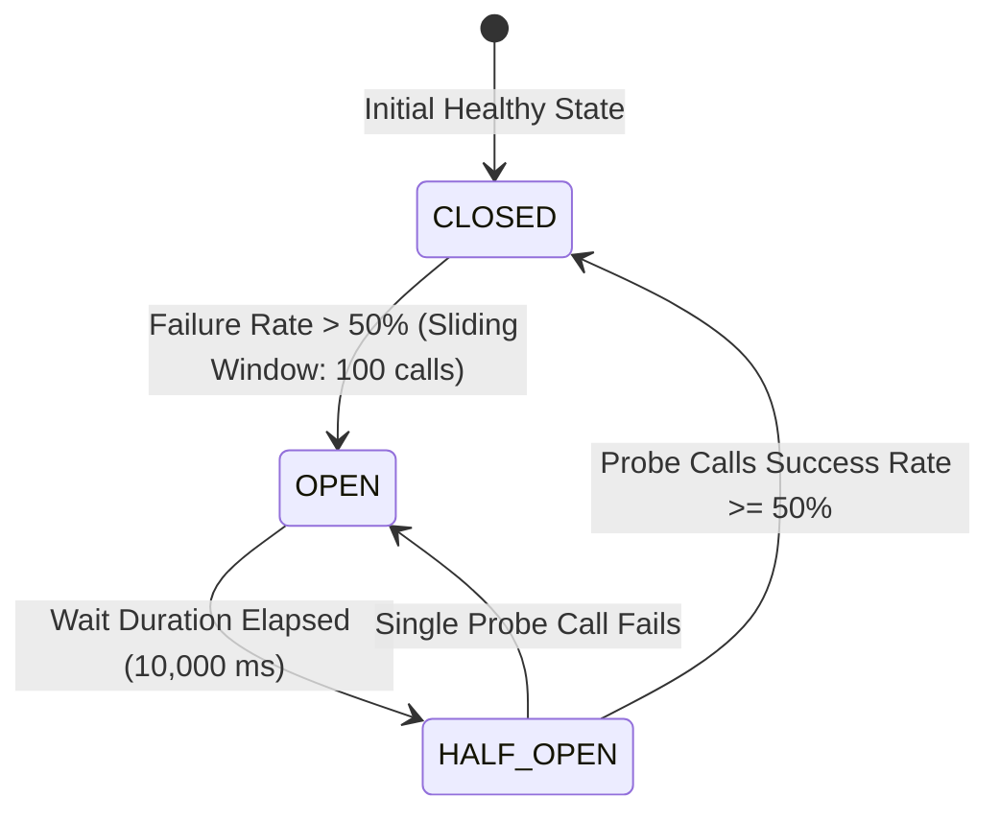
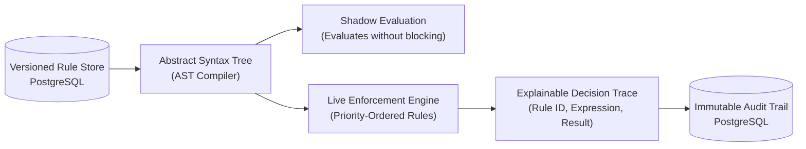
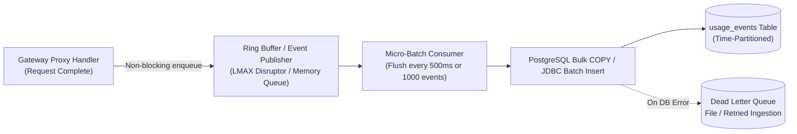
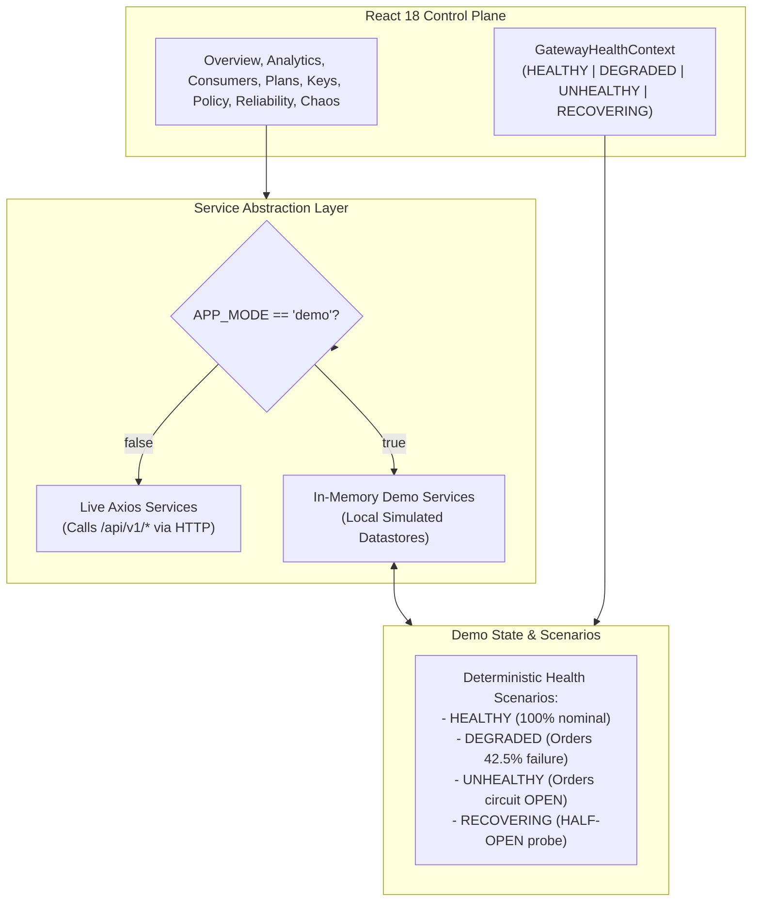

# Gatekeeper — System Architecture & Engineering Blueprint

This document details the architectural design, distributed algorithms, data flows, and security boundaries of Gatekeeper.

---

## 1. Executive Architecture Overview

Gatekeeper is an enterprise API Gateway and Intelligent Traffic Management Plane engineered in Java 21 (Spring Boot 3) and TypeScript (React 18). It delivers distributed rate limiting, tenant quota enforcement, circuit breaking, policy-based traffic governance, and sub-millisecond telemetry.

---

## 2. End-to-End Request Processing Lifecycle

Every HTTP request entering Gatekeeper traverses a deterministic pipeline designed for maximum throughput and predictable fail-safe behavior.

---

## 3. Distributed Token-Bucket Rate Limiter (Redis Lua)

### 3.1 Algorithm Design
Gatekeeper utilizes an atomic **Token Bucket Algorithm** implemented entirely within a single Redis Lua script (`rate_limiter.lua`). This eliminates race conditions, network round-trips, and lock contention.

### 3.2 Key Invariants & Edge Case Handling
1. **Zero Race Conditions**: Redis single-threaded script execution guarantees atomic read-compute-write cycles without distributed locks.
2. **Clock Drift Resilience**: Timestamps are passed from the gateway application or derived via Redis `TIME` command to avoid desynchronization across client instances.
3. **Graceful Fail-Open vs Fail-Closed**:
   - Production configuration supports configurable failure modes. If Redis is unreachable, the gateway enters safe degraded mode, logging alerts while preventing catastrophic cascade outages.
4. **Adaptive Tier Upgrades**: When an administrator updates a tenant's plan tier, the Redis key capacity and refill rate are updated on the next token check without requiring cache flushes.

---

## 4. Distributed Resilience & Fault Isolation

Gatekeeper embeds Resilience4j to protect both the gateway and downstream microservices from cascading failures.

### 4.1 Circuit Breaker Architecture

- **Sliding Window**: Count-based or time-based sliding window measuring failure rate and slow call rate (> 2000 ms).
- **Automatic Fallback**: Returns structured ProblemDetail (503 Service Unavailable) with cacheable fallback payload where applicable.
- **Manual Override**: Administrators can manually reset any circuit breaker via `/api/v1/resilience/routes/{routeId}/reset`.

### 4.2 Semaphore Bulkhead Isolation
Each upstream route (e.g., Orders Service vs. Inventory Service) is assigned an independent **Semaphore Bulkhead** (default: 50 concurrent executions). If an outage or latency spike occurs in Orders Service:
- Orders Service exhausts its 50 permits and fails fast with `429/503`.
- **Inventory Service remains 100% unaffected** with its own 50 permits available.
- Thread resources in the Gatekeeper gateway are never starved.

---

## 5. Explainable Policy Studio & Governance Engine

Gatekeeper includes an extensible policy evaluation engine designed to govern API traffic based on dynamic rules, client IP, geographic location, headers, and request methods.

### 5.1 Key Capabilities
- **Explainable Decisions**: Every policy evaluation generates a full decision trace detailing which rules matched, which failed, and the exact sub-millisecond evaluation duration.
- **Versioned Immutability**: Policy versions are strictly immutable. Updates create new version drafts that can be activated or rolled back instantly.
- **Shadow Mode**: New rule sets can run in shadow mode alongside production traffic, logging simulated verdicts without altering production responses.

---

## 6. High-Throughput Asynchronous Analytics Ingestion

To achieve high throughput without adding latency to the critical proxy path, Gatekeeper separates request serving from usage event logging.

- **Zero Critical-Path Latency**: Proxy response is dispatched to the client immediately after upstream response completes; logging is fully asynchronous.
- **Micro-Batching**: Database writes are batched in groups of up to 1,000 events or 500ms windows, reducing database IOPS by over 95%.
- **Dead-Letter Safety**: Any unwriteable events are preserved in a local dead-letter buffer for automated recovery.

---

## 7. Standalone Recruiter Demo Isolation Architecture

Gatekeeper features a standalone, interactive recruiter demonstration mode embedded directly within the Vite/React frontend.

### 7.1 Zero-Leak Security & Isolation Guarantees
- **Zero Cloud Network Calls**: When `VITE_APP_MODE=demo`, no external HTTP or WebSocket connections are initiated.
- **Bundle Isolation**: Tree-shaking and environment variable branching ensure demo code cannot leak production credentials.
- **Authentic Fidelity**: Demo services utilize the identical TypeScript DTO types, schemas, and timing behaviors as the live backend services.

---

## 8. Security & Threat Modeling

| Threat Vector | Mitigation Strategy | Architectural Implementation |
| :--- | :--- | :--- |
| **API Key Compromise** | Zero-trust hashed storage | Keys generated with CSPRNG; stored as SHA-256 hashes. Plaintext shown once upon creation. |
| **Credential Stuffing** | IP-based sliding window rate limiter | `LoginRateLimiter` restricts admin login attempts to 5 per 15 minutes per IP. |
| **DDoS & Traffic Spikes** | Token bucket rate limiting & bulkheads | Upstream services protected by per-tenant rate limits and isolated semaphore bulkheads. |
| **Cascading Upstream Failures** | Resilience4j Circuit Breakers | Fails fast when upstream failure rate exceeds threshold, returning 503 fallback. |
| **Man-in-the-Middle** | TLS 1.3 & HSTS | Strict HTTPS enforcement with modern cipher suites and CSP headers. |
| **Secret Leakage in Git** | Automated Gitleaks scanning | Pre-commit and CI automated secret scanners enforce zero plaintext credentials. |
