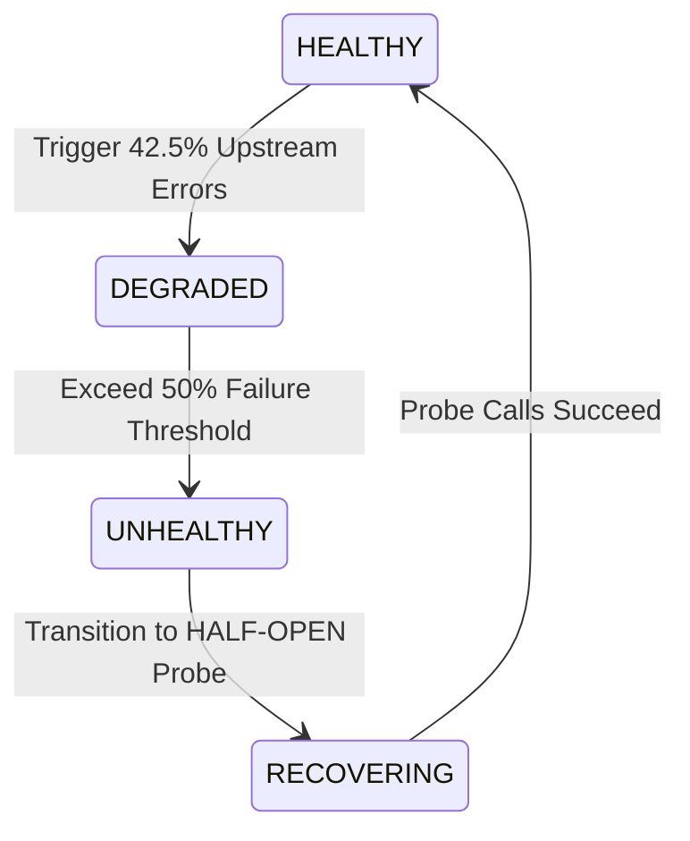

# Gatekeeper — Standalone Recruiter Demonstration Guide

The Gatekeeper Standalone Recruiter Demonstration is an interactive, high-fidelity experience of the entire Gatekeeper control plane designed to run locally with zero cloud, backend, or database dependencies.

---

## 1. Quick Launch (60 Seconds)

### Step 1: Start the Demo Preview Server
From the project root:
```bash
cd frontend
npm run preview:demo
```
*Note: If you have not yet installed dependencies, run `npm install` first.*

### Step 2: Open Your Browser
Navigate to:
```text
http://127.0.0.1:4173/login
```

---

## 2. Walkthrough of the 9 Control Plane Views

### 2.1 Login Screen (`/login`)
- **Experience**: Clean, dark-mode Obsidian Titanium login card.
- **Convenience**: Notice the quick-fill credentials banner. Click **"Sign In as Administrator"** or enter `admin` / `Password123!` to enter.

### 2.2 Command Center / Overview (`/`)
- **KPI Counters**: Real-time cards displaying Total Requests (1.85M+), Success Rate (99.5%), Active Consumers (12), and Active Policies (4).
- **Traffic Throughput Chart**: Area chart showing request volume categorized into 2xx, 4xx, 429, and 5xx responses.
- **Upstream Route Status Grid**: Live status cards for Orders Service and Inventory Service displaying latency percentiles (p50, p95, p99) and active circuit breaker states.
- **Dynamic Health Selector**: Notice the health scenario selector pill at the top right of the navbar.

### 2.3 Subscription Plans & Quotas (`/plans`)
- **Pricing & Quota Cards**: Explore the three production rate-limiting tiers:
  - **Starter**: 60 req/min, burst 100.
  - **Professional**: 1,000 req/min, burst 2,000.
  - **Enterprise**: 10,000 req/min, burst 20,000.
- **Calculated Throughput & Burst**: Demonstrates token-bucket bucket capacity and refill rate calculations.

### 2.4 API Consumers Directory (`/consumers`)
- **Tenant Directory**: Browse registered enterprise tenants across different tiers.
- **Status & Actions**: Inspect consumer status badges (`ACTIVE`, `SUSPENDED`). Click on any tenant to view deep metrics.

### 2.5 Consumer Detail View (`/consumers/:id`)
- **Tenant Telemetry**: Per-consumer request history, error distribution, quota consumption gauge, and active API keys.

### 2.6 API Key Lifecycle Management (`/api-keys`)
- **Directory**: View provisioned keys with masked prefixes (e.g., `gk_live_acme_****`).
- **Provisioning Workflow**: Click **"Provision New API Key"**. Select tenant and scopes (`orders:read`, `orders:write`).
- **Single-Reveal Security Modal**: Observe the one-time plaintext reveal modal with copy-to-clipboard functionality and security warning.

### 2.7 Policy Studio & Rule Engine (`/policies`)
- **Visual Rule Builder**: Inspect versioned traffic governance policies with boolean conditions.
- **Dry-Run Simulation**: Enter test request headers and click **"Run Simulation"** to view an explainable, step-by-step decision trace with execution duration in sub-milliseconds.
- **Version Control & Rollback**: View immutable policy history and instant rollback capability.

### 2.8 Reliability Workbench & Service Topology (`/reliability`)
- **Configured Service Topology**: Interactive node graph mapping Gatekeeper Edge -> Semaphore Bulkheads -> Orders & Inventory Microservices.
- **Resilience Telemetry**: Real-time sliding window counters, failure rate percentages, and bulkhead permit counters.
- **Manual Circuit Reset**: Click **"Reset Circuit Breaker"** to simulate an operator overriding an open circuit back to closed state.

### 2.9 Chaos Engineering Laboratory (`/chaos`)
- **Pre-Baked Chaos Experiments**: Review historical and runnable chaos scenarios (e.g., Orders Service 100% 500 Outage, Downstream Latency Injection).
- **Resilience Invariants**: Verify that downstream chaos in Orders Service does not degrade Inventory Service throughput (bulkhead isolation proof).

---

## 3. Testing Interactive Health Scenarios

Gatekeeper includes an interactive health state engine that dynamically re-renders topology, metrics, and incident severity across the entire control plane.

Locate the **Health Scenario Selector** in the navigation header:



### Scenario 1: `HEALTHY` (Nominal Operation)
- **Status**: 100% green indicators.
- **Orders Service**: Circuit `CLOSED`, 0.0% failure rate, 12ms p95 latency.
- **Inventory Service**: Circuit `CLOSED`, 0.0% failure rate, 8ms p95 latency.

### Scenario 2: `DEGRADED` (Partial Upstream Latency & Errors)
- **Status**: Warning status bar in amber (`#F59E0B`).
- **Orders Service**: Experiencing 42.5% failure rate; latency spikes to 850ms.
- **Inventory Service**: Operates nominally at 100% health.

### Scenario 3: `UNHEALTHY` (Critical Circuit Tripped OPEN)
- **Status**: High-contrast, localized red indicators (`#EF4444`).
- **Obsidian Titanium Background**: Background remains dark and readable (no jarring full-screen red tint).
- **Orders Service**: Circuit breaker trips `OPEN`. Gateway fails fast with 503 fallback responses.
- **Inventory Service**: **Remains 100% HEALTHY** proving bulkhead fault isolation.

### Scenario 4: `RECOVERING` (Probing Upstream Health)
- **Status**: Cyan/Indigo transition indicators.
- **Orders Service**: Circuit enters `HALF-OPEN` state, allowing a limited sample of test probe requests.
- **Recovery Assertion**: As probe requests succeed, the system automatically transitions back to `HEALTHY`.
