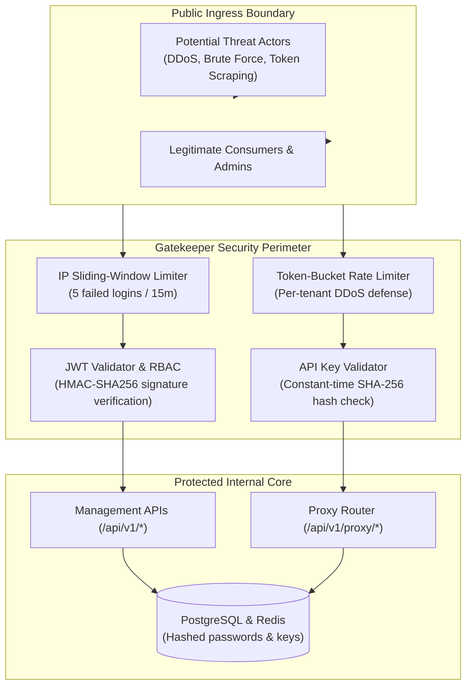

# Gatekeeper — Security Architecture & Threat Mitigation Model

Gatekeeper is engineered under a zero-trust model where all ingress traffic, administrative actions, and internal state changes are authenticated, authorized, rate-limited, and audited.

---

## 1. Security Architecture & Threat Model



---

## 2. Authentication & Credential Architecture

### 2.1 Administrator Identity & Session Security
- **Password Hashing**: Passwords are saved using BCrypt / Argon2 with adaptive cost factor. Plaintext passwords are never logged, cached, or persisted.
- **Session Tokens**: Administrative sessions issue short-lived JSON Web Tokens (JWT) complying with RFC 7519.
- **Brute-Force Mitigation**: The `LoginRateLimiter` component tracks failed authentication attempts using an IP-keyed sliding window. Exceeding 5 failures within 15 minutes triggers an immediate `429 Too Many Requests` lock out.

### 2.2 API Key Lifecycle & Single-Reveal Plaintext Model
- **Cryptographic Entropy**: API keys are generated using Java's `SecureRandom` (CSPRNG), producing 256 bits of entropy.
- **Prefix Isolation**: Keys are prefixed with tenant identifiers (e.g., `gk_live_acme_...`) allowing instant routing and fast database indexing without hashing the prefix.
- **Irreversible Storage**: The secret token portion is hashed using SHA-256 before storage in PostgreSQL.
- **Single-Reveal UX**: The plaintext secret is displayed **only once** in the `OneTimeSecretModal` immediately upon provisioning. It cannot be recovered by any user or administrator afterward.

---

## 3. Rate Limiting as a Security Perimeter

Gatekeeper's token-bucket rate limiter acts as the primary defense against application-layer Distributed Denial of Service (DDoS) attacks:
- **Tenant Quota Isolation**: High-volume attacks against one tenant's API key consume only that tenant's token bucket, leaving other tenants completely unaffected.
- **Upstream Protection**: Prevents resource exhaustion in internal microservices by bounding maximum concurrency and burst throughput.
- **Atomic Concurrency**: Executed via Redis Lua scripts to eliminate race conditions such as parallel request bypass.

---

## 4. Secret Protection & CI/CD DevSecOps

Gatekeeper employs strict secret scanning to guarantee zero production credentials or private keys are ever committed to the Git repository.

### 4.1 Gitleaks Configuration (`.gitleaks.toml`)
- Automated scanning runs on every push and Pull Request.
- Scans full commit history for high-entropy strings, AWS keys, JWT secrets, and private keys.
- **Safe Synthetic Demo Mocks**: Synthetic mock keys in demo files (e.g. `gk_live_demo_...`) are safely categorized with designated regex rules so they receive secret scanning without creating false positives.

### 4.2 Environment Variable Isolation
- All secrets (`DB_PASSWORD`, `REDIS_PASSWORD`, `JWT_SECRET`) must be provided via external environment variables or vault mounts.
- `.env.example` provides sanitized template values with zero real credentials.
- `.gitignore` strictly excludes `.env`, `*.key`, `*.pem`, and `credentials.json`.

---

## 5. Security Headers & Network Protections

Every HTTP response dispatched by Gatekeeper includes enterprise security headers:
```http
Content-Security-Policy: default-src 'self'; script-src 'self'; style-src 'self' 'unsafe-inline';
X-Content-Type-Options: nosniff
X-Frame-Options: DENY
X-XSS-Protection: 1; mode=block
Referrer-Policy: strict-origin-when-cross-origin
Strict-Transport-Security: max-age=31536000; includeSubDomains; preload
```

---

## 6. Vulnerability Disclosure Policy

If you discover a security vulnerability in Gatekeeper:
1. Do **not** open a public GitHub issue.
2. Submit a confidential report to the security maintainers via GitHub Security Advisories.
3. Include detailed reproduction steps and affected component versions.
4. The security team will acknowledge receipt within 48 hours and coordinate a patch release.
