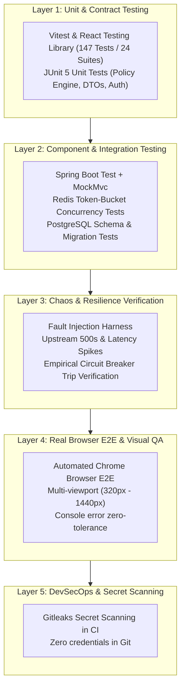

# Gatekeeper — Comprehensive Testing Strategy & Verification Blueprint

Gatekeeper enforces an uncompromising testing discipline across every tier of the distributed architecture.

---

## 1. Test Pyramid & Verification Layers



---

## 2. Layer 1: Unit & Contract Testing

### 2.1 Frontend Test Suite (Vitest + React Testing Library)
The frontend contains **147 tests across 24 test suites** ensuring 100% component stability, polymorphic health state transitions, and contract normalization.

```bash
# Execute full frontend test suite
cd frontend
npm test -- --run
```

#### Test Suite Directory:
| Test File | Tests | Focus Area |
| :--- | :--- | :--- |
| `DemoHealthScenarios.test.tsx` | 20 | Dynamic health scenarios (`HEALTHY`, `DEGRADED`, `UNHEALTHY`, `RECOVERING`) |
| `DemoMode.test.tsx` | 21 | Standalone demo services, in-memory isolation, mock contracts |
| `HealthVisualPolish.test.tsx` | 14 | Obsidian Titanium severity hierarchy, localized badge and metric colors |
| `ResilienceContractRegression.test.tsx` | 12 | Live backend DTO contract compatibility, polymorphic health status |
| `CommandPalette.test.tsx` | 7 | Global search, keyboard shortcut navigation (`Ctrl+K`) |
| `PolicyStudio.test.tsx` | 5 | AST rule builder, dry-run simulation, explainable traces |
| `ReliabilityWorkbench.test.tsx` | 4 | Service topology, circuit breaker reset modal, metrics |
| `OneTimeSecretModal.test.tsx` | 4 | Plaintext API key single-reveal modal & clipboard security |
| `Analytics.test.tsx` | 4 | Recharts KPI tiles, time-series telemetry, consumer filtering |
| `ChaosLab.test.tsx` | 4 | Chaos experiment execution, provenance telemetry display |
| `Security.test.tsx` | 4 | Admin profile, password policy validation, session security |
| `Plans.test.tsx` | 3 | Subscription plan cards, token bucket burst metrics |
| `Consumers.test.tsx` | 1 | Tenant table rendering, status badges, plan tiers |
| `Login.test.tsx` | 4 | Admin login form, error handling, credentials helper |
| `nginxSecurityConfig.test.ts` | 6 | Nginx security headers, CSP, frame-ancestors, rate limits |
| `apiClient.test.ts` | 3 | Axios interceptors, Bearer token injection, 401 redirect |
| `GatewayHealthContext.test.tsx` | 4 | Global health state provider and subscriber hooks |
| `AuthContext.test.tsx` | 4 | Admin authentication lifecycle and token storage |
| `ProtectedRoute.test.tsx` | 3 | Route guards and unauthorized redirect logic |
| `utils.test.ts` | 7 | Currency, date, and latency string formatting utilities |
| `NotFound.test.tsx` | 1 | 404 error page layout and navigation |
| `AuthLifecycle.test.tsx` | 4 | Token expiry, auto-logout, and credential refresh |
| `ApiKeys.test.tsx` | 3 | Key directory rendering, scope badges, creation flow |

---

## 3. Layer 2: Backend Integration & Concurrency Testing

### 3.1 Redis Lua Token Bucket Concurrency Tests
Validates that simultaneous concurrent requests from multiple client threads execute atomically without over-subscribing token quotas:
- **Test**: 100 concurrent threads requesting tokens from a bucket with capacity 50.
- **Assertion**: Exactly 50 requests succeed (`allowed = 1`); exactly 50 requests are rejected (`allowed = 0`).

### 3.2 MockMvc Controller Contract Tests
Ensures all API endpoints return proper HTTP status codes, conform to RFC 7807 Problem Details, and reject unauthorized requests.

```bash
# Execute backend tests
cd backend
mvn test
```

---

## 4. Layer 3: Chaos Engineering & Resilience Testing

Gatekeeper includes empirical scripts to simulate upstream failure and verify automated recovery:

```powershell
# 1. Benchmark policy engine throughput under sustained load
.\benchmark-policy-engine.ps1

# 2. Test bulkhead isolation: induce 100% failure in Orders Service
# and verify Inventory Service maintains < 10ms latency and 0% errors
.\verify-bulkhead-isolation.ps1

# 3. Test circuit breaker tripping from CLOSED to OPEN
.\verify-resilience-engine.ps1

# 4. Test recovery: verify circuit breaker transitions to HALF-OPEN
# after waitDurationInOpenState, conducts probe calls, and returns to CLOSED
.\verify-resilience-recovery.ps1
```

---

## 5. Layer 4: Real Browser E2E & Visual QA

E2E testing is conducted using automated Chrome browser instances across 5 standard viewport resolutions:
- **Desktop**: 1440 × 900
- **Laptop**: 1280 × 800
- **Tablet**: 768 × 1024
- **Mobile**: 390 × 844
- **Narrow Mobile**: 320 × 700

### Invariants Verified:
- **Zero Console Errors**: Uncaught exceptions or broken image links cause test failure.
- **Zero Horizontal Overflow**: `document.documentElement.scrollWidth <= window.innerWidth`.
- **Contrast & Hierarchy**: Dark theme maintained without unreadable text contrast.

---

## 6. Layer 5: DevSecOps & Secret Scanning

All commits and Pull Requests are scanned by **Gitleaks**:
- Scans entire Git commit history for API keys, private keys, passwords, and tokens.
- Safe synthetic mock tokens in demo files are explicitly allowlisted via `.gitleaks.toml`.
- Secret detection regression tests verify genuine leaked credentials fail the CI build immediately.
