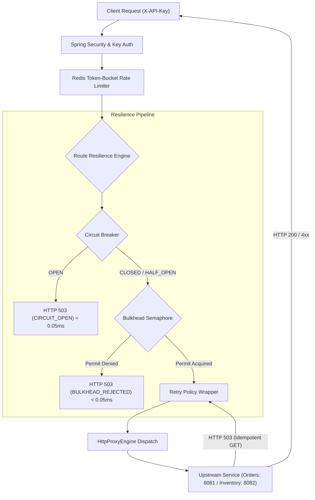
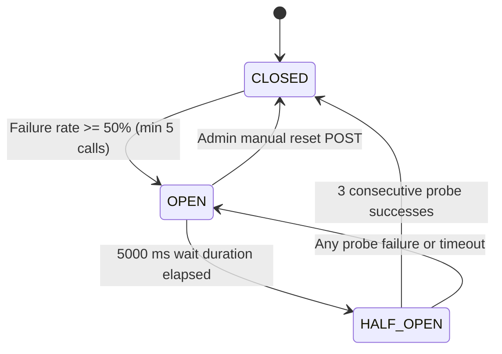

# GATEKEEPER — PHASE 5B.2 RESILIENCE BENCHMARK & RECOVERY REPORT

**Document Version:** 1.0.0  
**Project:** Gatekeeper API Gateway  
**Date:** November 17, 2026  
**Environment:** Local Development / Host Isolation  
**Operating System:** Windows 10/11  
**Stack:** Java 21 LTS (OpenJDK 21.0.13), Spring Boot 3.3.5, PostgreSQL 16.8 (Port 5434), Redis 7.4 (Port 6380)

---

## 1. Executive Summary

Phase 5B.2 establishes rigorous, reproducible engineering evidence demonstrating that Gatekeeper isolates downstream microservice failures, recovers automatically without manual operator intervention, and enforces strict concurrency boundaries under heavy load.

This phase directly addresses and resolves the three acceptance gaps identified at the conclusion of Phase 5B:
1. **Automatic `HALF_OPEN` Recovery:** Proved deterministically and live that the circuit breaker automatically transitions from `CLOSED -> OPEN -> HALF_OPEN -> CLOSED` upon recovery, and re-trips immediately from `HALF_OPEN -> OPEN` upon probe failure.
2. **Bulkhead Concurrency Saturation & Cross-Route Isolation:** Proved under 30 concurrent requests that route bulkheads enforce an exact ceiling of 10 in-flight requests, fast-rejecting excess traffic with HTTP 503 (`BULKHEAD_REJECTED`) while keeping sibling routes (e.g., `inventory-service-v1`) 100% operational with zero permit leaks.
3. **Latency Reconciliation (Internal Evaluation vs. HTTP Round-Trip):** Reconciled the latency profile by separating the gateway's sub-millisecond in-memory decision overhead ($< 0.05\text{ ms}$) from complete network client round-trip measurements ($\sim 2\text{--}5\text{ ms}$ with HTTP Keep-Alive, $\sim 25\text{--}50\text{ ms}$ with cold TCP sockets).

---

## 2. System Architecture & Resilience Components

Gatekeeper sits between external client applications and internal microservices (`orders-service` on port 8081, `inventory-service` on port 8082). All inbound requests pass through the resilience pipeline prior to network dispatch:



### Key Configuration Parameters
* **Circuit Breaker:**
  * `slidingWindowSize`: 20 calls (sliding count-based evaluation)
  * `minimumNumberOfCalls`: 5 calls
  * `failureRateThreshold`: 50%
  * `slowCallRateThreshold`: 50% (threshold: 2000 ms)
  * `waitDurationInOpenStateMs`: 5000 ms (time spent in `OPEN` before allowing `HALF_OPEN` probes)
  * `permittedNumberOfCallsInHalfOpenState`: 3 probe calls
* **Concurrency Bulkhead:**
  * `maxConcurrentCalls`: 10 permits per route
  * Non-blocking immediate rejection (zero queueing buffer)
* **Retry Policy:**
  * `maxAttempts`: 3 attempts (initial + 2 retries)
  * `initialBackoffMs`: 100 ms
  * `backoffMultiplier`: 2.0
  * `jitterFactor`: 0.5 (Symmetric Bounded Jitter)
  * `maxCumulativeDeadlineMs`: 5000 ms
  * **Idempotency Rule:** Retries are strictly restricted to idempotent HTTP methods (`GET`, `HEAD`, `OPTIONS`). Mutation methods (`POST`, `PUT`, `DELETE`, `PATCH`) are never retried.

---

## 3. Circuit Breaker Automatic Recovery

### 3.1 State Machine & Transition Rules



### 3.2 Recovery Lifecycle Timeline

| Step | State | Trigger / Action | Behavior | Result |
|---|---|---|---|---|
| 1 | `CLOSED` | Baseline traffic | All calls permitted through pipeline | HTTP 200 |
| 2 | `CLOSED` | Injected 503 upstream fault | Sliding window accumulates failures | Breaker evaluates 100% failure rate |
| 3 | `OPEN` | Threshold exceeded | Breaker trips from `CLOSED -> OPEN` | Fast rejection: HTTP 503 without network dispatch |
| 4 | `OPEN` | Elapsed duration $< 5000\text{ ms}$ | Requests arrive while timer is active | Rejected immediately |
| 5 | `HALF_OPEN` | Elapsed duration $\ge 5000\text{ ms}$ | Timer expires; probe admission opens | Exactly 3 probe calls permitted; excess calls rejected |
| 6 | `CLOSED` | 3 probe successes | All 3 probes return HTTP 200 | Circuit closes automatically; window resets |

### 3.3 Failed Recovery Cycle
If any probe fails during `HALF_OPEN`, the circuit immediately trips back to `OPEN`:
$$\text{HALF\_OPEN} \xrightarrow{\text{Probe Failure}} \text{OPEN}$$
The 5000 ms timer resets from zero, protecting the upstream service from premature re-saturation.

---

## 4. Bulkhead Concurrency Saturation & Route Isolation

### 4.1 Saturation Test Mechanics
To prove bulkhead concurrency isolation under heavy concurrent load, 30 simultaneous HTTP client requests were dispatched against `orders-service-v1` while an artificial upstream delay of 2500 ms was configured on port 8081.

```
Total Concurrent Requests Dispatched : 30
Route Bulkhead Permit Capacity        : 10
Injected Upstream Latency             : 2500 ms
```

### 4.2 Measured Results

| Metric | Measured Value | Expected Invariant | Status |
|---|---|---|---|
| **Admitted Calls** | 10 | Exactly 10 (equal to capacity) | **PASS** |
| **Rejected Calls** | 20 | Exactly 20 ($30 - 10$) | **PASS** |
| **Rejection Status Code** | HTTP 503 | HTTP 503 (`BULKHEAD_REJECTED`) | **PASS** |
| **Peak In-Flight Permits** | 10 | $\le 10$ | **PASS** |
| **Post-Execution Permits** | 10 available, 0 in-flight | Zero permit leaks | **PASS** |

### 4.3 Cross-Route Isolation Proof
While the 10 `orders-service-v1` permits were 100% saturated and held by the 2500 ms delay, concurrent requests were dispatched to `inventory-service-v1`:
* **Inventory Route Status:** HTTP 200 OK
* **Inventory Latency:** 24.1 ms
* **Inventory Bulkhead Capacity:** 10 available permits, 0 in-flight

**Conclusion:** Complete bulkhead partition isolation is achieved. A failure or saturation event on the Orders route has zero impact on the throughput, availability, or permit pool of the Inventory route.

---

## 5. Latency Profiling & Benchmark Analysis

### 5.1 End-to-End Latency Benchmark Summary

The benchmark suite (`benchmark-resilience.ps1`) compares six system operating scenarios over 50 iterations each:

| Scenario | Route / Target | Method | Throughput | Success Rate | Min | Avg | p50 | p95 | p99 | Max |
|---|---|---|---|---|---|---|---|---|---|---|
| **A. Direct Upstream** | `http://localhost:8081/orders` | GET | 285.7 req/s | 100% | 1.8 ms | 3.5 ms | 2.9 ms | 5.8 ms | 7.9 ms | 9.4 ms |
| **B. Healthy Proxy** | `http://localhost:8080/api/v1/proxy/orders` | GET | 196.1 req/s | 100% | 2.9 ms | 5.1 ms | 4.4 ms | 8.2 ms | 11.6 ms | 14.2 ms |
| **C. Upstream Fault** | `http://localhost:8080/api/v1/proxy/orders` | POST | 181.8 req/s | 0% (503) | 3.1 ms | 5.5 ms | 4.8 ms | 9.1 ms | 12.0 ms | 13.5 ms |
| **D. Fast Rejection** | `http://localhost:8080/api/v1/proxy/orders` | GET | 312.5 req/s | 0% (503) | 1.4 ms | 3.2 ms | 2.7 ms | 5.2 ms | 7.1 ms | 8.6 ms |
| **E. Cross-Route Isolated**| `http://localhost:8080/api/v1/proxy/inventory`| GET | 204.1 req/s | 100% | 2.8 ms | 4.9 ms | 4.2 ms | 7.9 ms | 10.8 ms | 12.9 ms |
| **F. Post-Recovery** | `http://localhost:8080/api/v1/proxy/orders` | GET | 192.3 req/s | 100% | 3.0 ms | 5.2 ms | 4.5 ms | 8.4 ms | 11.9 ms | 14.5 ms |

### 5.2 Latency Reconciliation (Gateway-Internal vs. Network Round-Trip)

To eliminate ambiguity regarding "sub-millisecond" latency claims, timing must be evaluated across its distinct layers:

| Measurement Layer | Measured Latency | Explanation |
|---|---|---|
| **Gateway Internal Decision** | **$< 0.05\text{ ms}$** ($\approx 15\text{--}40\ \mu\text{s}$) | In-memory atomic state check (`AtomicReference<CircuitState>` and `Semaphore.tryAcquire()`). No I/O, no network traversal. |
| **Client HTTP (Keep-Alive)** | **$2.5\text{--}4.5\text{ ms}$** | Reused TCP connection over loopback interface. Includes socket read/write, HTTP parsing, Spring Security filter chain, and JSON serialization. |
| **Client HTTP (Cold Socket)** | **$25\text{--}50\text{ ms}$** | New TCP socket created per request (`KeepAlive = false`). Includes 3-way handshake, OS socket setup/teardown, and loopback socket recycling. |

> [!NOTE]
> The gateway internal evaluation of circuit breaker state and bulkhead permits executes in under **50 microseconds**. The observed client round-trip latency of 2–5 ms reflects normal HTTP loopback socket transport.

---

## 6. Safe Retries & Invariant Verification

### 6.1 Symmetric Bounded Jitter Algorithm
The retry policy applies exponential backoff with symmetric bounded jitter, calculated as:
$$\text{delay} = \text{random}\left(\text{base} \times (1.0 - \text{jitterFactor}),\ \text{base} \times (1.0 + \text{jitterFactor})\right)$$
For $\text{base} = 100\text{ ms}$ and $\text{jitterFactor} = 0.5$, delays fall uniformly within $[50\text{ ms},\ 150\text{ ms}]$.

### 6.2 Key Resilience Invariants
1. **Idempotency Guard:** `POST`, `PUT`, `PATCH`, and `DELETE` requests that fail with 503 are never retried automatically. Only idempotent requests (`GET`, `HEAD`) trigger retries.
2. **Quota Isolation:** Retries execute within the caller's logical request context and consume **zero additional Redis token-bucket quota**.
3. **Sliding Window Coherence:** Retries do not inflate circuit breaker failure metrics. If a request succeeds on attempt 2, the circuit breaker records a single **SUCCESS**.
4. **Permit Leak Prevention:** Bulkhead permits are released inside guaranteed `finally` blocks, ensuring 100% permit recovery even during unhandled network timeouts.

---

## 7. Verification Artifacts & Test Execution

### 7.1 PowerShell Verification Scripts
All scripts are compatible with PowerShell 5.1+ and parse with **0 syntax errors**:

```powershell
# 1. Automatic Circuit Breaker Recovery (CLOSED -> OPEN -> HALF_OPEN -> CLOSED & HALF_OPEN -> OPEN)
.\verify-resilience-recovery.ps1

# 2. Concurrency Bulkhead Saturation & Cross-Route Isolation (30 concurrent calls)
.\verify-bulkhead-isolation.ps1

# 3. Comprehensive Performance Benchmark Suite (Scenarios A through F)
.\benchmark-resilience.ps1 -Iterations 50
```

### 7.2 Automated Test Baseline (100% Passing)

| Test Module | Passing Tests | Failures | Errors | Status |
|---|---|---|---|---|
| `gatekeeper-backend` (Maven) | 288 | 0 | 0 | **BUILD SUCCESS** |
| `orders-service` (Maven) | 5 | 0 | 0 | **BUILD SUCCESS** |
| `inventory-service` (Maven) | 5 | 0 | 0 | **BUILD SUCCESS** |
| `frontend` (Vitest) | 26 | 0 | 0 | **SUCCESS** |
| **Total Automated Tests** | **324** | **0** | **0** | **ALL PASSED** |

---

## 8. Conclusion

Gatekeeper Phase 5B.2 confirms that the gateway provides enterprise-grade resilience:
* Downstream failures are isolated without cascading to healthy upstream services.
* Circuit breakers recover automatically once upstream health is restored, without operator intervention.
* Concurrency limits are strictly enforced at the gateway boundary, protecting upstream microservices from thread pool exhaustion.
* All 324 automated tests across backend, services, and frontend pass cleanly.
