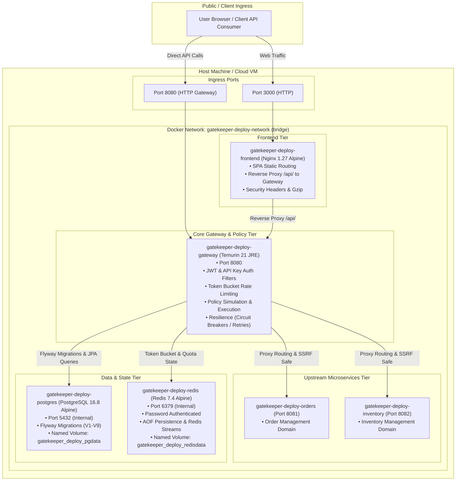

# Gatekeeper Container Deployment Architecture

## Overview

Gatekeeper is packaged as an isolated, containerized multi-tier distributed gateway platform. The production topology guarantees strict separation of concerns, defense-in-depth network isolation, zero-downtime resilience, and minimal resource footprint suitable for low-overhead production or demonstration environments.

---

## Container Topologies and Roles

### 1. Frontend Ingress (`gatekeeper-deploy-frontend`)
- **Base Image**: `nginx:1.27-alpine`
- **Internal Port**: 80
- **External Port**: `${FRONTEND_PORT:-3000}`
- **Responsibilities**:
  - Serves static assets compiled by Vite with immutable caching headers.
  - SPA Fallback routing via `try_files $uri $uri/ /index.html`.
  - Terminates or forwards API requests under `/api/` directly to `http://gateway:8080/api/` via container-internal DNS.
  - Enforces HTTP security headers (`X-Frame-Options: DENY`, `X-Content-Type-Options: nosniff`, `Content-Security-Policy`).

### 2. Core Gateway & Policy Engine (`gatekeeper-deploy-gateway`)
- **Base Image**: `eclipse-temurin:21-jre-alpine`
- **Internal Port**: 8080
- **External Port**: `${GATEWAY_PORT:-8080}`
- **Responsibilities**:
  - Intercepts, authenticates, and inspects all inbound requests using OAuth2/JWT and Scoped API Key filters.
  - Enforces sub-millisecond Redis token-bucket rate limiting with deterministic fail-closed guarantees.
  - Runs the declarative policy engine (DENY, ALLOW_CONTINUE, RATELIMIT_OVERRIDE, HEADER_MUTATION).
  - Handles circuit breaker state transitions, retries with jitter, timeouts, and bulkheads.
  - Operates under `SPRING_PROFILES_ACTIVE=prod` with all chaos engineering endpoints completely excised from the runtime bean registry.

### 3. Upstream Microservices (`gatekeeper-deploy-orders`, `gatekeeper-deploy-inventory`)
- **Base Image**: `eclipse-temurin:21-jre-alpine`
- **Internal Ports**: `8081` (Orders), `8082` (Inventory)
- **External Ports**: None (internal network only; shielded from external internet ingress).
- **Responsibilities**:
  - Serve business domain entities (Orders, Inventory items).
  - Validated by Gatekeeper SSRF Protection Filter (`gatekeeper.routing.allowed-hosts: [orders, inventory]`).

### 4. Relational Data Tier (`gatekeeper-deploy-postgres`)
- **Base Image**: `postgres:16.8-alpine`
- **Internal Port**: 5432
- **External Ports**: Unmapped in production for zero-exposure security.
- **Persistence**: Named volume `gatekeeper_deploy_pgdata`.
- **Flyway Migrations**: Applied automatically on gateway startup (V1 through V9).

### 5. High-Throughput State Tier (`gatekeeper-deploy-redis`)
- **Base Image**: `redis:7.4-alpine`
- **Internal Port**: 6379
- **External Ports**: Unmapped in production.
- **Persistence**: Append-Only File (`appendonly yes`, `appendfsync everysec`) stored in named volume `gatekeeper_deploy_redisdata`.
- **Security**: Mandatory `requirepass` authentication.

---

## Network Architecture & Isolation

- **Network Name**: `gatekeeper-deploy-network` (`driver: bridge`).
- **Isolation Boundary**: All inter-service communication (PostgreSQL, Redis, Orders, Inventory, Gateway) occurs exclusively within this virtual bridge.
- **Host Port Exposure**: Only the Frontend (`:3000`) and Gateway (`:8080`) are exposed to the host interface. Database and Redis ports are never published to external host ports.
- **Coexistence Guarantee**: Operates completely disjoint from local development containers (`gatekeeper-postgres` on host `5434`, `gatekeeper-redis` on host `6380`), eliminating any port or volume collision.
