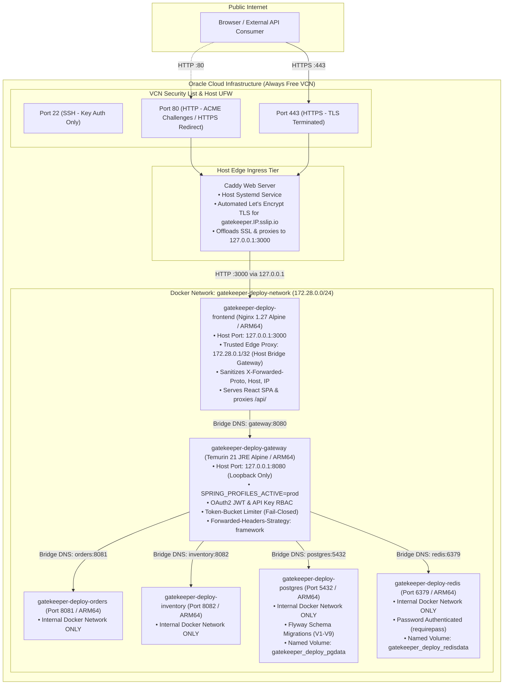

# Gatekeeper Zero-Cost Deployment Architecture (Oracle Cloud Always Free)

## Executive Summary

This architecture establishes a **₹0 / $0 recurring hosting cost** production topology for the Gatekeeper enterprise API gateway on Oracle Cloud Infrastructure (OCI) Always Free tier. It utilizes an **Ampere A1 ARM64** compute instance, **sslip.io** wildcard DNS resolution, and automated **Let's Encrypt TLS via Caddy**.

---

## 1. Oracle Cloud Always Free Resource Entitlements & Console Quotas

Official Oracle Cloud documentation establishes the following Always Free resource limits:

| Resource Dimension | Official Always Free Allowance | Gatekeeper Proposed Allocation | Tenancy Quota Verification Requirement |
|---|---|---|---|
| **Ampere A1 Compute** | Up to 4 OCPUs & 24 GB RAM tenancy pool (3,000 OCPU-hrs / 18,000 GB-hrs/month) | **2 OCPUs & 12 GB RAM** (`VM.Standard.A1.Flex`) | **Must verify in OCI Console** under *Limits, Quotas and Usage* before provisioning |
| **Block Volume Storage** | 200 GB total across tenancy (Boot + Block Volumes) | **50 GB Boot Volume** | Verify total storage does not exceed 200 GB across all volumes |
| **Outbound Data Transfer** | 10 TB / month free across all services | < 50 GB / month (Estimated API + SPA traffic) | Monitor in OCI Billing / Usage reports |
| **Public IPv4 Address** | 1 free ephemeral or reserved IPv4 | **1 Dedicated Ephemeral/Reserved IPv4** | Verify no additional reserved IPs are allocated |
| **Cloud Firewalls** | Unlimited Virtual Cloud Network Security Lists | Port 22 (SSH), 80 (HTTP), 443 (HTTPS) only | All internal microservice & DB ports dropped |

> [!IMPORTANT]
> **Entitlement & Quota Verification Notice**:
> - The 4 OCPU / 24 GB allowance represents the **total tenancy pool** for Ampere A1 resources. Sizing our production host at **2 OCPUs and 12 GB RAM** consumes approximately 1,488 OCPU-hours and 8,928 GB-hours per 31-day month.
> - Actual available quotas vary by region and tenancy status. Operators must never assume quotas are granted automatically; check **Governance & Administration -> Limits, Quotas and Usage -> Compute -> Cores for Standard.A1 Based VM and BM Instances** in the OCI Console.
> - **Zero-Cost Policy**: Estimated resource usage alone does not guarantee a ₹0 invoice. The operator must adhere to the billable-risk checklist below to avoid incidental charges.

---

## 2. Billable Resource Risks & Prevention Checklist

To ensure strict ₹0 recurring cost, the following risks must be actively managed:

| Billable Resource Risk | Failure Mode | Prevention Control |
|---|---|---|
| **Paid Shape Selection** | Selecting Intel/AMD shapes (e.g. `VM.Standard3.Flex`, `VM.Standard.E4.Flex`) | Only select **Ampere `VM.Standard.A1.Flex`** bearing the "Always Free Eligible" badge. |
| **Storage Over-Allocation** | Allocating default or custom boot volumes exceeding 200 GB total across tenancy | Specify custom boot volume size: **50 GB**. Do not create unnecessary block volumes. |
| **Orphaned Boot Volumes** | Deleting a VM while leaving its boot volume detached in the tenancy | When terminating an instance, always check: **"Permanently delete the attached boot volume"**. |
| **Additional Public IPv4** | Allocating secondary reserved public IPs | Use only the **1 free public IPv4** assigned at instance creation. Never allocate additional reserved IPs. |
| **Paid Cloud Services** | Provisioning a standard Flexible Load Balancer or paid OCI Database | Ingress is terminated natively on-host via **Caddy**; no OCI Load Balancer is provisioned. |
| **Billing Alerts** | Resource drift unnoticed until invoice generation | Set an OCI Budget alert at **$1.00 (or ₹100)** with email notification at 10% spend forecast. |

---

## 3. Provider Idle Reclamation Policy & Disaster Recovery

### OCI Always Free Idle Instance Policy
Under official Oracle terms, Always Free compute instances are monitored on a rolling 7-day window. An instance is classified as idle if:
1. 95th percentile CPU utilization is below 20%.
2. Network utilization is below 20%.
3. Memory utilization is below 20% (for Ampere A1 shapes).

If classified as idle, Oracle may stop or reclaim the instance after notification.

### Safe Engineering Response (No Artificial Load Inflation)
- **Do NOT deploy artificial heartbeat scripts, fake load generators, or synthetic ping loops** to trick cloud monitoring systems.
- Rely on legitimate operator, API consumer, and dashboard traffic.
- Design for recovery: Assume the VM can be terminated or stopped by the cloud provider.
- Implement automated off-host backups (`pg_dump` exported to developer workstation or OCI 10 GB free Object Storage).
- Maintain an executable, tested runbook (`docs/deployment/oracle-first-deployment-runbook.md`) allowing complete redeployment from Git and database restore in under 15 minutes.

---

## 4. End-to-End System Topology

---

## 5. Host Resource Allocation on 2 OCPU / 12 GB RAM

| Service / Layer | Memory Reservation | Memory Hard Ceiling | CPU Allocation | Storage Usage |
|---|---|---|---|---|
| **Linux OS (Ubuntu 24.04 ARM64)** | ~600 MB | ~1,000 MB | 0.25 vCPU | ~4.0 GB |
| **Caddy TLS Proxy** | 64 MB | 128 MB | 0.25 vCPU | ~100 MB |
| **`gateway`** (Java 21 / Spring Boot) | 384 MB | 768 MB | 1.0 vCPU | ~350 MB |
| **`orders`** (Java 21 microservice) | 192 MB | 384 MB | 0.5 vCPU | ~300 MB |
| **`inventory`** (Java 21 microservice) | 192 MB | 384 MB | 0.5 vCPU | ~300 MB |
| **`postgres`** (PostgreSQL 16) | 256 MB | 512 MB | 0.5 vCPU | ~2.0 GB (Data volume) |
| **`redis`** (Redis 7) | 128 MB | 256 MB | 0.5 vCPU | ~256 MB (AOF volume) |
| **`frontend`** (Nginx / SPA) | 64 MB | 128 MB | 0.5 vCPU | ~50 MB |
| **Log Rotation & Backups** | N/A | N/A | N/A | ~5.0 GB |
| **Total Stack Allocated** | **~1.88 GB** | **~3.56 GB** | **3.75 vCPUs** | **~12.3 GB of 50 GB** |
| **Available Host Memory Buffer** | **~10.12 GB** | **~8.44 GB** | **Conservative load profile** | **> 37 GB free disk** |
