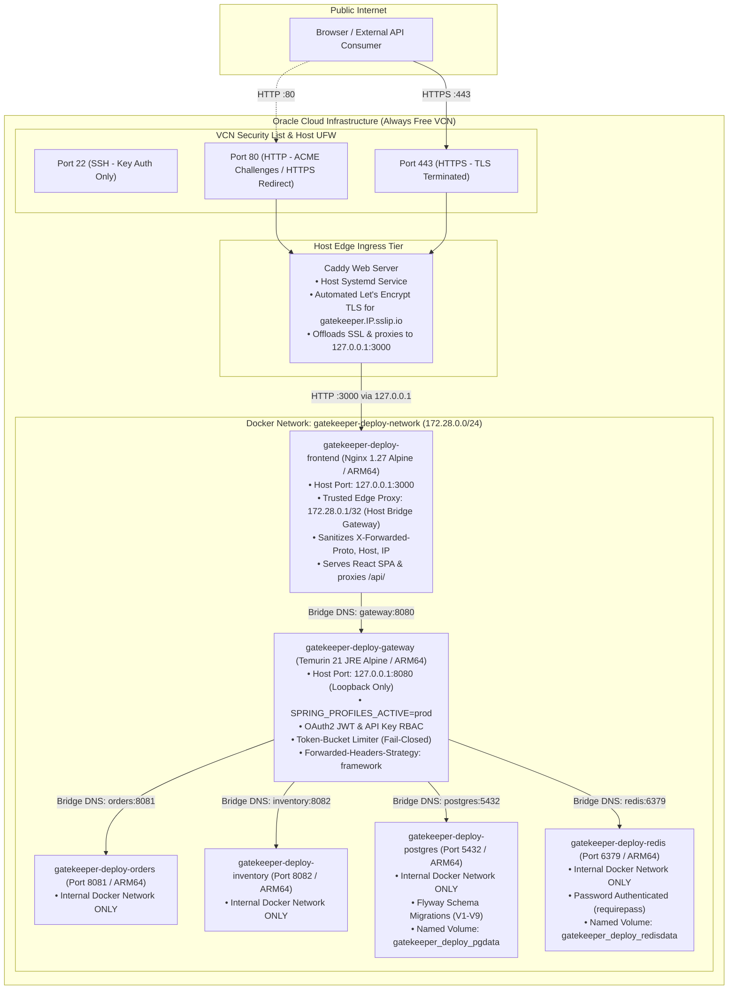

# Gatekeeper Zero-Cost Deployment Architecture (Oracle Cloud Always Free)

## Executive Summary

This architecture establishes a **₹0 / $0 recurring hosting cost** production topology for the Gatekeeper enterprise API gateway on Oracle Cloud Infrastructure (OCI) Always Free tier. It utilizes an **Ampere A1 ARM64** compute instance, **sslip.io** wildcard DNS resolution, and automated **Let's Encrypt TLS via Caddy**.

---

## 1. Verified Oracle Cloud Always Free Specifications

| Resource Dimension | Always Free Allowance | Gatekeeper Proposed Allocation | Safety Buffer / Remaining Headroom |
|---|---|---|---|
| **Ampere A1 Compute** | 4 OCPUs & 24 GB RAM (3,000 OCPU-hrs / 18,000 GB-hrs/mo) | **2 OCPUs & 12 GB RAM** | 2 OCPUs & 12 GB RAM (50% headroom retained) |
| **Block Volume Storage** | 200 GB total (Boot + Block Volumes) | **50 GB Boot Volume** | 150 GB storage available |
| **Outbound Data Transfer** | 10 TB / month free | < 50 GB / month (Estimated) | > 9,950 GB / month bandwidth remaining |
| **Public IPv4 Address** | 1 free ephemeral or reserved IPv4 | **1 Dedicated Public IPv4** | Included at ₹0 |
| **Cloud Firewalls** | Unlimited VCN Security Lists / NSGs | Port 22 (SSH), 80 (HTTP), 443 (HTTPS) | All internal ports blocked |

---

## 2. Zero-Cost Risk Analysis & Mitigation

### A. Idle Instance Reclamation
- **Policy**: Oracle automatically reclaims Always Free compute instances if over a 7-day rolling window:
  - 95th percentile CPU utilization is below 20%.
  - Network utilization is below 20%.
  - Memory utilization is below 20% (for A1 shapes).
- **Mitigation Strategy**:
  1. **Primary**: Upgrade the OCI account to **Pay-As-You-Go (PAYG)** after initial verification. In PAYG status, Always Free resource allowances remain 100% free (zero charge as long as usage is within the free limits), but instances are permanently immune to idle reclamation.
  2. **Secondary**: Deploy a lightweight systemd background heartbeat timer executing synthetic local health checks against `/api/v1/health` and Actuator metrics every 15 minutes.

### B. Regional Capacity Availability ("Out of Capacity")
- **Risk**: In high-demand regions (e.g. Mumbai, Hyderabad, Frankfurt, Ashburn), Ampere A1 shapes may occasionally return "Out of capacity for shape VM.Standard.A1.Flex".
- **Mitigation Strategy**: If immediate A1 capacity is constrained, choose alternate availability domains or retry provisioning via OCI CLI loop.

### C. Credit Card Verification
- **Policy**: Registration requires a credit card for identity verification ($1 temporary authorization hold reversed immediately).
- **Zero-Cost Guarantee**: Setting zero billing alarms and strict budget limits in the OCI billing console guarantees zero surprise charges.

---

## 3. End-to-End System Topology

---

## 4. Resource Allocation on 2 OCPU / 12 GB RAM Host

| Service / Layer | Memory Reservation | Memory Hard Ceiling | CPU Allocation | Storage Usage |
|---|---|---|---|---|
| **Linux OS (Ubuntu 24.04 ARM64)** | ~600 MB | ~1,000 MB | 0.25 vCPU | ~4.0 GB |
| **Caddy TLS Proxy** | 64 MB | 128 MB | 0.25 vCPU | ~100 MB |
| **`gateway`** (Java 21 / Spring Boot) | 384 MB | 768 MB | 1.0 vCPU | ~350 MB |
| **`orders`** (Java 21 microservice) | 192 MB | 384 MB | 0.5 vCPU | ~300 MB |
| **`inventory`** (Java 21 microservice) | 192 MB | 384 MB | 0.5 vCPU | ~300 MB |
| **`postgres`** (PostgreSQL 16) | 256 MB | 512 MB | 0.5 vCPU | ~2.0 GB (Data volume) |
| **`redis`** (Redis 7) | 128 MB | 256 MB | 0.5 vCPU | ~256 MB (AOF volume) |
| **`frontend`** (Nginx / SPA) | 64 MB | 128 MB | 0.5 vCPU | ~50 MB |
| **Log Rotation & Backups** | N/A | N/A | N/A | ~5.0 GB |
| **Total Stack Allocated** | **~1.88 GB** | **~3.56 GB** | **3.75 vCPUs** | **~12.3 GB of 50 GB** |
| **Free Host Buffer** | **~10.12 GB** | **~8.44 GB** | **Substantial Headroom** | **> 37 GB free disk** |
