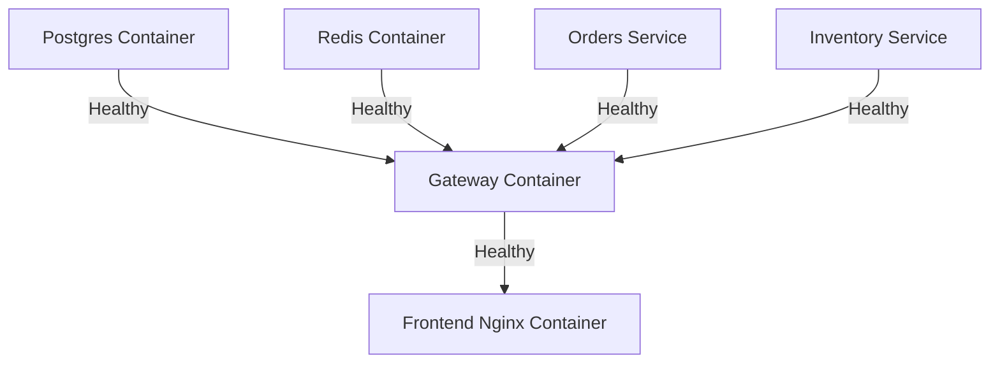

# Gatekeeper Production Readiness & Operational Checklist

This document details the hardening principles, resource ergonomics, operational controls, and disaster recovery procedures implemented for Gatekeeper production deployments.

---

## 1. Security Hardening & Zero-Chaos Posture

### A. Strict Profile Exclusion
- **Defect Neutralization**: Previously, `@Profile({"default", "local", "test", "dev"})` allowed chaos engineering controllers and fault injection endpoints to load when no profile was specified.
- **Production Hardening**: The `"default"` profile has been completely excised across all 16 chaos and fault injection classes in `backend`, `orders-service`, and `inventory-service`.
- **Default Behavior**: Running without `--spring.profiles.active` loads standard production defaults where zero chaos beans exist in the Spring ApplicationContext.
- **Access Lockout**: Attempting to invoke `/api/v1/chaos/**` or `/fault-injection/**` in production yields `HTTP 404 Not Found`. `ChaosSafetyGuard.validateEnvironment()` additionally enforces programmatic rejection (`SecurityException`) if invoked outside explicit `local`, `test`, or `dev` profiles.

### B. Container Runtime Privileges & Ownership
- **Gateway & Upstream Microservices**: Execute 100% as non-root user `appuser:appgroup` (UID/GID `10001:10001`). Application binaries and work directories (`/app`) are read-only to non-privileged processes.
- **Frontend Nginx Container**: Nginx master process starts to bind port 80 and immediately drops all worker process execution to unprivileged user `nginx` (UID 101). Web root (`/usr/share/nginx/html`) is set to `755` permissions with `nginx:nginx` ownership.

### C. Network Ingress & Secret Isolation
- **Ingress Boundary**: Only the Frontend Nginx reverse proxy (`${FRONTEND_PORT:-3000}:80`) is exposed publicly.
- **Gateway Loopback Default**: The Gateway port is bound to `127.0.0.1:${GATEWAY_PORT:-8080}:8080` by default, preventing direct public bypass of Nginx security headers and rate limits.
- **Zero Exposed Internal Ports**: PostgreSQL (5432), Redis (6379), Orders (8081), and Inventory (8082) are unmapped to host interfaces and communicate exclusively over the internal `gatekeeper-deploy-network` bridge.
- **Zero Baked Secrets**: No secrets exist in Docker images or source control. Mandatory runtime variables (`POSTGRES_PASSWORD`, `REDIS_PASSWORD`, `GATEKEEPER_JWT_SECRET`) enforce container termination on startup if omitted (`:?`).

---

## 2. JVM Resource Ergonomics & Low-Memory Tuning

### Host Constraint Context
The developer workstation has ~7.5 GB RAM and previously suffered Windows Error 1455 (`ERROR_COMMITMENT_LIMIT`) when running unbounded Maven processes and Docker containers simultaneously.

### Implemented JVM Mitigations

1. **CGroup-Aware RAM Percentage**:
   ```bash
   -XX:MaxRAMPercentage=75.0 -XX:InitialRAMPercentage=50.0
   ```
   The JVM dynamically calculates heap ceilings based on the container's cgroup memory limit rather than static `-Xmx` values.

2. **Immediate Fail-Fast on Allocation Failure**:
   ```bash
   -XX:+ExitOnOutOfMemoryError
   ```
   Prevents unresponsive thrashing when native memory or heap is exhausted. The orchestrator immediately restarts the faulted container.

3. **Garbage Collection Optimization**:
   ```bash
   -XX:+UseG1GC
   ```
   G1GC provides predictable pause times, compacts memory, and returns unused heap pages back to the host operating system.

4. **Fast Secure Entropy**:
   ```bash
   -Djava.security.egd=file:/dev/./urandom
   ```
   Prevents JVM thread blocking on headless Linux kernels during cryptographic operations.

### Container Resource Budget (Estimated ~2.4 GB Total)

| Container | Memory Limit | Memory Reservation | CPU Limit | Rationale |
|---|---|---|---|---|
| `gateway` | 768 MB | 384 MB | 1.0 | Core routing, rate limiting, and JPA operations. |
| `orders` | 384 MB | 192 MB | 0.5 | Domain microservice; in-memory data store. |
| `inventory` | 384 MB | 192 MB | 0.5 | Domain microservice; in-memory data store. |
| `postgres` | 512 MB | 256 MB | 0.5 | Relational persistence with moderate connection pool. |
| `redis` | 256 MB | 128 MB | 0.5 | In-memory token bucket and stream buffers. |
| `frontend` | 128 MB | 64 MB | 0.5 | Nginx static asset serving and reverse proxying. |
| **Total Stack** | **~2,432 MB (~2.4 GB)** | **~1,216 MB (~1.2 GB)** | **3.5 CPUs** | Sizing budget designed for resource-constrained nodes. |

*Note: Sizing allocations are baseline estimates. Real-world high-concurrency loads require empirical capacity testing.*

---

## 3. Healthchecks & Startup Sequencing

Every container defines an internal, unauthenticated, lightweight HTTP probe:
- **Postgres**: `pg_isready -U gatekeeper_app -d gatekeeper` (Interval: 5s, Retries: 5)
- **Redis**: `redis-cli -a "$REDIS_PASSWORD" ping` (Interval: 5s, Retries: 5)
- **Orders**: `wget -qO- http://localhost:8081/health | grep -q "UP"` (Interval: 10s, Retries: 5)
- **Inventory**: `wget -qO- http://localhost:8082/health | grep -q "UP"` (Interval: 10s, Retries: 5)
- **Gateway**: `wget -qO- http://localhost:8080/api/v1/health | grep -q "UP"` (Interval: 10s, Retries: 5)
- **Frontend**: `wget -qO- http://localhost:80/healthz` (Interval: 10s, Retries: 3)

### Startup Dependency Graph


Gateway waits for Postgres, Redis, Orders, and Inventory to report `healthy` before attempting Flyway migrations and route binding. Frontend accepts public ingress only after Gateway is healthy.

---

## 4. Reverse Proxy, Proxy Headers & TLS Termination

### Forwarded Headers & Ingress
- Nginx forwards client IP and protocol via:
  ```nginx
  proxy_set_header X-Real-IP $remote_addr;
  proxy_set_header X-Forwarded-For $proxy_add_x_forwarded_for;
  proxy_set_header X-Forwarded-Proto $scheme;
  ```
- Gateway parses forwarded headers via Spring Boot framework integration:
  ```yaml
  server:
    forward-headers-strategy: framework
  ```

### TLS Termination Requirements
In production, HTTPS must terminate at an edge reverse proxy (such as Cloudflare, AWS ALB, Caddy, or an external Nginx Certbot instance) before reaching the Frontend container. When TLS terminates upstream, the edge proxy must set `X-Forwarded-Proto: https` so that Gatekeeper generates secure redirects and links.

---

## 5. Backup & Disaster Recovery Procedures

### A. PostgreSQL Persistence & Snapshots
- Data resides in named Docker volume `gatekeeper_deploy_pgdata`.
- **Scheduled Backup Command**:
  ```bash
  docker exec -t gatekeeper-deploy-postgres pg_dump -U gatekeeper_app -Fc gatekeeper > /backups/gatekeeper_$(date +%Y%m%d_%H%M%S).dump
  ```
- **Disaster Restoration**:
  ```bash
  docker exec -i gatekeeper-deploy-postgres pg_restore -U gatekeeper_app -d gatekeeper --clean /backups/gatekeeper_backup.dump
  ```

### B. Redis Token-Bucket State
- Configured with Append-Only File (`appendonly yes`, `appendfsync everysec`) in volume `gatekeeper_deploy_redisdata`.
- In the event of catastrophic Redis corruption, restarting the Redis container re-initializes clean rate-limiting quotas without causing application failure (fail-closed protection guarantees zero rate-limit bypass).

### C. Flyway Schema Healing
If a migration fails during deployment due to transient network interruption:
```bash
mvn flyway:repair -f backend/pom.xml
```

---

## 6. Local Validation vs CI Status

- **Developer Host Headroom**: Physical host memory is currently constrained (~950 MB free), preventing concurrent execution of a second 6-container Docker Compose stack on Windows.
- **CI Build & Runtime Gate**: The GitHub Actions workflow (`.github/workflows/ci.yml`) executes the complete build, test, Flyway migration, and Docker build pipeline in an isolated Linux runner with 16 GB of memory and disposable service containers.
