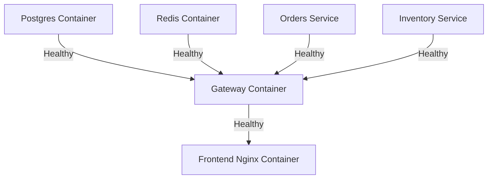

# Gatekeeper Production Readiness & Operational Checklist

This document details the hardening principles, resource ergonomics, operational controls, and disaster recovery procedures implemented for Gatekeeper production deployments.

---

## 1. Security Hardening & Zero-Chaos Posture

### A. Strict Profile Exclusion
- **Defect Neutralization**: Previously, `@Profile({"default", "local", "test", "dev"})` allowed chaos engineering controllers and fault injection endpoints to load when no profile was specified.
- **Production Hardening**: The `"default"` profile has been completely excised across all 16 chaos and fault injection classes in `backend`, `orders-service`, and `inventory-service`.
- **Default Behavior**: Running without `--spring.profiles.active` loads standard production defaults where zero chaos beans exist in the Spring ApplicationContext.
- **Access Lockout**: Attempting to invoke `/api/v1/chaos/**` or `/fault-injection/**` in production yields `HTTP 404 Not Found`. `ChaosSafetyGuard.validateEnvironment()` additionally enforces programmatic rejection (`SecurityException`) if invoked outside explicit `local`, `test`, or `dev` profiles.

### B. Container Runtime Privileges & Ownership
- **Gateway & Upstream Microservices**: Execute 100% as non-root user `appuser:appgroup` (UID/GID `10001:10001`). Application binaries and work directories (`/app`) are read-only to non-privileged processes.
- **Frontend Nginx Container**: Nginx master process starts to bind port 80 and immediately drops all worker process execution to unprivileged user `nginx` (UID 101). Web root (`/usr/share/nginx/html`) is set to `755` permissions with `nginx:nginx` ownership.

### C. Network Ingress & Secret Isolation
- **Ingress Boundary**: Only the Frontend Nginx reverse proxy (`${FRONTEND_PORT:-3000}:80`) is exposed publicly.
- **Gateway Loopback Default**: The Gateway port is bound to `127.0.0.1:${GATEWAY_PORT:-8080}:8080` by default, preventing direct public bypass of Nginx security headers and rate limits.
- **Zero Exposed Internal Ports**: PostgreSQL (5432), Redis (6379), Orders (8081), and Inventory (8082) are unmapped to host interfaces and communicate exclusively over the internal `gatekeeper-deploy-network` bridge.
- **Zero Baked Secrets**: No secrets exist in Docker images or source control. Mandatory runtime variables (`POSTGRES_PASSWORD`, `REDIS_PASSWORD`, `GATEKEEPER_JWT_SECRET`) enforce container termination on startup if omitted (`:?`).

---

## 2. JVM Resource Ergonomics & Low-Memory Tuning

### Host Constraint Context
The developer workstation has ~7.5 GB RAM and previously suffered Windows Error 1455 (`ERROR_COMMITMENT_LIMIT`) when running unbounded Maven processes and Docker containers simultaneously.

### Implemented JVM Mitigations

1. **CGroup-Aware RAM Percentage**:
   ```bash
   -XX:MaxRAMPercentage=75.0 -XX:InitialRAMPercentage=50.0
   ```
   The JVM dynamically calculates heap ceilings based on the container's cgroup memory limit rather than static `-Xmx` values.

2. **Immediate Fail-Fast on Allocation Failure**:
   ```bash
   -XX:+ExitOnOutOfMemoryError
   ```
   Prevents unresponsive thrashing when native memory or heap is exhausted. The orchestrator immediately restarts the faulted container.

3. **Garbage Collection Optimization**:
   ```bash
   -XX:+UseG1GC
   ```
   G1GC provides predictable pause times, compacts memory, and returns unused heap pages back to the host operating system.

4. **Fast Secure Entropy**:
   ```bash
   -Djava.security.egd=file:/dev/./urandom
   ```
   Prevents JVM thread blocking on headless Linux kernels during cryptographic operations.

### Container Resource Budget (Estimated ~2.4 GB Total)

| Container | Memory Limit | Memory Reservation | CPU Limit | Rationale |
|---|---|---|---|---|
| `gateway` | 768 MB | 384 MB | 1.0 | Core routing, rate limiting, and JPA operations. |
| `orders` | 384 MB | 192 MB | 0.5 | Domain microservice; in-memory data store. |
| `inventory` | 384 MB | 192 MB | 0.5 | Domain microservice; in-memory data store. |
| `postgres` | 512 MB | 256 MB | 0.5 | Relational persistence with moderate connection pool. |
| `redis` | 256 MB | 128 MB | 0.5 | In-memory token bucket and stream buffers. |
| `frontend` | 128 MB | 64 MB | 0.5 | Nginx static asset serving and reverse proxying. |
| **Total Stack** | **~2,432 MB (~2.4 GB)** | **~1,216 MB (~1.2 GB)** | **3.5 CPUs** | Sizing budget designed for resource-constrained nodes. |

*Note: Sizing allocations are baseline estimates. Real-world high-concurrency loads require empirical capacity testing.*

---

## 3. Healthchecks & Startup Sequencing

Every container defines an internal, unauthenticated, lightweight HTTP probe:
- **Postgres**: `pg_isready -U gatekeeper_app -d gatekeeper` (Interval: 5s, Retries: 5)
- **Redis**: `redis-cli -a "$REDIS_PASSWORD" ping` (Interval: 5s, Retries: 5)
- **Orders**: `wget -qO- http://localhost:8081/health | grep -q "UP"` (Interval: 10s, Retries: 5)
- **Inventory**: `wget -qO- http://localhost:8082/health | grep -q "UP"` (Interval: 10s, Retries: 5)
- **Gateway**: `wget -qO- http://localhost:8080/api/v1/health | grep -q "UP"` (Interval: 10s, Retries: 5)
- **Frontend**: `wget -qO- http://localhost:80/healthz` (Interval: 10s, Retries: 3)

### Startup Dependency Graph


Gateway waits for Postgres, Redis, Orders, and Inventory to report `healthy` before attempting Flyway migrations and route binding. Frontend accepts public ingress only after Gateway is healthy.

---

## 4. Reverse Proxy, Proxy Headers & TLS Termination

### Narrowly Defined Trusted Edge Proxy Architecture
To prevent header spoofing attacks while supporting upstream TLS termination (e.g., Caddy, AWS ALB, Cloudflare, Traefik), `frontend/nginx.conf` implements a strictly scoped **Trusted Edge Proxy Model**. Broad RFC 1918 CIDRs (`10.0.0.0/8`, `172.16.0.0/12`, `192.168.0.0/16`) are explicitly disallowed because trusting entire private blocks would allow sibling containers or adjacent cloud VPC tenants to forge client identity, host, or protocol state.

```nginx
geo $remote_addr $trusted_edge_proxy {
    default 0;
    127.0.0.1 1;
    ::1 1;
    # Deployment-specific trusted edge proxy addresses:
    # Operators: Add specific, dedicated static ingress proxy IPs or narrow /32 /28 subnets here.
    # Broad RFC 1918 CIDRs (10.0.0.0/8, 172.16.0.0/12, 192.168.0.0/16) MUST NOT be added.
    # Example:
    # 192.0.2.10/32 1;        # Dedicated cloud ingress load balancer
    # 172.28.0.2/32 1;        # Specific upstream edge proxy container IP
}

# --- Protocol Sanitization ---
map $http_x_forwarded_proto $edge_proto {
    default $http_x_forwarded_proto;
    ""      $scheme;
}

map $trusted_edge_proxy $forwarded_proto {
    1       $edge_proto;
    default $scheme;
}

# --- Host Header Sanitization ---
map $http_x_forwarded_host $edge_host {
    default $http_x_forwarded_host;
    ""      $host;
}

map $trusted_edge_proxy $forwarded_host {
    1       $edge_host;
    default $host;
}

# --- Client IP Sanitization ---
map $trusted_edge_proxy $forwarded_for {
    1       $proxy_add_x_forwarded_for;
    default $remote_addr;
}
```

### Security Behaviors Under Ingress Scenarios:
1. **Direct Untrusted Client Connections**:
   When a client connects directly to Nginx over HTTP, `$trusted_edge_proxy` evaluates to `0`. Nginx strictly enforces:
   - `X-Forwarded-Proto`: Set to connection `$scheme` (`http`), stripping client-supplied `https`.
   - `X-Forwarded-Host`: Set to connection `$host`, preventing Host header injection attacks.
   - `X-Forwarded-For`: Set to connection `$remote_addr`, discarding any forged IP chain.
2. **Legitimate HTTPS Behind Explicit Edge Proxy (Caddy / ALB / Cloudflare)**:
   When an edge proxy terminates TLS and connects from an explicitly declared trusted IP or loopback, `$trusted_edge_proxy` evaluates to `1`. Nginx preserves:
   - `X-Forwarded-Proto`: Preserves `https` forwarded from edge.
   - `X-Forwarded-Host`: Preserves original domain name requested by client.
   - `X-Forwarded-For`: Appends client and proxy hops via `$proxy_add_x_forwarded_for`.
3. **Malicious Sibling Container / Network Spoofing**:
   If an adjacent container on the Docker network or LAN attempts to send forged headers, `$trusted_edge_proxy` evaluates to `0` because internal Docker bridge ranges are not implicitly trusted. The forged headers are neutralized.

### Spring Boot Forwarded Header Strategy
The Gateway backend consumes these sanitized headers through:
```yaml
server:
  forward-headers-strategy: framework
```
Verified via automated integration test `ForwardedHeaderSecurityTest` and Nginx configuration test `nginxSecurityConfig.test.ts`.

---

## 5. Backup & Disaster Recovery Procedures

### A. PostgreSQL Persistence & Snapshots
- Data resides in named Docker volume `gatekeeper_deploy_pgdata`.
- **Scheduled Backup Command**:
  ```bash
  docker exec -t gatekeeper-deploy-postgres pg_dump -U gatekeeper_app -Fc gatekeeper > /backups/gatekeeper_$(date +%Y%m%d_%H%M%S).dump
  ```
- **Disaster Restoration**:
  ```bash
  docker exec -i gatekeeper-deploy-postgres pg_restore -U gatekeeper_app -d gatekeeper --clean /backups/gatekeeper_backup.dump
  ```

### B. Redis Token-Bucket State
- Configured with Append-Only File (`appendonly yes`, `appendfsync everysec`) in volume `gatekeeper_deploy_redisdata`.
- In the event of catastrophic Redis corruption, restarting the Redis container re-initializes clean rate-limiting quotas without causing application failure (fail-closed protection guarantees zero rate-limit bypass).

### C. Flyway Schema Healing
If a migration fails during deployment due to transient network interruption:
```bash
mvn flyway:repair -f backend/pom.xml
```

---

## 6. Local Validation vs CI Status

- **Developer Host Headroom**: Physical host memory is currently constrained (~950 MB free), preventing concurrent execution of a second 6-container Docker Compose stack on Windows.
- **CI Build & Runtime Gate**: The GitHub Actions workflow (`.github/workflows/ci.yml`) executes the complete build, test, Flyway migration, and Docker build pipeline in an isolated Linux runner with 16 GB of memory and disposable service containers.
